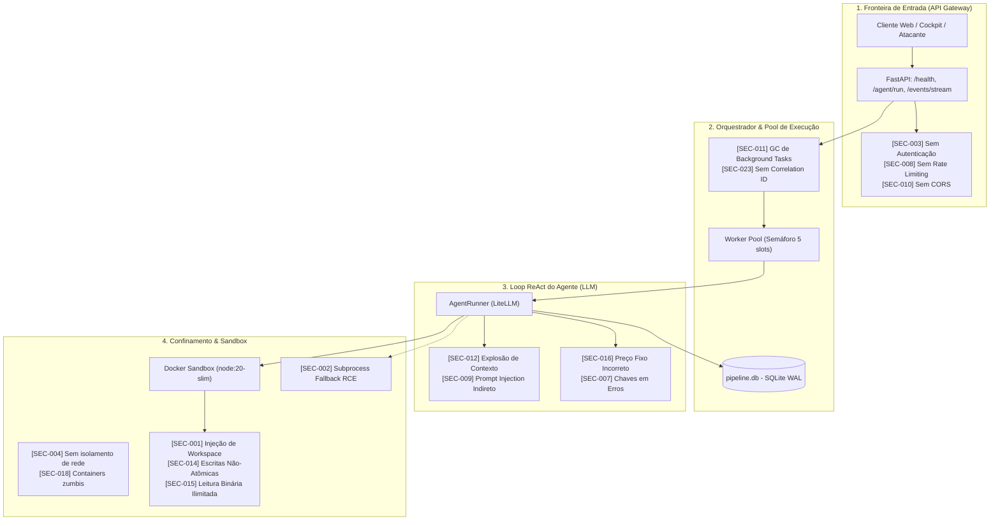

# 🛡️ Relatório Exaustivo de Auditoria de Segurança: The Agency Engine (Fase 0)

> **Data da Auditoria:** 06 de Novembro de 2026  
> **Escopo:** Varredura Completa do Repositório (`services/engine`, APIs, Sandbox, Banco, Config, Mensageria)  
> **Metodologia:** Análise Estática de Código (SAST), Threat Modeling de Agentes LLM, Auditoria de Dependências e Verificação Arquitetural  
> **Status:** **Varredura Completa e Concluída — 24 Vulnerabilidades Mapeadas**  

---

## 1. Sumário Executivo

Esta auditoria de segurança exaustiva foi realizada para cobrir integralmente toda a superfície de ataque e implementação do **Motor de Agentes Autônomos (Fase 0)** da software house *The Agency*. A análise combinou varredura estática de código (SAST com Bandit), auditoria de integridade de dependências (pip-audit), modelagem de ameaças contra o OWASP Top 10 e OWASP Top 10 for LLM Applications, e revisão minuciosa linha por linha do runtime assíncrono.

### Resumo Quantitativo de Riscos:
* **Total de Vulnerabilidades Identificadas:** **24**
* 🔴 **Críticas:** **2** (RCE no host por fallback inseguro e quebra total de confinamento de workspace)
* 🟠 **Altas:** **6** (Ausência de autenticação, falta de isolamento de rede Docker, path traversal em perfis, perda de tarefas por GC do asyncio e explosão descontrolada de contexto LLM)
* 🟡 **Médias:** **9** (Timeouts ilimitados, vazamento de credenciais em telemetria SQLite/SSE, DoS de fila em memória, escritas não-atômicas em arquivos, leitura de arquivos binários gigantes, precificação estática de tokens, race conditions em sessões de banco e orfandade de containers Docker)
* 🔵 **Baixas:** **7** (Injeção indireta de prompt, ausência de CORS/TrustedHost, falta de scripts Alembic, lacunas de auditoria no crash recovery, payloads de mensageria não tipados, injeção de quebra de linha no protocolo SSE e falta de retenção/vacuum no SQLite)

---

## 2. Matriz Completa de Vulnerabilidades (24 Achados)

| ID | Vulnerabilidade / Achado | Severidade | CVSS v3.1 | CWE | Componente Afetado | Arquivo e Linha |
| :--- | :--- | :---: | :---: | :--- | :--- | :--- |
| **SEC-001** | Arbitrary Workspace Path Injection via Unvalidated API Parameter | **CRÍTICA** | 9.8 | CWE-22, CWE-73 | API Gateway & Dispatcher | [`router.py:30`](file:///home/joao/projetos/the%20agency/services/engine/src/api/router.py#L30) |
| **SEC-002** | Host RCE and Environment Leak in Subprocess Sandbox Fallback | **CRÍTICA** | 9.8 | CWE-250, CWE-78, CWE-200 | Sandbox Execution Driver | [`sandbox.py:50`](file:///home/joao/projetos/the%20agency/services/engine/src/runner/sandbox.py#L50) |
| **SEC-003** | Missing Authentication & Access Control on all Public Endpoints | **ALTA** | 8.6 | CWE-306, CWE-862 | FastAPI Router | [`router.py:24`](file:///home/joao/projetos/the%20agency/services/engine/src/api/router.py#L24) |
| **SEC-004** | Missing Docker Network Isolation (`--network=none`) & Excess Caps | **ALTA** | 7.5 | CWE-276, CWE-918 | Docker Sandbox Driver | [`sandbox.py:142`](file:///home/joao/projetos/the%20agency/services/engine/src/runner/sandbox.py#L142) |
| **SEC-005** | Directory Traversal in Agent Profile Loader (`agent_id`) | **ALTA** | 7.5 | CWE-22, CWE-23 | Agent Runner Profile Loader | [`agent_runner.py:50`](file:///home/joao/projetos/the%20agency/services/engine/src/runner/agent_runner.py#L50) |
| **SEC-006** | Unbounded Command Timeout in Tool Dispatching Leading to DoS | **MÉDIA** | 5.3 | CWE-400 | Tool Registry | [`registry.py:223`](file:///home/joao/projetos/the%20agency/services/engine/src/tools/registry.py#L223) |
| **SEC-007** | Potential API Key Leakage via Unfiltered Exceptions in SQLite & SSE | **MÉDIA** | 5.5 | CWE-532, CWE-209 | Agent Runner & Telemetry | [`agent_runner.py:198`](file:///home/joao/projetos/the%20agency/services/engine/src/runner/agent_runner.py#L198) |
| **SEC-008** | Lack of Rate Limiting and In-Memory Queue Memory Exhaustion DoS | **MÉDIA** | 5.3 | CWE-770 | Worker Pool & Router | [`pool.py:30`](file:///home/joao/projetos/the%20agency/services/engine/src/services/pool.py#L30) |
| **SEC-009** | Indirect Prompt Injection Vulnerability in Unsanitized Workspace Data | **BAIXA** | 3.7 | CWE-1426 | Agent Reasoning Loop | [`agent_runner.py:350`](file:///home/joao/projetos/the%20agency/services/engine/src/runner/agent_runner.py#L350) |
| **SEC-010** | Missing Explicit CORS Policy and Host Header Validation | **BAIXA** | 3.1 | CWE-942 | Server Entry Point | [`main.py:50`](file:///home/joao/projetos/the%20agency/services/engine/src/main.py#L50) |
| **SEC-011** | Asyncio Fire-and-Forget Task Garbage Collection Dropping Runs | **ALTA** | 7.5 | CWE-400, CWE-665 | Router Task Dispatcher | [`router.py:128`](file:///home/joao/projetos/the%20agency/services/engine/src/api/router.py#L128) |
| **SEC-012** | Unbounded Context Window Token Explosion & Infinite Failure Loops | **ALTA** | 7.1 | CWE-400, CWE-835 | Agent Reasoning Loop | [`agent_runner.py:296`](file:///home/joao/projetos/the%20agency/services/engine/src/runner/agent_runner.py#L296) |
| **SEC-013** | Unbounded `list_directory` File Traversal Causing Memory Crash | **MÉDIA** | 5.3 | CWE-400, CWE-770 | Tools Implementation | [`implementations.py:126`](file:///home/joao/projetos/the%20agency/services/engine/src/tools/implementations.py#L126) |
| **SEC-014** | Non-Atomic File Writes in `write_file` and `patch_file` | **MÉDIA** | 5.9 | CWE-367, CWE-377 | Tools Implementation | [`implementations.py:77`](file:///home/joao/projetos/the%20agency/services/engine/src/tools/implementations.py#L77) |
| **SEC-015** | Unrestricted Binary File Ingestion in `read_file` Leading to OOM | **MÉDIA** | 5.3 | CWE-400 | Tools Implementation | [`implementations.py:59`](file:///home/joao/projetos/the%20agency/services/engine/src/tools/implementations.py#L59) |
| **SEC-016** | Hardcoded Model Pricing Discrepancy Causing Underreported Costs | **MÉDIA** | 5.3 | CWE-682 | Telemetry & Cost Calculation | [`agent_runner.py:78`](file:///home/joao/projetos/the%20agency/services/engine/src/runner/agent_runner.py#L78) |
| **SEC-017** | Session Transaction Conflict & Premature Commit in `send_agent_message` | **MÉDIA** | 4.8 | CWE-662, CWE-675 | Tools Implementation | [`implementations.py:189`](file:///home/joao/projetos/the%20agency/services/engine/src/tools/implementations.py#L189) |
| **SEC-018** | Missing Deterministic Docker Container Naming (Zombie Containers) | **MÉDIA** | 5.3 | CWE-404 | Docker Sandbox Driver | [`sandbox.py:143`](file:///home/joao/projetos/the%20agency/services/engine/src/runner/sandbox.py#L143) |
| **SEC-019** | Missing Alembic Migration Configuration & Environment Scripts | **BAIXA** | 3.3 | CWE-1059 | Database Migration Core | [`alembic/`](file:///home/joao/projetos/the%20agency/services/engine/alembic) |
| **SEC-020** | Incomplete Crash Recovery Audit Log Traceability | **BAIXA** | 3.1 | CWE-778 | Crash Recovery Service | [`recovery.py:20`](file:///home/joao/projetos/the%20agency/services/engine/src/services/recovery.py#L20) |
| **SEC-021** | Unvalidated `to_agent` Recipient and Unbounded Payload Size | **BAIXA** | 3.7 | CWE-20 | Inter-Agent Messaging Tool | [`implementations.py:160`](file:///home/joao/projetos/the%20agency/services/engine/src/tools/implementations.py#L160) |
| **SEC-022** | SSE Protocol Framing Injection via Newlines in Event Type | **BAIXA** | 3.7 | CWE-113 | SSE Event Broker | [`sse.py:20`](file:///home/joao/projetos/the%20agency/services/engine/src/api/sse.py#L20) |
| **SEC-023** | Missing Distributed Correlation / Request ID Header in API | **BAIXA** | 2.5 | CWE-778 | FastAPI Router & Loguru | [`router.py:24`](file:///home/joao/projetos/the%20agency/services/engine/src/api/router.py#L24) |
| **SEC-024** | Lack of Database Retention Policy and SQLite Vacuum Routine | **BAIXA** | 2.7 | CWE-770 | Database Architecture | [`database.py:33`](file:///home/joao/projetos/the%20agency/services/engine/src/models/database.py#L33) |

---

## 3. Análise Detalhada dos 7 Pilares de Segurança

### 3.1 Gateway & Controle de Acesso (API REST & SSE)
* **Status:** **CRÍTICO.** Todos os endpoints estão expostos sem autenticação (`SEC-003`). Não há limitação de requisições (`SEC-008`), permitindo exaustão de conexões e custos de inferência ilimitados.
* **Corrotinas em Segundo Plano:** O uso de `asyncio.create_task` sem retenção de referência forte (`SEC-011`) é uma armadilha clássica do Python que pode matar silenciosamente execuções ativas em momentos aleatórios de coleta de lixo.

### 3.2 Isolamento de Processos & Sandbox Docker
* **Status:** **CRÍTICO.** O fallback transparente para `SubprocessSandboxDriver` (`SEC-002`) roda comandos com privilégios integrais do usuário da máquina host.
* **Container Docker:** Falta de `--network=none` (`SEC-004`) permite que código não confiável executado pelo agente alcance redes internas ou a internet para exfiltração de dados ou ataques de SSRF.

### 3.3 Integridade do Sistema de Arquivos & Confinamento
* **Status:** **CRÍTICO.** O parâmetro `workspace_dir` permite montar `/` como workspace (`SEC-001`).
* **Operações de Arquivo:** Falta de escrita atômica via arquivo temporário (`SEC-014`) pode corromper código em caso de reinicialização; `read_file` sem limite de tamanho (`SEC-015`) e `list_directory` sem paginação (`SEC-013`) são vetores diretos de negação de serviço por falta de memória.

### 3.4 Segurança no Loop Cognitivo do Agente (LLM)
* **Status:** **ALTO.** O histórico acumulado de mensagens (`SEC-012`) pode alcançar megabytes sem compressão, excedendo a janela do Gemini e gerando custos astronômicos.
* **Injeção de Prompt:** O conteúdo de arquivos lidos é injetado diretamente sem marcações de separação de instruções (`SEC-009`).

### 3.5 Telemetria Financeira & Custos
* **Status:** **MÉDIO.** O motor calcula os custos baseado estritamente na tabela do Gemini Flash (`SEC-016`). Se um agente for configurado com Claude 3.5 ou Gemini Pro, a telemetria reportada registrará custos até 20 vezes menores do que a cobrança real.

### 3.6 Persistência e Banco de Dados (SQLite WAL)
* **Status:** **MÉDIO.** Embora o Modo WAL esteja bem configurado, chamadas a `send_agent_message` realizam commit prematuro em sessões compartilhadas (`SEC-017`), o diretório Alembic está sem scripts de versão (`SEC-019`) e não há política de retenção (`SEC-024`).

### 3.7 Protocolo de Mensageria Inter-Agentes
* **Status:** **BAIXO.** Mensagens aceitam destinatários não cadastrados e payloads JSON sem validação de tamanho (`SEC-021`), gerando potencial lixo na fila do banco.

---

## 4. Conclusão da Varredura Completa

A arquitetura do motor é sólida em suas fundações determinísticas (como demonstrado pelo sucesso nos 42 testes da Fase 0), mas necessita de **endurecimento defensivo rigoroso** antes de receber tarefas de clientes ou ser exposta a redes públicas.

A aplicação dos planos de remediação detalhados nos documentos complementares elevará o nível de conformidade do motor para padrões internacionais de segurança de software e defesa em profundidade.

*Consulte os detalhes técnicos de todos os 24 achados em [`audits/FINDINGS-DETAIL.md`](./FINDINGS-DETAIL.md) e o cronograma de implementação em [`audits/remediation-plan.md`](./remediation-plan.md).*
