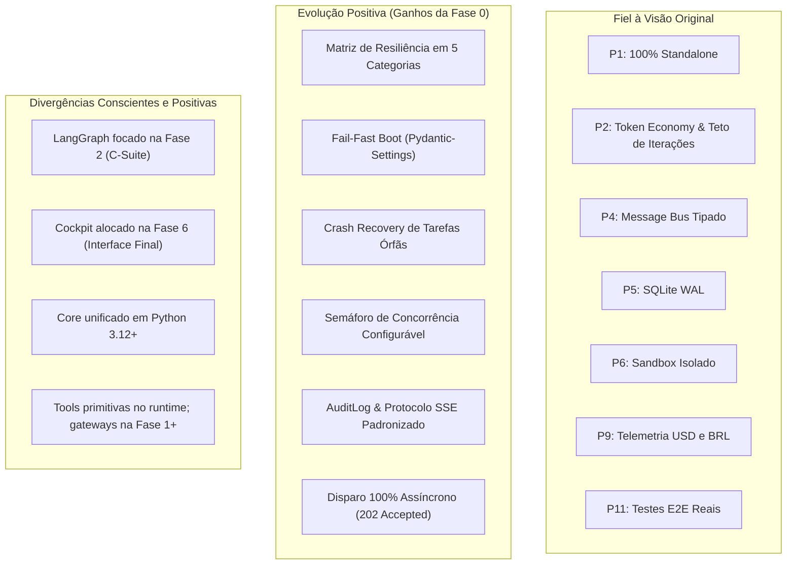

# Análise de Aderência: Fase 0 vs. Visão Original

> **Hierarquia de documentos (fonte de verdade):**
> [especificacao-esteira.md](file:///home/joao/projetos/the%20agency/docs/especificacao-esteira.md) (visão original, exploratória)
> → [roadmap.md](file:///home/joao/projetos/the%20agency/docs/roadmap.md) (rascunho de refinamento)
> → [fase-0-motor-agentes.md](file:///home/joao/projetos/the%20agency/docs/fase-0-motor-agentes.md) (especificação consolidada para implementação)
>
> A Fase 0 é a **fonte de verdade** para o que vai ser implementado agora.
> O roadmap é um rascunho intermediário — divergências dele são naturais ao detalhar cada etapa.
> A esteira é a visão original — o que importa é manter o **espírito** e os **princípios**, não os detalhes técnicos (que evoluíram com razão).

---

## 1. O Que a Esteira Original Pedia da Fundação

Extraindo da [especificacao-esteira.md](file:///home/joao/projetos/the%20agency/docs/especificacao-esteira.md) os princípios e capacidades fundamentais que a infraestrutura base deveria ter:

| # | Princípio / Capacidade | Seção de Origem |
| :--- | :--- | :--- |
| P1 | Sistema 100% autônomo, independente de IDE/plugin | Header |
| P2 | Economia extrema de tokens como custo financeiro direto | Seção 1.2, 2.3 |
| P3 | Desacoplamento total: agentes = inteligência, ferramentas = serviços compartilhados | Seção 3 |
| P4 | Agent Message Bus assíncrono para comunicação inter-agentes | Seção 3.2 |
| P5 | SQLite local (`pipeline.db`) com persistência durável | Seção 3, Marco 3 |
| P6 | Sandbox de segurança para terminal e sistema de arquivos | Seção 3 (implícito) |
| P7 | Cláusula pétrea: Conselho não modifica seus próprios prompts/modelos | Seção 2.4, 2.5 |
| P8 | Régua de Autonomia Progressiva (Calibragem → Supervisão → Piloto Automático) | Seção 7, fase-2 |
| P9 | Telemetria financeira de tokens (custo por etapa, por modelo, USD e BRL) | Seção 2.3 |
| P10 | Crash recovery e resiliência | Implícito |
| P11 | Testes reais (sem mocks de LLM) para validar function calling | Implícito |

---

## 2. Análise de Aderência: Item por Item

### Manteve-se Fiel (Alinhamento Total)

| Princípio | Status na Fase 0 | Avaliação |
| :--- | :--- | :--- |
| **P1 - Standalone** | FastAPI rodando local na porta `:8000`, independente de qualquer IDE | Fiel |
| **P2 - Token Economy** | Entidade `TokenMetric` com custo USD/BRL por chamada, teto estrito de 25 iterações | Fiel |
| **P4 - Message Bus** | Entidade `AgentMessage` com prioridades, correlation ID, requires_ack e tool `send_agent_message` | Fiel — a mecânica estrutural e persistência estão garantidas |
| **P5 - SQLite WAL** | Especificado explicitamente com SQLModel + Alembic em modo WAL | Fiel |
| **P6 - Sandbox** | Sandbox isolado via containers Docker efêmeros (`node:20-slim`) montando apenas `/workspace` | Fiel e com padrão de segurança superior |
| **P9 - Telemetria** | `TokenMetric` com input/output tokens, custo USD e BRL via taxa oficial em tempo real | Fiel |
| **P10 - Crash Recovery** | Varredura de tarefas órfãs no boot com marcação `INTERRUPTED_BY_CRASH` | Fiel — ganho expressivo de robustez |
| **P11 - Testes Reais** | Testes automatizados contra a API ativa do Google Gemini, sem dados simulados | Fiel |

---

### Evoluiu Intencionalmente (Ganhos do Refinamento)

Estas são capacidades que a especificação inicial da esteira **não detalhava**, mas que a Fase 0 incorporou:

| Evolução | O que a esteira original trazia | O que a Fase 0 especificou |
| :--- | :--- | :--- |
| **Matriz de Resiliência** | Princípios gerais de resiliência | 5 categorias de erro com tratamento diferenciado (rate limit inteligente com `retry-after`, auto-correção em 3 turnos, circuit breaker) |
| **Fail-Fast Boot** | Configurações genéricas | Validação estrita no startup via `pydantic-settings` |
| **Semáforo de Concorrência** | Pool genérico de execução | Semáforo assíncrono com teto configurável (`MAX_CONCURRENT_AGENTS`) e enfileiramento ordenado |
| **Logs Estruturados** | Logs operacionais simples | Gerenciamento via Loguru com rotação automática em 10MB |
| **AuditLog** | Menção a um "Event Store" abstrato | Entidade relacional concreta vinculada a `run_id`, tipo de ação e payload detalhado |
| **Streaming via SSE** | "Cockpit consome APIs" | Canal SSE (`/api/v1/events/stream`) com eventos padronizados (`thought`, `tool_call`, `tool_result`, `token_usage`, `task_completed`) |
| **Operação Assíncrona** | Disparo síncrono implícito | Resposta imediata `202 Accepted` com `run_id`, imune a timeouts de proxy |

---

### Análise de Transições e Decisões Arquiteturais

#### 1. Desacoplamento Agente vs. Ferramenta (P3)
* **Visão Original:** A esteira definia gateways compartilhados independentes (WhatsApp, Scraper, Payment, etc.).
* **Fase 0:** As 5 ferramentas da Fase 0 (`read_file`, `write_file`, `patch_file`, `run_terminal_command`, `send_agent_message`) são **primitivas essenciais do runtime computacional**, não serviços de regra de negócio de clientes.
* **Veredito:** Transição natural. O padrão de microgateways externos se aplica a partir da Fase 1 (WhatsApp, Payment, Scraper).

#### 2. Ordem dos Marcos vs. Ordem das Fases
* **Visão Original:** O Cockpit web era o Marco 1, construído inicialmente com mocks.
* **Fase 0:** O motor de execução backend foi antecipado para a Fase 0, e a interface gráfica (Cockpit) passou para a Fase 6.
* **Veredito:** Decisão acertada. Construir primeiro o motor funcional garante que o Cockpit seja alimentado por eventos, estados e métricas reais, eliminando retrabalho de mocks.

#### 3. Orquestração com LangGraph
* **Visão Original:** LangGraph citado no roadmap para o Deliberation Engine do C-Suite e time-travel.
* **Fase 0:** O motor adota um loop ReAct determinístico assíncrono próprio.
* **Veredito:** Adequado. Para um agente individual executando tarefas com ferramentas na Fase 0, um loop ReAct enxuto é mais leve e controlável. LangGraph faz sentido ao orquestrar a deliberação multilateral do C-Suite na Fase 2.

#### 4. Stack Polyglot Simplificada
* **Visão Original:** Mix amplo com Python, Go, Node.js e sugestão de Java para módulos pesados.
* **Fase 0:** Unificada em Python 3.12+ assíncrono (FastAPI, SQLModel, Uvicorn).
* **Veredito:** Simplificação correta para o core computacional. Outras linguagens mantêm-se reservadas aos seus papéis dedicados (Node.js para Baileys, Go para Scraper).

#### 5. Abstração de Modelos (LiteLLM)
* **Visão Original:** Menção direta ao Gemini Flash e SDK Google.
* **Fase 0:** LiteLLM atua como proxy roteador com extração de telemetria bruta via payload original da API (`response._hidden_params["original_response"]`), assegurando compatibilidade com fallbacks multi-provedor (Groq/Claude) sem perda de exatidão de tokens.
* **Veredito:** Alinhado ao requisito de resiliência e failover inteligente.

---

## 3. Resumo Visual: Mapa de Aderência

---

## 4. Veredito Final

A especificação da Fase 0 está **plenamente aderente aos princípios estratégicos e operacionais da esteira original**. 

O processo evolutivo `esteira → roadmap → fase-0` cumpriu com sucesso seu propósito: converteu intenções arquiteturais amplas em uma especificação técnica determinística, segura, à prova de falhas e pronta para codificação.
