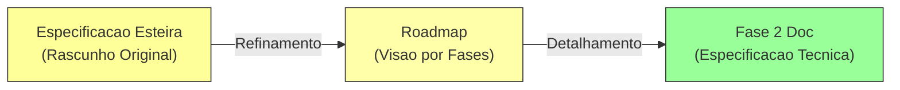

# Analise Criteriosa: Fase 2 - C-Suite & Governanca Autonoma

> **Documento analisado:** [fase-2-c-suite-governanca.md](file:///home/joao/projetos/the%20agency/docs/fase-2-c-suite-governanca.md)  
> **Documentos de referencia:** [roadmap.md](file:///home/joao/projetos/the%20agency/docs/roadmap.md) | [especificacao-esteira.md](file:///home/joao/projetos/the%20agency/docs/especificacao-esteira.md)  
> **Data:** 2026-11-16

---

## 1. Veredito Geral

A Fase 2 e **o documento mais maduro e bem-estruturado de todos os tres**. Ele fez um excelente trabalho ao refinar os conceitos vagos da especificacao original em uma arquitetura concreta e implementavel. Porem, existem **pontas soltas criticas**, **riscos arquiteturais significativos** e algumas **inconsistencias com os documentos anteriores** que precisam ser resolvidas antes de entrar em desenvolvimento.

> [!IMPORTANT]
> O documento **NAO esta pronto para desenvolver** sem resolver os pontos abaixo. Precisa de 1-2 rodadas de refinamento focadas nos itens criticos.

---

## 2. Aderencia a Ideia Original (Especificacao-Esteira)

### 2.1 O que foi PRESERVADO com fidelidade

| Conceito Original | Status na Fase 2 |
|---|---|
| Soberania absoluta de Joao | Totalmente preservada e refinada com niveis de autonomia |
| 4 agentes C-Suite (CEO, CTO, CRO, COO) | Preservado com atribuicoes detalhadas |
| Clausula petrea de imutabilidade | Expandida com mecanismo `SEC-council-immutability` |
| Matriz Tripla (Buy vs Host vs Build) | Formalizada como `TripleMatrixAnalysis` Pydantic |
| Relatorio de Proposta Padronizado | Preservado e melhorado com formato Markdown estruturado |
| Alcada financeira R$ 0,00 | Mantida com gate de aprovacao formal |
| Debate estruturado multi-perspectiva | Evoluiu de "debate conversacional" para maquina de estados LangGraph |
| Economia de tokens | Preservada com teto de 3 rodadas |
| Precificacao dinamica pelo CRO | Mantida com faixas de autonomia pre-aprovadas |

### 2.2 Evolucoes POSITIVAS em relacao a especificacao original

1. **De "teatro de agentes" para Flywheel em malha fechada** - A especificacao original falava em "debate" generico. A Fase 2 transformou isso em uma maquina de estados finita formal no LangGraph, o que e uma melhoria arquitetural significativa.

2. **Regua de Autonomia Progressiva** - Conceito novo que nao existia na especificacao original. Excelente addicao para permitir evolucao gradual da confianca.

3. **Timeout de 24h com fail-closed** - Mecanismo de seguranca que nao existia antes. Impede que propostas fiquem penduradas indefinidamente.

4. **Teto de 3 rodadas** - Solucao pratica para o problema de consumo infinito de tokens em debates, que era um risco real da especificacao original.

5. **Dupla camada de fechamento do loop** (pipeline_configs + knowledge-memory CRAG) - Mecanismo sofisticado que torna o aprendizado concreto, nao apenas conceitual.

### 2.3 Inconsistencias com documentos anteriores

> [!WARNING]
> Pontos onde a Fase 2 diverge ou contradiz os documentos de referencia.

| # | Inconsistencia | Especificacao Original | Fase 2 | Severidade |
|---|---|---|---|---|
| I-1 | **Scraper em Go vs MCP Server** | A especificacao original fala em "Motor compilado em Go de altissima velocidade rodando na porta `:8080`" para mineracao | O roadmap e a Fase 2 referenciam `osint-scraper-gateway (:3009)` como MCP Server Python. O Go Scraper sumiu | Alta |
| I-2 | **Gateway de pagamento** | Especificacao original referencia "Asaas / Mercado Pago via API REST" com custo zero e taxa percentual | Roadmap e Fase 2 migraram para "Banco Inter mTLS (:3006)" que requer certificados digitais e conta PJ | Media (decisao de refinamento valida) |
| I-3 | **Cockpit backend stack** | Especificacao original diz "Para novos modulos de backend pesados (...) adota-se preferencialmente **Java** (Spring Boot / Micronaut) ou Go" | Roadmap e Fase 2 eliminaram Java/Go do backend, tudo e Python FastAPI + Next.js | Media (decisao de refinamento valida) |
| I-4 | **Barramento de mensagens** | Especificacao original define `AgentMessage` em TypeScript com tipos como `improvement_request`, `pentest_report`, `qa_failure` | Fase 2 usa barramento RabbitMQ AMQP com routing keys totalmente diferentes (`council.deliberate.*`, `council.escalation.*`) | Media |
| I-5 | **Numero de microsservicos** | Especificacao original lista 7-8 servicos | Roadmap e Fase 2 expandiram para 11 microsservicos + Cockpit | Baixa (evolucao natural) |
| I-6 | **Modelo de debate do conselho** | Especificacao original diz "Os agentes do Conselho conversam, debatem e confrontam perspectivas" de forma livre | Fase 2 impoe Round-Robin rigido: CRO->CTO->COO->CEO. Perde a flexibilidade de debate adversarial livre | Media |
| I-7 | **Fases do roadmap vs Niveis de autonomia** | O roadmap define Fase 1/2/3 como fases de maturidade do *negocio* (Calibragem, Metas Iniciais, Escala Evolutiva) | A Fase 2 doc define Nivel 1/2/3 de autonomia da *esteira*, que sao conceitos *diferentes* embora similares | Baixa (potencial confusao conceitual) |

> [!NOTE]
> As inconsistencias I-2 e I-3 sao **decisoes de refinamento validas** - voce disse que o roadmap refinou a especificacao original. Mas I-1, I-4 e I-6 merecem atencao.

---

## 3. Pontas Soltas Criticas (Showstoppers)

### 3.1 Falta de contrato entre Fase 2 e Fase 3/4/5

O documento define `council.decision.approved` e `council.decision.vetoed` como eventos AMQP, mas **nao especifica como a esteira operacional (Fases 3, 4, 5) consome essas decisoes**. 

- Quem escuta o evento `council.decision.approved`? O `engine-core`? Um servico especifico?
- Quando o C-Suite aprova uma precificacao dinamica (Pauta A), **quem injeta o preco no Sales Executive**?
- Quando o CTO propoe troca de LLM (Pauta C), **quem aplica a rota no LiteLLM**?

> [!CAUTION]
> Sem esse contrato de integracao, a Fase 2 funciona como um cerebro desconectado do corpo. O "Auto-Ajuste de Parametros Operacionais" mencionado no diagrama inicial e uma caixa preta.

### 3.2 Ausencia do Cockpit Web (Fase 6) na Fase 2

O documento referencia constantemente o "Cockpit Web (`:3000`)" para:
- Alterar `AUTONOMY_LEVEL`
- Mesa Redonda do C-Suite
- Centro de Governanca de IA

Mas o Cockpit e definido como **Fase 6** no roadmap. Isso cria uma **dependencia circular**: a Fase 2 precisa do Cockpit para funcionar, mas o Cockpit so sera construido na Fase 6.

**Solucao necessaria:** Definir um **MVP minimo do Cockpit** que deve ser construido junto com a Fase 2, ou aceitar que o controle sera 100% via Telegram + CLI ate a Fase 6.

### 3.3 Como o C-Suite e "disparado"?

O documento detalha o **grafo de deliberacao** mas nao especifica claramente **quem/o que dispara** cada pauta:

| Pauta | Gatilho declarado | Mecanismo de disparo? |
|---|---|---|
| A: Precificacao | "Lead minerado com perfil atipico" | Quem detecta que e "atipico"? O Mining Agent da Fase 3? Nao existe ainda |
| B: Buy vs Build | "Agente ou servico solicita nova API" | Como um agente "solicita"? Via qual mensagem AMQP? |
| C: Troca de LLMs | "CTO detecta modelo mais economico" | O CTO roda proativamente um cron de pesquisa? Qual frequencia? |
| D: Incidentes | "QA reprova 3x seguidas" | Quem conta as 3 reprovacoes? O engine-core? O QA Agent da Fase 4? |
| E: Fechamento semanal | "Disparo semanal agendado (cron)" | Quem roda esse cron? O engine-core? Qual dia/hora? |

> [!IMPORTANT]
> Sem definir os mecanismos de disparo, o grafo de deliberacao e uma maquina de estados que ninguem liga.

### 3.4 O COO nao tem ferramentas MCP definidas

Todos os agentes tem `Ferramentas MCP Autorizadas` explicitas, exceto o COO que lista apenas:
- `knowledge-memory-gateway` (`:3013`): `recall`, `remember`
- "Leitura de metricas internas do sistema (filas do RabbitMQ, saude de conteineres e logs de auditoria)"

A segunda linha e **vaga demais**. Como o COO le metricas do RabbitMQ? Via qual endpoint? Existe um MCP Server de monitoramento? O RabbitMQ Management Plugin (`:15672`) sera exposto como ferramenta MCP?

---

## 4. Riscos Arquiteturais

### 4.1 SQLite como unico banco para tudo (RISCO ALTO)

O `pipeline.db` em modo WAL acumula:
- Tabelas de infraestrutura (Fase 0)
- Checkpoints do LangGraph (`langgraph_checkpoints`)
- Configuracoes do conselho (`council_configs`)
- Deliberacoes (`council_deliberations`)
- Opinioes (`council_opinions`)
- Propostas (`council_proposals`)
- Parametros operacionais (`pipeline_configs`)
- Logs de auditoria (`audit_logs`)
- Metricas de tokens (`token_metrics`)
- Mensagens de agentes (`agent_messages`)

**Problemas:**
1. **WAL + escrita concorrente**: SQLite WAL suporta apenas **1 escritor por vez**. Com 4 agentes do C-Suite + agentes operacionais + telemetria + checkpoints do LangGraph todos escrevendo simultaneamente, havera **lock contention** significativa.
2. **Tamanho do banco**: Com retencao de 365 dias para deliberacoes + 30 dias para logs + checkpoints LangGraph (que podem ser grandes), o banco vai crescer consideravelmente.
3. **Single point of failure**: Corrupcao do `pipeline.db` derruba todo o sistema.

**Mitigacao sugerida:** Considerar separar pelo menos os checkpoints do LangGraph em um arquivo SQLite separado, e avaliar se o volume de auditoria justifica um banco dedicado.

### 4.2 LangGraph Checkpointer + Human-in-the-Loop (RISCO MEDIO)

O documento assume que o LangGraph pode:
1. Pausar em `interrupt_before` no nodo `HumanApprovalRouter_Node`
2. Serializar o estado completo para o `SqliteSaver`
3. Ficar pausado por ate **24 horas**
4. Ser reidratado quando Joao responde via Telegram webhook

**Riscos:**
- O estado do LangGraph precisa ser **totalmente serializavel**. Se algum campo do `CouncilState` referenciar objetos nao-serializaveis (conexoes, callbacks), a reidratacao falha silenciosamente.
- Se o `engine-core` reiniciar entre a pausa e a resposta de Joao, a correlacao entre o `callback_id` do Telegram e o `thread_id` do LangGraph pode se perder.
- O documento nao define como o webhook do Telegram **retoma** o grafo. Precisa de um endpoint tipo `POST /council/resume` que receba o `deliberation_id` e o veredito.

### 4.3 Fail-Closed sem fallback = Downtime total do cerebro (RISCO MEDIO-ALTO)

A politica de Fail-Closed (secao 3.3) diz:
> "Se a API do Gemini Pro sofrer instabilidade (...) o sistema NAO realiza fallback automatico para modelos secundarios"

Isso e correto do ponto de vista de governanca (nao queremos decisoes estrategicas de um modelo inferior), mas cria um risco operacional:

- Se o Gemini Pro ficar instavel por horas, **todo o C-Suite para**.
- As Pautas D (incidentes criticos) e E (fechamento semanal) tambem param.
- Um incidente de seguranca critico (CVE >= 7.0) nao sera deliberado ate o Gemini voltar.

**Sugestao:** Permitir que alertas criticos de seguranca (Pauta D) tenham um modo degradado onde o CTO pode emitir um parecer unilateral de emergencia via modelo alternativo, sujeito a validacao posterior de Joao.

### 4.4 Regra de convergencia vaga (RISCO MEDIO)

> "Se a concordancia de posicionamento for unanime ou com divergencia menor que 10% em parametros numericos, marca `has_converged = True`"

**Problemas:**
- "Divergencia menor que 10% em parametros numericos" - 10% de qual parametro? Se o CRO propoe R$ 1.000 e o CTO estima custo de R$ 950, isso e 5% de divergencia? Ou e sobre o preco total vs custo total?
- E se 2 agentes sao FAVORABLE e 1 e CONDITIONAL? Isso conta como "unanime"?
- O campo `stance` aceita FAVORABLE, UNFAVORABLE, CONDITIONAL, NEUTRAL - como essas 4 categorias mapeiam para uma regra de convergencia binaria?

**Sugestao:** Definir uma funcao deterministica de convergencia com pesos claros para cada `stance`.

### 4.5 Hot-reload de `pipeline_configs` sem validacao (RISCO MEDIO)

> "O engine-core faz hot-reload dinamico desses parametros a cada nova execucao de tarefa"

O documento nao define:
- **Validacao de schema**: se o CRO gravar `"abc"` em `cro.pricing.min_setup_brl`, o hot-reload vai injetar um valor invalido?
- **Rollback automatico**: se um parametro causar problema, como reverter?
- **Notificacao de mudanca**: os agentes operacionais sabem que um parametro mudou?

---

## 5. Pontos de Ambiguidade

### 5.1 Ordem de execucao no Round-Robin

O grafo define: `CRO -> CTO -> COO -> CEO_Synthesizer`

Mas a especificacao original dizia:
> "O CEO Agent orquestra o debate, alinha os trade-offs com as diretrizes do chefe e sintetiza o posicionamento final"

Na Fase 2, o CEO so aparece como **sintetizador no final**, perdendo o papel de "orquestrador ativo" que a especificacao original definia. Ele nao participa das rodadas intermediarias.

### 5.2 Onde fica o `AUTONOMY_LEVEL`?

O documento menciona `AUTONOMY_LEVEL` como "parametro global" mas nao diz **onde** ele e armazenado:
- Na tabela `pipeline_configs`?
- Como variavel de ambiente?
- Na tabela `council_configs`?

Pela logica, deveria estar em `pipeline_configs` com `param_key = 'system.autonomy_level'`, mas isso nao esta explicito.

### 5.3 Telegram vs Cockpit: canal canonico de decisao

O documento permite que Joao decida tanto via Telegram quanto via Cockpit, mas:
- Se Joao aprovar via Telegram e depois tentar aprovar via Cockpit (ou vice-versa), ha **risco de dupla-execucao**?
- Qual e o canal canonico de verdade?
- O `version_id` com bloqueio otimista mitiga isso, mas nao esta claro no fluxo.

### 5.4 O CRO tem acesso ao `whatsapp-gateway`?

Na secao 2.3, o CRO tem como atribuicao:
> "Analisa a telemetria do whatsapp-gateway (:3005) para avaliar o desempenho de copies comerciais"

Mas na lista de ferramentas MCP autorizadas do CRO, o `whatsapp-gateway` **NAO aparece**. Ele so tem:
- `payment-gateway` (:3006)
- `osint-scraper-gateway` (:3009)  
- `knowledge-memory-gateway` (:3013)

**Inconsistencia interna do documento.** O CRO precisa de `get_whatsapp_metrics` ou similar para cumprir sua missao.

---

## 6. O que esta BEM e pronto

1. **Schema Pydantic do `CouncilState`** - Bem tipado, imutavel, com enums explicitos. Pronto para implementar.
2. **Modelagem SQL** - Tabelas normalizadas, com `version_id` para bloqueio otimista, FKs corretas e tipos adequados.
3. **Topicos AMQP** - Routing keys bem estruturadas seguindo convencao `council.*`.
4. **Cenarios BDD** - Cobertura excelente dos fluxos criticos: convergencia, impasse, veto, timeout, imutabilidade, fail-closed, hot-reload.
5. **Integracao com MCP** - Mapeamento claro de quais ferramentas cada agente pode usar.
6. **Politica de timeout 24h** - Mecanismo fail-safe bem pensado.
7. **Secao de seguranca SEC-council-immutability** - Robusta e bem definida.

---

## 7. Checklist Pre-Desenvolvimento

| # | Item | Status | Acao necessaria |
|---|---|---|---|
| 1 | Mecanismos de disparo das 5 pautas | Indefinido | Definir quem/como dispara cada pauta |
| 2 | Contrato de integracao com Fases 3-5 | Indefinido | Definir consumidores de `council.decision.*` |
| 3 | Ferramentas MCP do COO | Vago | Especificar endpoints de monitoramento |
| 4 | Acesso do CRO a metricas do WhatsApp | Inconsistente | Adicionar ferramenta MCP ou remover atribuicao |
| 5 | Armazenamento do `AUTONOMY_LEVEL` | Ambiguo | Definir tabela/campo explicito |
| 6 | Regra de convergencia deterministica | Vaga | Formalizar funcao com pesos para cada `stance` |
| 7 | Endpoint de retomada pos-Telegram | Nao definido | Criar contrato `POST /council/resume` |
| 8 | Canal canonico (Telegram vs Cockpit) | Ambiguo | Definir precedencia e protecao contra dupla-execucao |
| 9 | Lock contention SQLite | Risco | Avaliar separacao de banco para checkpoints |
| 10 | Dependencia do Cockpit (Fase 6) | Circular | Definir MVP minimo ou alternativa CLI |
| 11 | Fallback para Pauta D (incidentes criticos) | Risco | Avaliar modo degradado para emergencias de seguranca |
| 12 | Validacao de schema no hot-reload | Ausente | Definir Pydantic validators para `pipeline_configs` |
| 13 | Role do CEO como orquestrador vs sintetizador | Divergente da spec | Decidir se CEO participa ativamente ou so sintetiza |

---

## 8. Conclusao

A Fase 2 fez um **trabalho excelente** de transformar conceitos vagos da especificacao original em uma arquitetura concreta. A evolucao de "debate conversacional" para "maquina de estados LangGraph com teto de rodadas" e um refinamento muito acertado. A Regua de Autonomia e o mecanismo de timeout sao adicoes inteligentes.

Porem, o documento tem **13 itens pendentes** que precisam de definicao antes de comecar a codar. Os mais criticos sao:

1. **Mecanismos de disparo** - O grafo existe mas ninguem sabe como liga-lo
2. **Contrato de integracao** - O cerebro nao esta conectado ao corpo
3. **Dependencia circular do Cockpit** - Fase 2 precisa de algo que so existe na Fase 6
4. **Inconsistencia CRO/WhatsApp** - Erro interno do documento

Recomendacao: **1 sprint de refinamento** focado no checklist acima, depois estara pronto para desenvolvimento.
