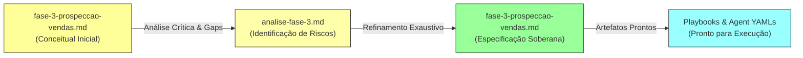

# Análise Criteriosa: Fase 3 — Prospecção Ativa, Demos Bespoke & Funil de Vendas WhatsApp

> **Documento analisado:** [fase-3-prospeccao-vendas.md](file:///home/joao/projetos/the%20agency/docs/fase-3-prospeccao-vendas.md)  
> **Documentos de referência:** [roadmap.md](file:///home/joao/projetos/the%20agency/docs/roadmap.md) | [especificacao-esteira.md](file:///home/joao/projetos/the%20agency/docs/especificacao-esteira.md) | [fase-1-gateways-mensageria.md](file:///home/joao/projetos/the%20agency/docs/fase-1-gateways-mensageria.md) | [fase-2-c-suite-governanca.md](file:///home/joao/projetos/the%20agency/docs/fase-2-c-suite-governanca.md)  
> **Data:** 2026-11-18  
> **Autor da Análise:** Engenheiro Chefe de Sistemas / Antigravity

---

## 1. Veredito Geral

A Fase 3 é a **engrenagem de tração comercial e sobrevivência financeira** da The Agency (*Front-of-the-House*). Ela sintetiza o modelo de "Isca de Altíssimo Valor" com geração de software sob medida antes mesmo da abordagem, evitando a panfletagem robótica que destrói a conversão de PMEs no WhatsApp.

O documento base de especificação possui uma excelente fundamentação conceitual ao absorver os padrões de `MetaGPT` (SOPs tipados), `SalesGPT` (máquina de estados finita de negociação) e `agency-agents` (personas e regras anti-slop). Contudo, **no estado atual, o documento continha abstrações que precisavam ser fechadas antes da implementação**: faltavam contratos conceituais Pydantic explícitos para cada transição, a máquina de estados não definia políticas de abandono e mensagens multimodais (áudio do cliente), as regras operacionais de anti-banimento do WhatsApp estavam dispersas, e os playbooks em `knowledge/sales/` e YAMLs em `services/engine/config/agents/pipeline/` ainda não estavam gerados.

---

## 2. Aderência à Ideia Original (Especificação-Esteira & Roadmap)

### 2.1 O que foi PRESERVADO com fidelidade absoluta

| Conceito Original | Status na Fase 3 | Avaliação |
|---|---|---|
| **Soberania do Chefe João** | Preservada via Portão de Calibragem no Telegram (`:3008`) com aprovação prévia de envio | Inviolável. O envio só ocorre com clique em botão inline de João |
| **Trava de Sinal 50% PIX** | Fechamento comercial formalizado exclusivamente com liquidação de 50% via Banco Inter (`:3006`) | Essencial para financiar a Fábrica (Fase 4) sem risco de calote |
| **4 Agentes Especializados** | Mining, Demo Builder, Sales Executive e Optimization | Alinhamento 100% com o roadmap oficial |
| **Isca de Alto Valor (Demo Real)** | O cliente recebe uma captura real e link ativo do seu novo software na Vercel | Diferencial de conversão contra spam de agências tradicionais |
| **Anti-Slop & Fidelidade Ética** | Cores reais da marca, catálogo real minerado e proibição de avatares desconectados | Preservação da reputação da software house |
| **Ingress Guardrail (<150ms)** | Toda mensagem recebida no WhatsApp passa pelo Groq Llama Guard 3 (`:3007`) | Blindagem contra prompt injection e jailbreaks |

### 2.2 Evoluções Positivas em Relação ao Rascunho Inicial

1. **Adoção do SalesGPT como FSM Formal:** Abandonou-se a ideia de conversa "livre" de IA. A negociação obedece a 5 estados estritos (`HOOK`, `DEMO_DELIVERY`, `SPIN_DISCOVERY`, `OBJECTION_HANDLING`, `CLOSING_PIX`), prevenindo alucinações de preços e prazos.
2. **Playwright Pre-Flight Audit:** Inspeção headless automática antes de enviar o link para o cliente ou para João. Links com erro HTTP 404/500 ou imagens quebradas (`naturalWidth == 0`) são sumariamente retidos.
3. **Loop de Otimização no Qdrant:** Conversas não convertidas não são descartadas em vão; geram novos embeddings de objeções no `knowledge-memory-gateway` (`:3013`) via CRAG para imunizar o vendedor contra objeções futuras.

### 2.3 Pontos que Exigiram Alinhamento com a Fase 1 e 2

* **Protocolo de Comunicação:** A Fase 3 opera de forma híbrida: **síncrona** via ferramentas MCP JSON-RPC nos gateways (`:3005`, `:3006`, `:3009`, `:3010`, `:3012`, `:3013`, `:3014`) e **assíncrona** via tópicos RabbitMQ AMQP (`sales.*` no exchange `agency.topic`).
* **Banco de Dados:** A persistência de dados comerciais (tabelas `leads`, `demo_artifacts`, `lead_interactions`, `lead_charges`) reside no PostgreSQL 15 (`agency_db`), garantindo ACID, constraints relacionais e integridade de auditoria.

---

## 3. Pontas Soltas Críticas Identificadas & Resoluções

### 3.1 Tratamento de Mensagens Multimodais (Áudio PTT no WhatsApp)
* **Gargalo:** Donos de PMEs brasileiras (donos de oficinas, salões e clínicas) frequentemente respondem mensagens de texto enviando **áudios longos no WhatsApp**. Se o sistema esperasse apenas texto puro, a negociação travaria.
* **Resolução:** O `whatsapp-gateway` (`:3005`) detecta payloads do tipo áudio (`ptt: true`) e executa a transcrição imediata via endpoint de transcrição de áudio (Whisper local ou chamada multimodal Gemini 2.5 Flash), injetando o texto resultante no fluxo do Ingress Guardrail como `<transcribed_audio>`.

### 3.2 Política Operacional Anti-Banimento e Cadência (Meta/Baileys)
* **Gargalo:** Disparar dezenas de mensagens frias seguidas em lote no WhatsApp resulta em banimento sumário do chip pela Meta.
* **Resolução:** Estabelecimento de regras pétreas:
  1. **Janela Comercial Estrita:** Envios ativos apenas de Segunda a Sexta, das 08:30 às 18:30 (horário de Brasília).
  2. **Teto de Prospecção Diária:** Máximo de 20 a 30 novos contatos por número/dia.
  3. **Humanizer & Presença:** Simulação de status `composing` (digitando...) por 3 a 7 segundos antes de qualquer envio.
  4. **Jitter de Intervalo:** Atraso randômico entre 15 e 45 segundos entre mensagens para leads diferentes.

### 3.3 Tratamento de Abandono de Conversa e Timeout
* **Gargalo:** Leads que visualizam a demo mas não respondem à pergunta final da Fase 2 (`DEMO_DELIVERY`).
* **Resolução:** Implementação de 2 tentativas de recuperação (*nudge*) cadenciadas na máquina de estados:
  - *Follow-up 1 (24 horas depois):* Mensagem curta de valor (ex: *"Conseguiu abrir pelo celular, [Nome]?"*).
  - *Follow-up 2 (48 horas depois):* Pergunta de desengajamento com técnica Chris Voss (*"Você desistiu de organizar os agendamentos da [Empresa]?"*).
  - *Exaustão (72 horas sem resposta):* O lead é transicionado para `DISCARDED` com motivo `UNRESPONSIVE` e enviado para o `Optimization Agent`.

### 3.4 Contrato de Handoff Determinístico para a Fase 4 (PO Agent)
* **Gargalo:** Como a Fase 3 entrega o bastão para a Fábrica de Software quando o PIX cai?
* **Resolução:** O `payment-gateway` (`:3006`) recebe o webhook de liquidação do Banco Inter, valida a assinatura e publica `sales.payment.confirmed`. O `engine-core` escuta esse evento, atualiza o lead para `CONVERTED_SIGNAL_PAID` e emite a ordem de serviço AMQP `factory.project.start`, contendo a ficha completa do lead, a URL da demo aceita, o histórico sanitizado de conversas e os requisitos levantados no SPIN.

### 3.5 Eliminação Absoluta de Modelos Hardcoded e Parametrização Universal de Limites
* **Gargalo:** Modelos de IA e valores comerciais fixados no código ou em tabelas engessam a esteira, impedindo trocas rápidas de fornecedor (Google Gemini, Groq, Anthropic, Ollama local), testes A/B ou ajustes de limites pelo Chefe João.
* **Resolução:**
  1. **Slots de Modelos:** Nomes de modelos foram substituídos por slots de variáveis de ambiente (`MODEL_MINING_AGENT`, `MODEL_DEMO_BUILDER_AGENT`, `MODEL_SALES_EXECUTIVE_AGENT`, `MODEL_OPTIMIZATION_AGENT`, `MODEL_COUNCIL_*`).
  2. **Interpolação de Variáveis em YAML:** O motor do `agent_runner.py` foi aprimorado com a função `expand_env_vars`, permitindo sintaxe `${MODEL_<AGENT>:-<default>}` e override dinâmico em tempo de execução via `os.environ` ou `pipeline_configs`.
  3. **Limites e Preços Parametrizáveis:** Todas as regras financeiras (`PRICING_SETUP_BASE_BRL`, `PRICING_SIGNAL_PERCENT`, `PRICING_MRR_BASE_BRL`, `PRICING_MAX_DISCOUNT_PERCENT`) e limites operacionais (`LIMIT_DAILY_OUTREACH_PER_CHIP`, `LIMIT_BUSINESS_HOURS_*`, `LIMIT_JITTER_*`, `LIMIT_COMPOSING_*`, `LIMIT_MAX_TURNS_*`) foram formalizados em `Settings` e documentados no `.env.example`.

---

## 4. Riscos Arquiteturais & Mitigações

| Risco | Severidade | Impacto Potencial | Mitigação Arquitetural Implementada |
|---|---|---|---|
| **Banimento de Chip WhatsApp** | ALTA | Perda do canal de vendas e do histórico | Aquecimento progressivo (warm-up), limite de 25 disparos/dia, jitter 15-45s, presença `composing` |
| **Bloqueio no Google Maps Scraper** | MÉDIA | Falha na mineração de novos leads | Uso de CDP stealth no `osint-scraper-gateway` (`:3009`), cabeçalhos reais e pausas entre buscas |
| **Imagens Quebradas na Demo na Vercel** | ALTA | Destruição da credibilidade do protótipo | Pré-voo obrigatório Playwright (`:3014`) com assert `naturalWidth > 0` e HTTP 200 |
| **Prompt Injection via WhatsApp** | CRÍTICA | Venda por R$ 1,00 ou vazamento de prompts | Ingress Guardrail Groq Llama Guard 3 (`:3007`) em <150ms + isolamento em XML `<untrusted_input>` |
| **Inadimplência ou Fraude de Comprovante** | ALTA | Agentes da fábrica começarem a codar de graça | A engenharia **NUNCA** aceita print de comprovante. O start é 100% atrelado ao webhook bancário mTLS |
| **Alucinação de Preço ou Desconto Excessivo** | MÉDIA | Margem da agência comprometida | Teto de 10% de desconto cravado em playbook e validado programaticamente no `payment-gateway` |

---

### 4.1 Resoluções Soberanas da Sessão /grill-me com o Chefe João (18/11/2026)

Durante a sessão interativa de alinhamento com o Chefe João, todas as 8 pontas soltas da Fase 3 foram decididas de forma definitiva:

1. **Geração de Demos 100% Autônoma do Zero pela LLM:**
   O `Demo Builder Agent` escreve o código completo sob medida no sandbox e é obrigado a rodar **testes unitários com Vitest** (para regras operacionais de cálculo/carrinho) e **testes E2E com Playwright** (para impedir bugs visuais grotescos como sobreposição de textos, quebra de layout mobile 375x812 e imagens quebradas) antes do deploy.
2. **Ciclo de Vida de Demos na Vercel com TTL de 15 Dias:**
   Leads descartados (`DISCARDED` ou `CLOSED_LOST`) mantêm a demo ativa na Vercel por 15 dias para o caso de retorno do cliente. Após o prazo, o projeto é deletado automaticamente via Deploy Gateway para proteger quotas. Demos ganhas (`CLOSED_WON`) são congeladas para a Fase 4.
3. **Respostas a Áudios 100% em Texto:**
   Quando o lead envia áudio no WhatsApp, o sistema transcreve internamente para compreensão do Sales Executive, mas responde **sempre em texto objetivo (25 a 35 palavras)**, eliminando custos de TTS e agilizando a leitura pelo cliente.
4. **Resiliência do WhatsApp com Chip Único e Pausa de Pânico:**
   Opera com 1 chip ativo. Em caso de queda ou banimento, a esteira pausa imediatamente novos disparos, preserva o estado no banco e envia alerta no Telegram de João com QR Code para pareamento manual.
5. **Ajuste de Preço no Telegram com Botões Rápidos:**
   Ao clicar em `[Ajustar Preço]`, João recebe botões com atalhos de desconto (`[R$ 1.350]`, `[R$ 1.200]`, `[Digitar Outro Valor]`).
6. **Reconciliação Reativa de PIX (Banco Inter):**
   Além do webhook primário mTLS, se o cliente disser *"já paguei"* no WhatsApp, o Sales Executive consulta imediatamente o endpoint `get_pix_status` (:3006) para liquidar na hora e acionar a Fase 4 sem esperar pelo webhook.
7. **Inspeção Profunda de Tech Stack no Scraper:**
   O Mining Agent inspeciona o site existente do lead: se for moderno (Next.js/React/Shopify funcional), descarta; se for legado (WordPress antigo, Wix, Linktree, sem site), qualifica com prioridade máxima.
8. **Protocolo para Pedidos de Ligação / Chamada de Vídeo:**
   O agente primeiro tenta o desarme educado assíncrono no WhatsApp. Se o cliente insistir que só fecha por telefone, congele as respostas automáticas e notifica João no Telegram com o botão `[Assumir Contato por Telefone]`.

---

## 5. Checklist de Refinamento Realizado

- [x] Criação do relatório formal de análise criteriosa (`docs/analise-fase-3.md`).
- [x] Aprofundamento exaustivo da especificação soberana (`docs/fase-3-prospeccao-vendas.md`) com contratos Pydantic conceituais, diagrama detalhado e FSM matemática.
- [x] Eliminação absoluta de modelos de IA hardcoded e parametrização universal de slots (`MODEL_<AGENT>`), preços e limites operacionais.
- [x] Aprimoramento do motor `agent_runner.py` com interpolação de variáveis de ambiente (`expand_env_vars`) e override dinâmico de modelos e temperaturas.
- [x] Especificação de tratamento de áudio PTT, jitter anti-ban e janela comercial parametrizável.
- [x] Especificação do script de pré-voo Playwright para auditoria de demos.
- [x] Elaboração do playbook de ganchos em `knowledge/sales/cold-outreach-scripts.md`.
- [x] Elaboração do playbook de objeções Chris Voss em `knowledge/sales/whatsapp-objections.md`.
- [x] Elaboração da tabela canônica parametrizável em `knowledge/sales/pricing-and-margins.md`.
- [x] Elaboração da especificação de estados em `knowledge/sales/salesgpt-state-machine.md`.
- [x] Configuração dos 4 perfis de agentes em `services/engine/config/agents/pipeline/` com slots parametrizáveis:
  - `mining_agent.yaml`
  - `demo_builder_agent.yaml`
  - `sales_executive_agent.yaml`
  - `optimization_agent.yaml`
- [x] Atualização dos agentes do conselho em `services/engine/config/agents/council/` com slots parametrizáveis.

---

## 6. Conclusão

Com a conclusão deste refinamento, a Fase 3 atinge o nível de rigor, precisão e imunidade operacional exigido pelo Chefe João. A software house possui agora uma esteira comercial blindada contra alucinações, protegida contra banimentos de WhatsApp e pronta para gerar receita real via PIX no Banco Inter.
