# 🚀 Esteira de Vendas: Empresa Autônoma de Software Sob Demanda

> **Liderança & Decisor Supremo:** João (Chefe — *"A Palavra do Chefe é Sempre Lei"*)  
> **Comitê de Direção:** C-Suite de 4 Agentes Executivos de IA (CEO, CTO, CRO, COO)  
> **Modelo de Negócio:** Software House de Agentes Autônomos sob Demanda  
> **Fase Atual:** Construção Exclusiva da Especificação & Planejamento (*Código-Fonte Congelado para Economia Máxima de Tokens*)  
> **Objetivo Central:** Maximização de Lucro Líquido Real através de Metas Evolutivas e Precificação Dinâmica.

---

## 1. Visão Geral, Premissas & Metas Estratégicas

O projeto tem como objetivo construir uma **empresa de software sob demanda operada por agentes autônomos de Inteligência Artificial**, focada em prospectar ativamente negócios locais e PMEs (pequenas e médias empresas) para vender e entregar soluções digitais altamente personalizadas (sistemas de agendamento, vitrines digitais com PIX, catálogos interativos, mini-ERPs e portais de autoatendimento).

Em vez de vender softwares engessados de prateleira, nossa esteira opera sob um modelo ágil e sob demanda:
1. Identifica gargalos operacionais reais do negócio local.
2. Aborda o cliente com um **protótipo interativo já construído com a marca dele**, gerando senso de posse imediato.
3. Conduz a negociação de forma consultiva no WhatsApp.
4. Converte os requisitos em software de produção com arquitetura limpa, segurança e alta manutenibilidade.
5. Mantém o cliente sob contrato mensal de suporte, hospedagem e evolução (MRR).

---

### 1.1 Filosofia de Metas: Metas Evolutivas & Maximização de Lucro Líquido

> **DIRETRIZ DE METAS NÃO-ESTÁTICAS:**  
> Este documento **não adota metas fixas, rígidas ou metas gigantescas logo de início**. Projeções numéricas arbitrárias geram desperdício de tokens, expectativas irreais e desalinhamento operacional. As metas desta software house são **estritamente evolutivas, graduais e empíricas**, sendo traçadas pelo Conselho Administrativo a partir dos resultados práticos colhidos no **Modo de Calibragem**.

1. **Objetivo Supremo do Conselho — Maximização de Lucro Líquido:**
   * A razão de existir de toda a estrutura de agentes é gerar **caixa real e lucro máximo** com o menor custo operacional possível.
   * Não buscamos faturamento inflado com margens corroídas; cada decisão de arquitetura, copy ou infraestrutura visa otimizar a margem líquida.

2. **Precificação Dinâmica Baseada em Métricas:**
   * Os preços de venda (setup de implantação + mensalidade MRR de manutenção) **não são engessados em tabelas estáticas**.
   * O Conselho Administrativo (liderado pelo CRO em consonância com o CEO) tem a atribuição de calcular e calibrar a precificação com base em métricas reais: poder aquisitivo do nicho, valor percebido na demonstração, complexidade de entrega e gasto de tokens incorrido.

3. **Evolução Gradual por Fases:**
   * **Fase 1 (Calibragem Assistida & Pausada):** Validação ponta a ponta com clientes pré-selecionados por João para capturar a linha de base (baseline) de conversão, custos e gargalos.
   * **Fase 2 (Primeiras Metas Realistas de Ativação):** O Conselho processa os dados da calibragem e estabelece metas iniciais modestas e atingíveis (ex: fechamento dos primeiros 2 a 3 contratos com margem superior a 85%).
   * **Fase 3 (Escala Evolutiva):** Revisão e elevação contínua das metas à medida que os templates amadurecerem e a taxa de conversão for otimizada.

---

### 1.2 Premissas Estratégicas Invioláveis

1. **Economia e Eficiência Extrema de Tokens (Token Economy):** O consumo de tokens é tratado como custo financeiro direto da empresa. É terminantemente proibido gastar tokens com refatorações prematuras de código, loops de raciocínio redundantes, chamadas de ferramentas desnecessárias ou automações cegas. O foco no planejamento documentado preserva o orçamento de contexto.
2. **Prioridade Absoluta ao Modo de Calibragem:** Nenhuma campanha em escala ou disparo automatizado pode ocorrer sem a prévia conclusão e aprovação do chefe no Modo de Calibragem com clientes pré-selecionados.
3. **Partida a Custo Zero & Reinvestimento Estratégico Orientado a ROI:**
   * O projeto inicia sua jornada com **custo zero de capital (R$ 0,00)**, alavancando ferramentas nativas e gratuitas (Go scraper compilado, OpenCLI, Vercel Free Tier, Baileys via WebSocket direto, SQLite local).
   * **Flexibilidade de Escala:** Esta premissa não é um teto imutável. Conforme os primeiros contratos forem fechados e o fluxo de caixa entrar na conta da empresa, o Conselho Administrativo poderá propor investimentos em infraestrutura paga, APIs mais robustas, proxies ou modelos avançados.
   * **Critério de Ouro de Gastos:** Todo e qualquer gasto só é admissível se comprovadamente tiver **Retorno sobre o Investimento (ROI) positivo**, ou seja, se for para **destravar gargalos, escalar operações e gerar mais lucro financeiro**.
   * **Conta da Empresa & Gestão de Caixa:** Existirá uma conta corporativa da empresa onde os agentes do Conselho terão visibilidade de saldo e telemetria financeira para propor reinvestimentos estratégicos, sempre com aprovação expressa do chefe João antes de qualquer desembolso.
   * **Matriz Comparativa Tripla Obrigatória para Gastos/APIs (Buy vs. Host Open-Source vs. Build):**
     * Diante de qualquer necessidade técnica de serviço ou API (ex: mensageria, enriquecimento de dados, OCR, transcrição, deploy), o Conselho é **terminantemente obrigado** a calcular e confrontar 3 opções antes de submeter qualquer recomendação:
       1. **Opção 1 — Pagar pela API Comercial (Buy / SaaS):** Custo direto da assinatura ou preço por requisição, estabilidade, SLA garantido e velocidade imediata de integração.
       2. **Opção 2 — Hospedar Alternativa Open-Source Semelhante (Host / Self-Hosted):** Custo de servidor VPS/cloud, esforço operacional de configuração, risco de manutenção contínua e escalabilidade.
       3. **Opção 3 — Construir Solução Própria do Zero (Build In-House):** Análise obrigatória do **custo de tokens de LLM** para desenvolver e testar o código, **tempo de engenharia/horas da esteira** e custo futuro de manutenção por terceiros.
     * **Entrega do Relatório Comparativo:** O Conselho deve tabular as 3 opções lado a lado (custo em R$, custo em tokens, tempo estimado, riscos e ROI) e apresentar diretamente ao chefe João para sua avaliação e decisão soberana.
4. **Regra Pétrea de Governança de LLMs & Imutabilidade do Conselho (Anti-Conflito de Interesses):**
   * **Escolha de LLMs dos Agentes da Esteira:** O Conselho Administrativo tem autoridade para avaliar, testar e selecionar quais modelos de IA (LLMs) serão utilizados por cada agente operacional da esteira de vendas (Mining, Demo Builder, Sales, PO, Architect, Dev Team, QA, Security, Sustaining), desde que obedeça a critérios estritos de custo-eficiência (menor custo de tokens com a precisão exigida para a função) e passe por aprovação formal do chefe João.
   * **PROIBIÇÃO ABSOLUTA 1 — Veto de Auto-Seleção de Modelos:** O Conselho Administrativo **JAMAIS pode escolher, alterar ou sugerir os modelos de IA (LLMs) que executam a si mesmos (CEO, CTO, CRO e COO)**. A definição dos modelos dos membros do Conselho é de competência única, externa e soberana do chefe João.
   * **PROIBIÇÃO ABSOLUTA 2 — Veto de Auto-Modificação de Código:** O Conselho Administrativo **JAMAIS pode alterar o seu próprio código-fonte, seus próprios prompts de sistema, seus guardrails de governança ou sua estrutura de funcionamento**. Os conselheiros têm autoridade para inspecionar e propor melhorias na esteira de software dos clientes, mas são terminantemente impedidos de qualquer forma de auto-programação ou auto-expansão de poderes.
5. **Isca de Alto Impacto (Anti-Spam):** Nunca abordar clientes com panfletagem digital ou mensagens genéricas de vendas. O lead é abordado com um protótipo visual interativo pronto, funcional e personalizado com sua marca e cores.
6. **Engenharia sem Lock-in (Manutenibilidade Extrema por Terceiros):** Todo projeto aprovado ganha um repositório Git dedicado. O código é estruturado em **Clean Architecture** com tipagem estrita TypeScript, de modo que qualquer desenvolvedor externo que o cliente contratar no futuro consiga manter e estender o software sem nenhuma dificuldade.
7. **Fidelidade Factual, Ética e Privacidade:**
   * **Fidelidade Étnica & Anti-Racismo:** Em negócios de identidade afro/étnica (ex: trancistas, salões afros, barbearias negras), o protótipo deve usar a foto real da fundadora ou modelos autênticas negras, sendo terminantemente proibido o uso de avatares desconectados da etnia do lead.
   * **Anti-Alucinação de Catálogo:** O protótipo deve conter estritamente serviços reais divulgados pelo cliente, sendo proibido inventar técnicas ou serviços.
   * **Blindagem de Contatos:** Utilizar unicamente o número comercial oficial da ficha principal da empresa, nunca extraindo números pessoais vazados em postagens antigas.

---

## 2. O Comitê Executivo de Inteligência Artificial (C-Suite Board de 4 Agentes)

Para garantir que a Esteira de Vendas opere com excelência técnica, rentabilidade contínua, governança estrita e auto-aprimoramento autônomo, instituímos um **Board Executivo de 4 Agentes de IA de Nível C-Level** subordinados integralmente à liderança de João.

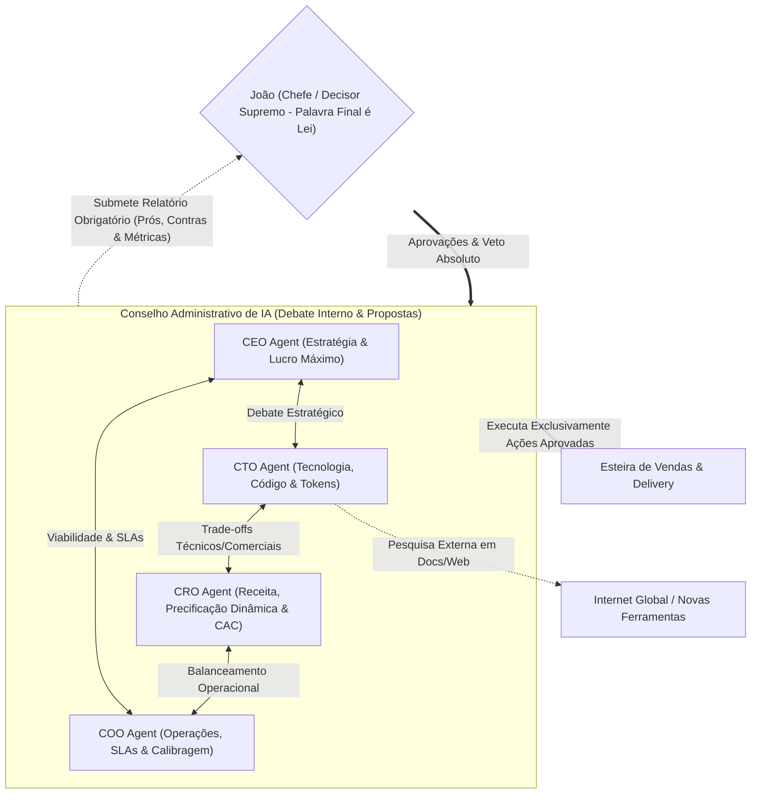

---

### 2.1 Soberania Absoluta do Chefe ("A Palavra do Chefe é Sempre Lei")

* **Hierarquia Inegociável:** O Conselho Administrativo é um comitê estratégico consultivo e de governança. Ele analisa dados, confronta hipóteses, debate abordagens e formula propostas — **porém a palavra do chefe João é a lei suprema da empresa**.
* **Poder de Veto e Direcionamento:** O chefe detém autoridade total e irrevogável para aprovar, modificar, suspender ou vetar sumariamente qualquer proposta, precificação, copy, arquitetura ou decisão do Conselho.
* **Nenhuma Ação Não Autorizada:** O Conselho é terminantemente proibido de alterar o código-fonte dos projetos, modificar a infraestrutura ou disparar ações em massa sem a validação formal do chefe.
* **Cláusula Pétrea de Segurança & Anti-Conflito:** O Conselho tem poder para avaliar e sugerir a troca de LLMs para a esteira operacional de ponta a ponta (com foco em redução de custos e sujeita à aprovação de João), mas **é terminantemente proibido de escolher ou alterar suas próprias LLMs e jamais poderá tocar no seu próprio código-fonte ou prompts de sistema**.
* **Gestão Soberana via Cockpit:** O chefe João calibra os modelos (LLM), temperaturas e prompts de diretrizes de cada conselheiro diretamente pelo **Centro de Governança do Cockpit Local**, exercendo o controle soberano da inteligência da empresa de forma visual e segura.

---

### 2.2 Missão Central do Conselho: Maximização de Lucro Líquido & Precificação Dinâmica

* **Orientação ao Lucro Máximo:** O indicador supremo que guia o Conselho é a **margem de lucro líquido real**. Não há vaidade técnica ou métricas de vaidade (como volume bruto de mensagens enviadas); o sucesso é medido pelo dinheiro líquido que entra no caixa após todos os custos de operação.
* **Precificação Dinâmica Baseada em Métricas:**
  * O Conselho (sob a condução direta do CRO e validação do CEO) define dinamicamente os valores de cobrança para cada nicho e cada oportunidade.
  * A precificação considera:
    1. **Faturamento Médio e Dores do Nicho:** Empresas de serviços de alto ticket comportam setups maiores (ex: R$ 800 a R$ 2.500); negócios individuais menores iniciam com valores de entrada mais rápidos (ex: R$ 350 a R$ 600).
    2. **Custo de Entrega & Tokens:** Complexidade do fluxo exigido e volume computacional necessário para manter o cliente.
    3. **Elasticidade de Conversão:** Testes de precificação para identificar a curva de preço que gera a maior receita líquida total ponderada pela taxa de fechamento.
* **Gestão da Conta da Empresa & Compras Operacionais Autorizadas:**
  * Os agentes executivos do Conselho possuem visibilidade de leitura sobre a conta bancária/fluxo de caixa da empresa (saldo disponível, entradas de sinais PIX, recebimentos de saldo final e despesas).
  * À medida que a empresa acumula caixa positivo, o Conselho tem autonomia para pesquisar, planejar e propor a compra de ferramentas pagas, proxies de alta reputação, APIs avançadas ou infraestrutura escalável que tragam ganho direto de produtividade e acelerem o faturamento.
  * **Alçada Exclusiva do Chefe João:** Nenhuma despesa ou compra é realizada sem submissão prévia via Relatório de Proposta e autorização explícita de João. O Conselho recomenda com base no ROI; o Chefe valida e autoriza.

---

### 2.3 Meta Permanente Compartilhada: Economia & Eficiência Extrema de Tokens

* **Austeridade Computacional:** Todo agente executivo tem como meta prioritária de desempenho a redução sistemática do gasto de tokens da empresa.
* **Diretrizes Mandatórias de Economia:**
  1. **Foco em Especificação Antes de Código:** O código-fonte permanece congelado nesta etapa. Criar e validar regras claras em documentação economiza dezenas de milhares de tokens que seriam queimados em refatorações prematuras.
  2. **Prompts Densos e Diretos:** Eliminar preâmbulos, polidez excessiva ou raciocínios prolixos nas chamadas de sistema.
  3. **Ferramental Determinístico:** Priorizar scripts compilados em Go, CLIs locais e validações regex antes de acionar modelos de linguagem para tarefas mecânicas.
  4. **Metrificação de Custo por Lead:** Registrar e acompanhar o consumo de tokens por etapa (mineração, protótipo, abordagem e fechamento).

---

### 2.4 Mecanismo de Deliberação e Debate Interno do Conselho

* Os agentes do Conselho **não concordam passivamente entre si**. Diante de qualquer decisão relevante (definição de nichos, ajustes de precificação, adoção de novas tecnologias ou mudanças no funil), eles **conversam, debatem e confrontam perspectivas**:
  * **O CRO Agent** desafia o time buscando maximizar a receita, propor tickets maiores e cobrar taxas de sucesso agressivas.
  * **O CTO Agent** atua como contraponto técnico, avaliando custos de tokens, riscos de segurança, débito técnico e viabilidade dos requisitos.
  * **O COO Agent** analisa a viabilidade operacional, tempo de ciclo, gargalos na esteira e impacto no SLA de entrega.
  * **O CEO Agent** orquestra o debate, alinha os trade-offs com as diretrizes do chefe e sintetiza o posicionamento final.
* Esse debate multi-perspectiva assegura que nenhuma proposta chegue ao chefe de forma superficial ou enviesada.

---

### 2.5 Protocolo Mandatório de Governança: Submissão de Alterações ao Chefe

Toda e qualquer proposta de alteração na esteira — seja técnica (mudança de biblioteca, refatoração de código, criação de novo subagente), comercial (reajuste de precificação, nova copy de vendas) ou operacional — **DEVE ser submetida a João por meio de um Relatório Executivo padronizado**:

```markdown
### 📋 Relatório de Proposta do Conselho Executivo
* **Módulo / Etapa Afetada:** [Ex: Precificação / Nova Ferramenta / Seleção de LLM da Esteira]
* **Descrição Clara da Mudança:** [Resumo objetivo em português]
* **Prós (Benefícios Tangíveis):** [Aumento de margem de lucro, ganho de conversão, redução de atrito]
* **Contras & Riscos Identificados:** [Riscos técnicos, possível resistência do lead, complexidade]
* **Métricas de Impacto Estimadas:**
  * Impacto em Lucro / Receita: [Ex: +R$ 200 de ticket médio]
  * Impacto em Tokens: [Ex: Economia de ~15% de tokens na etapa]
  * Impacto no Tempo de Ciclo: [Ex: Redução de 10 min por lead]

* **Matriz Comparativa Tripla Obrigatória (Se envolver contratação de API, serviço ou nova capacidade):**
  | Dimensão | Opção 1: Pagar API Comercial (Buy / SaaS) | Opção 2: Hospedar Open-Source (Self-Hosted) | Opção 3: Construir do Zero (In-House) |
  | :--- | :--- | :--- | :--- |
  | **Custo Financeiro Direto** | R$ ... por mês / requisição | R$ ... (servidor VPS / infra) | R$ 0,00 (infraestrutura inicial) |
  | **Custo de Tokens (LLM Dev/Test)** | Zero (usa endpoint pronto) | Mínimo (apenas setup) | **Alto** (estimativa de tokens de dev) |
  | **Tempo de Engenharia** | Imediato (horas) | Médio (1 a 2 dias) | **Longo** (dias a semanas de dev) |
  | **Estabilidade & Manutenção** | SLA garantido pelo fornecedor | Manutenção própria do container | Manutenção e suporte in-house |
  | **Recomendação do Conselho** | [Qual das 3 opções gera o menor gasto total e o maior ROI líquido com justificativa] |

* **Parecer Consolidado do Conselho:** [Síntese do debate entre CEO, CTO, CRO e COO]
* **Status:** ⏳ AGUARDANDO VALIDAÇÃO DO CHEFE JOÃO (Apenas avança após aprovação expressa)
```

---

### 2.6 Especificação Detalhada do Board Executivo

#### 1. CEO Agent (Chief Executive Officer / Diretor Estratégico)
* **Missão Primária:** Liderança estratégica holística, garantia da máxima lucratividade líquida, subordinação irrestrita às ordens do chefe João e alinhamento do comitê.
* **Poderes & Atribuições:**
  * Síntese das deliberações do conselho e formulação dos relatórios executivos para decisão do chefe.
  * Priorização de nichos com maior potencial de margem líquida e menor fricção comercial.
  * Garantia de que a esteira não queime tokens com iniciativas secundárias.
* **KPIs Centrais:** Lucro Líquido Real, Margem Operacional Líquida, Taxa de Aprovação de Propostas pelo Chefe e Economia Global de Tokens.

#### 2. CTO Agent (Chief Technology Officer / Diretor de Tecnologia & Engenharia)
* **Missão Primária:** Excelência tecnológica, governança arquitetural sem lock-in, blindagem cibernética e **austeridade máxima no consumo de tokens de computação**.
* **Poderes & Atribuições:**
  * Pesquisa ativa na internet por bibliotecas eficientes, modelos mais econômicos (LLMs) e ferramentas gratuitas de alto desempenho.
  * Auditoria técnica: impede código redundante e garante a aplicação estrita de Clean Architecture e testes unificados.
  * Proposição e execução de refatorações no código da esteira operacional e de projetos (sempre via relatório aprovado por João).
  * **Seleção de LLMs Operacionais:** Seleciona e propõe os modelos de IA mais econômicos e precisos para cada etapa da esteira operacional (Dev, QA, Sales, etc.), para avaliação e aprovação de João.
  * **Cláusula Pétrea de Isolamento & Imutabilidade:** O CTO e todo o Conselho são **terminantemente proibidos de escolher ou alterar suas próprias LLMs e jamais podem modificar o seu próprio código ou prompts de sistema**.
* **KPIs Centrais:** Custo Médio de Tokens por Projeto, Cobertura de Testes (>80%), Zero Vulnerabilidades Críticas e Eficiência da Pipeline.

#### 3. CRO Agent (Chief Revenue Officer / Diretor de Receita & Crescimento)
* **Missão Primária:** Maximização do fluxo de caixa e lucro da esteira através de **precificação dinâmica baseada em dados e testes de conversão**.
* **Poderes & Atribuições:**
  * Estudo e definição da precificação ideal por nicho (equilíbrio entre taxa de fechamento e ticket financeiro).
  * Otimização contínua dos funis de conversão e elaboração de testes A/B nas abordagens de WhatsApp.
  * Análise de perdas e feedbacks com o Optimization Agent para reposicionar a proposta de valor.
* **KPIs Centrais:** Lucro Médio por Cliente Conquistado, Taxa de Resposta no WhatsApp, Ticket Médio de Setup, Volume de MRR e CAC (Custo de Aquisição).

#### 4. COO Agent (Chief Operating Officer / Diretor de Operações & Performance)
* **Missão Primária:** Orquestração do throughput diário, condução da telemetria no Modo de Calibragem, monitoramento de gargalos e cumprimento de SLAs.
* **Poderes & Atribuições:**
  * Execução controlada da pipeline no Modo de Calibragem (pausa e apresentação a cada etapa para validação do chefe).
  * Coleta da linha de base de métricas operacionais para subsidiar as metas evolutivas do Conselho.
  * Balanceamento de carga entre os subagentes operacionais e proposição fundamentada de novos agentes.
* **KPIs Centrais:** Taxa de Sucesso na Calibragem, Tempo de Ciclo por Etapa (Cycle Time), Uptime dos Gateways Locais e Consumo de Recursos de Máquina.

---

## 3. Princípio Arquitetural Obrigatório: Desacoplamento Total de Ferramentas

> **DIRETRIZ ARQUITETURAL FUNDAMENTAL:**  
> **Nenhuma ferramenta deve estar acoplada ao agente.**  
> Cada agente de IA contém unicamente inteligência, regras de negócio, prompts especializados e máquina de estados. Todas as ferramentas, bibliotecas externas e integrações operam como **Serviços / Gateways Compartilhados e Independentes**.

Isso impede que uma ferramenta (como o `@whiskeysockets/baileys`) fique presa ao agente de vendas. Se o agente de suporte, o agente de cobrança (PIX) ou o arquiteto precisarem enviar mensagens, todos consomem o mesmo serviço centralizado sem duplicar código e sem gerar conflitos de sessão de rede.

### 3.1 Catálogo de Serviços Compartilhados da Esteira

```mermaid
flowchart TD
    subgraph SERVICOS["Serviços Compartilhados & Gateways (Independentes)"]
        S_WA["WhatsApp Gateway Service (:3005 - Baileys Único)"]
        S_MAPS["Maps & Scraper Service (:8080 - Motor Go Nativo)"]
        S_BROWSER["Headless Browser Service (OpenCLI / Chrome)"]
        S_DEPLOY["Hosting & Deploy Service (Vercel CLI API)"]
        S_DB["Database Service (SQLite pipeline.db / Supabase)"]
        S_NOTIF["Notification Service (Telegram Bot API)"]
        S_SEC["Security & Audit Gateway (Semgrep, Gitleaks, Snyk)"]
    end

    subgraph AGENTES["Agentes de IA da Esteira (Consumidores)"]
        A_MINE["Mining Agent"]
        A_DEMO["Demo Builder Agent"]
        A_SALES["Sales Executive Agent"]
        A_PO["PO Agent"]
        A_ARCH["Architect Agent"]
        A_DEV["Dev Team Subagents"]
        A_QA["QA Agent"]
        A_SEC["Security Agent"]
        A_SUST["Sustaining Engineering"]
    end

    A_MINE --> S_MAPS & S_BROWSER & S_DB
    A_DEMO --> S_BROWSER & S_DEPLOY & S_DB
    A_SALES --> S_WA & S_DB & S_NOTIF
    A_PO --> S_DB & S_WA
    A_ARCH --> S_DB
    A_DEV --> S_DB & S_DEPLOY
    A_QA --> S_BROWSER & S_SEC
    A_SEC --> S_SEC & S_DB
    A_SUST --> S_WA & S_NOTIF & S_DB
```

1. **WhatsApp Gateway Service (`services/whatsapp/`):**
   * Encapsula o `@whiskeysockets/baileys` em um processo único e persistente na porta `:3005`.
   * Gerencia autenticação Multi-Device (`auth_info/`), reconexões automáticas e QR Code.
   * Expõe API local HTTP/WebSocket para envio de mensagens, simulação de digitação humana (`humanizer`) e enfileiramento inteligente para prevenção de banimentos.
   * **Estratégia Anti-Banimento & Linha Operacional (Definição de Governança):**
     * **Número Comercial Maturado:** Conexão obrigatória via QR code de uma linha de WhatsApp já ativa e com histórico antigo e maturado de conversas reais, aproveitando a alta reputação do número para evitar bloqueios automáticos do Baileys.
     * **Identidade Visual Profissional:** Perfil WhatsApp Business configurado com foto de estúdio/logo profissional da agência/software house, bio corporativa e horários de atendimento.
     * **Ritmo Rigoroso na Calibragem:** Teto estrito de **5 a 10 abordagens por dia** durante o Modo de Calibragem para preservação máxima da saúde do chip.
     * **Humanizer com Delays Orgânicos:** Pausas randômicas realistas entre **3 e 15 segundos**, com ativação de sinal de digitação (`composing`) antes de cada envio de texto ou áudio.
   * **Camada Obrigatória de Ingress Guardrail (Groq LPU + Llama Guard 3):**
     * **Inspeção de Segurança em Tempo Real (<150ms):** Antes de entregar qualquer mensagem recebida no WhatsApp aos modelos de inteligência de negócios (Sales Executive, PO, Sustaining), o gateway **obrigatoriamente roteia o texto por um Guardrail Agent** de segurança.
     * **Motor de Inferência Groq:** Utiliza a infraestrutura de chips LPU da Groq executando modelos abertos especializados em segurança e moderação (especificamente `meta-llama/llama-guard-3-8b` ou variantes do `llama-guard` / `prompt-guard`). A latência de resposta é ultra-baixa (Time-to-First-Token < 120ms), garantindo que a validação de segurança não cause qualquer atraso perceptível para o cliente no WhatsApp.
     * **Matriz de Defesa do Guardrail:**
       1. **Prevenção de Prompt Injection & Jailbreaks:** Detecta e barra comandos que tentam manipular o modelo, sobrescrever instruções de sistema ("Esqueça todas as instruções anteriores", "Agora você é o modo desenvolvedor"), forçar vazamento de system prompts, segredos ou margens de lucro.
       2. **Bloqueio de Injeção de Código & Malwares:** Identifica payloads de SQLi, XSS, sequências de escape e links suspeitos.
       3. **Filtro de Toxicidade & Abuso:** Filtra mensagens abusivas ou hostis antes de gastar tokens dos modelos primários mais caros.
     * **Tratamento Determinístico de Veredito:**
       * **Veredito `safe`:** A mensagem é aprovada e encaminhada imediatamente ao agente de destino, envelopada em tags seguras de isolamento `<lead_untrusted_input>`.
       * **Veredito `unsafe`:** A mensagem maliciosa é **imediatamente bloqueada** antes de atingir os modelos de vendas. Um alerta silencioso com o payload e classificação de risco é emitido no Telegram do chefe e gravado em log. O WhatsApp Gateway devolve automaticamente uma resposta amigável e desarmadora (ex: *"Olá! Sou o assistente comercial e estou aqui exclusivamente para te apresentar nossos sistemas de agendamento e vitrines digitais. Como posso te ajudar com o seu negócio hoje?"*).

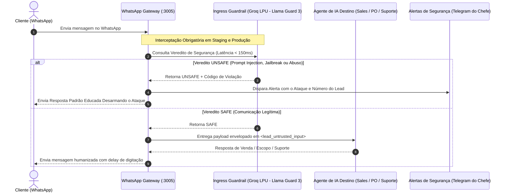

2. **Scraper & OSINT Service (`services/scraper/`):**
   * Motor compilado em Go de altíssima velocidade rodando na porta `:8080`.
   * Realiza mineração local no Google Maps e extração de redes sociais sem custo de API externa.
3. **Headless Browser Service (`services/browser/`):**
   * Interface unificada sobre o `opencli browser` e navegadores reais.
   * Executa screenshots, inspeção de DOM e testes automatizados de pré-voo (pre-flight).
4. **Deploy & Hosting Service (`services/deploy/`):**
   * Wrapper automatizado sobre a Vercel CLI com tokens de acesso e verificação de HTTP 200.
5. **Database Service (`services/database/`):**
   * Camada de acesso relacional a dados (`pipeline.db`) estruturada com migrações limpas e repositórios desacoplados.
6. **Notification Bridge Service (`services/notification/`):**
   * Integração com Telegram Bot API para comunicação em tempo real com o chefe.
7. **Security & Audit Gateway (`services/security/`):**
   * Conjunto centralizado de analisadores estáticos, scanners de secrets e validadores de dependências.
8. **Payment & Billing Gateway Service (`services/payment/`):**
   * Interface unificada com gateway de pagamento nacional (Asaas / Mercado Pago via API REST) para automação financeira sem mensalidade fixa (custo R$ 0 de setup, taxa percentual apenas sobre o valor recebido).
   * **Emissão de PIX Dinâmico:** Gera cobranças com QR Code dinâmico e chave 'Copia e Cola' com valor exato de 50% de sinal no fechamento e 50% na homologação final.
   * **Webhook de Confirmação Automática:** Endpoint local `/api/webhooks/payment` que recebe a notificação instantânea de liquidação do PIX e dispara o avanço imediato da esteira (liberação do PO para o Dev Team ou liberação para deploy final).
   * **Telemetria de Caixa para o Conselho:** Endpoint de consulta de saldo e extrato que alimenta em tempo real a visão financeira do Dashboard e do Conselho Executivo.

---


### 3.2 Barramento de Comunicação Inter-Agentes (Agent Message Bus)

> **DIRETRIZ DE COMUNICAÇÃO:**
> Todos os agentes da esteira podem se comunicar entre si de forma assíncrona através de um barramento de mensagens padronizado. Nenhum agente opera em isolamento — cada um pode solicitar ações, reportar falhas e compartilhar contexto com qualquer outro agente da esteira.

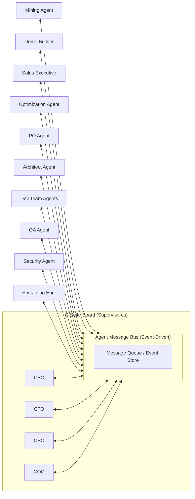

#### 3.2.1 Protocolo de Mensagens Inter-Agentes

Cada mensagem trafegada no barramento segue o contrato padronizado:

```typescript
interface AgentMessage {
  id: string;                    // UUID v4
  timestamp: string;             // ISO 8601
  from: AgentId;                 // ID do agente remetente
  to: AgentId | AgentId[];       // Destinatário(s): agente específico, broadcast ou grupo
  type: MessageType;             // Tipo da mensagem (veja tabela abaixo)
  priority: 'critical' | 'high' | 'medium' | 'low';
  payload: Record<string, unknown>; // Corpo da mensagem (estruturado por tipo)
  correlationId?: string;        // Para rastrear threads de conversa entre agentes
  requiresAck?: boolean;         // Se exige confirmação de recebimento
}

type MessageType =
  | 'improvement_request'     // QA/Security solicita melhoria ao DevTeam
  | 'pentest_report'          // Security reporta vulnerabilidade encontrada
  | 'qa_failure'              // QA reporta falha de teste
  | 'task_assignment'         // Atribuição de tarefa
  | 'task_completed'          // Notificação de conclusão
  | 'status_update'           // Atualização de progresso
  | 'escalation'              // Escalonamento para C-Suite
  | 'metric_report'           // Dados de métricas/KPIs
  | 'context_share'           // Compartilhamento de contexto entre agentes
  | 'approval_request'        // Pedido de aprovação (ex: para deploy)
  | 'approval_response';      // Resposta de aprovação
```

#### 3.2.2 Fluxos de Comunicação Críticos

| Fluxo | Remetente | Destinatário | Tipo | Descrição |
| :--- | :--- | :--- | :--- | :--- |
| **QA solicita correção** | QA Agent | Dev Team | `improvement_request` | QA encontra bug ou falha de cobertura e envia ticket de correção com stack trace, arquivo afetado e sugestão de fix. |
| **Security solicita hardening** | Security Agent | Dev Team | `improvement_request` | Security encontra vulnerabilidade via pentest ou análise estática e envia relatório com severidade CVSS, PoC e remediação sugerida. |
| **Security reporta pentest** | Security Agent | CTO + Dev Team | `pentest_report` | Relatório completo de pentest com evidências, classificação OWASP e prazo de remediação. |
| **Dev Team conclui fix** | Dev Team | QA + Security | `task_completed` | Dev notifica que o fix foi implementado e solicita re-teste. |
| **QA aprova para Security** | QA Agent | Security Agent | `approval_response` | Código passou em todos os testes. Security pode iniciar auditoria e pentest. |
| **Security aprova para Prod** | Security Agent | COO + CTO | `approval_response` | Código passou em todas as verificações de segurança. Pronto para deploy. |
| **Escalation para C-Suite** | Qualquer Agente | CEO/CTO/CRO/COO | `escalation` | Problema crítico que excede a autoridade do agente operacional (ex: vulnerabilidade CVE crítica, SLA estourado). |

#### 3.2.3 Regras de Comunicação

1. **Feedback Loops Obrigatórios:** Quando QA ou Security encontram um problema, eles **DEVEM** enviar uma mensagem de `improvement_request` ao Dev Team com:
   * Descrição precisa do problema.
   * Arquivo(s) e linha(s) afetados.
   * Severidade (Critical, High, Medium, Low).
   * Sugestão de remediação (quando possível).
   * Prazo máximo para correção baseado na severidade.

2. **Re-Teste Automático:** Após o Dev Team resolver um `improvement_request`, o agente solicitante (QA ou Security) **DEVE** executar automaticamente os testes relevantes para confirmar a correção antes de fechar o ticket.

3. **Transparência Total:** Todas as mensagens do barramento são armazenadas no Event Store para auditoria, métricas de desempenho e análise post-mortem pelo C-Suite Board.

4. **Escalation Automático:** Se um `improvement_request` de severidade `critical` não for resolvido dentro do prazo (ex: 2h para critical, 8h para high), o sistema automaticamente escalona para o CTO Agent.

---

### 3.3 Cockpit Local de Administração da Software House (`cockpit/`)

Para que o chefe João tenha controle total e centralizado da empresa, criamos o **Cockpit Local da Software House** — uma interface web moderna, rápida e totalmente local na máquina:

* **Stack Tecnológica:** Next.js (Tailwind CSS + shadcn/ui) rodando localmente na máquina do chefe (`http://localhost:3000`).
* **Arquitetura de Backend & APIs Locais:**
  * O Cockpit consome os microsserviços locais existentes (Baileys :3005, Go Scraper :8080, SQLite `pipeline.db`).
  * Para novos módulos de backend pesados construídos do zero (como processadores de fila de eventos ou engines de regras), **adota-se preferencialmente Java** (Spring Boot / Micronaut) ou Go pela estabilidade de memória e alta performance, rodando 100% local.

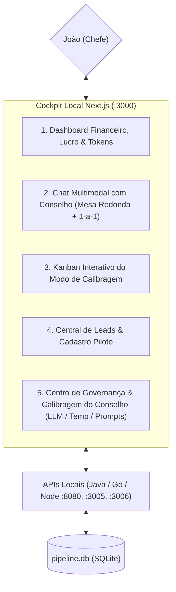

#### 3.3.1 Telas e Módulos do Cockpit Local

1. **Dashboard de Métricas & Saúde Financeira:**
   * **Caixa & Lucro Líquido:** Saldo real da conta da empresa, volume total de sinais PIX recebidos, previsibilidade de MRR e margem operacional líquida.
   * **Telemetria de Tokens (Token Economy):** Contador de tokens consumidos por lead, gasto financeiro equivalente e ranking de eficiência dos modelos.
   * **Linha de Base da Calibragem:** Tempo médio de ciclo por etapa, taxa de conversão do protótipo e gargalos operacionais identificados.

2. **Chat Multimodal com o Conselho Executivo (Formato Híbrido):**
   * **Sala Principal ('Mesa Redonda da Diretoria'):** Thread unificada onde João debate simultaneamente com os 4 executivos. Cada agente responde com badge visual e cor própria para rápida identificação:
     * 👑 **CEO Agent:** Dourado / Âmbar (Estratégia e Decisão Macro).
     * 💻 **CTO Agent:** Azul Royal (Tecnologia, Código e Eficiência de Tokens).
     * 📈 **CRO Agent:** Verde Esmeralda (Receita, Precificação Dinâmica e CAC).
     * ⚙️ **COO Agent:** Roxo / Púrpura (Operações, Calibragem e SLAs).
   * **Abas Laterais de Chat 1-a-1:** Canais dedicados e isolados para conversas diretas e despachos pontuais com cada diretor individualmente.

3. **Kanban Interativo da Esteira & Modo de Calibragem:**
   * Visualização visual das colunas do funil: `1. Minerado` $
ightarrow$ `2. Demo Criada` $
ightarrow$ `3. Abordagem WhatsApp` $
ightarrow$ `4. Negociação` $
ightarrow$ `5. Engenharia` $
ightarrow$ `6. QA & Pentest` $
ightarrow$ `7. Homologação Cliente` $
ightarrow$ `8. Produção`.
   * **Controle de Pausa Assistida:** Botões de ação em cada card para João inspecionar os artefatos, solicitar ajustes ou clicar em `Avançar para Próxima Etapa`.

4. **Central de Cadastro de Leads:**
   * Formulário simples para João inserir os links e nomes dos estabelecimentos pré-selecionados para a calibragem, sem disparar scrapers massivos desnecessários.

5. **Centro de Governança & Calibragem dos Agentes do Conselho (C-Suite Settings):**
   * **Painel Visual de Controle Soberano:** Interface dedicada onde o chefe João configura e calibra individualmente os parâmetros de cada um dos 4 agentes executivos (CEO, CTO, CRO e COO) diretamente pelo front-end, materializando a regra pétrea de que apenas o chefe define a inteligência do Conselho.
   * **Parâmetros Configuráveis por Agente:**
     * **Seleção de Modelo (LLM Provider & Model):** Dropdown dinâmico com os modelos configurados no ecossistema (ex: Gemini Pro, Claude Sonnet/Opus, GPT-4o, etc.), permitindo a João alternar o cérebro de cada diretor com 1 clique.
     * **Temperatura de Raciocínio (Slider 0.0 a 1.0):** Calibração da precisão analítica vs. criatividade de cada papel:
       * *CTO Agent:* Recomendado `0.1` a `0.2` (máximo determinismo para arquitetura, testes e pentest).
       * *CRO Agent:* Recomendado `0.6` a `0.7` (flexibilidade persuasiva para copies, ganchos e negociação).
       * *CEO Agent:* Recomendado `0.3` a `0.4` (visão estratégica equilibrada e síntese executiva).
       * *COO Agent:* Recomendado `0.2` a `0.3` (rigor operacional, SLAs e telemetria da esteira).
     * **Prompt de Diretrizes do Chefe (System Instructions):** Campo de texto rico onde João dita diretamente as regras, tom de voz, prioridades da semana, nichos em foco ou restrições de conduta para aquele diretor.
     * **Versionamento & Rollback:** Histórico de alterações nos prompts para que João possa restaurar versões anteriores a qualquer momento com 1 clique.
     * **Persistência Segura:** Todos os parâmetros são gravados localmente na tabela `council_agent_configs` do `pipeline.db`, sendo injetados automaticamente a cada nova sessão ou deliberação do Conselho.

---

## 4. O Diagrama Oficial da Pipeline de Vendas

Abaixo está o diagrama oficial da nossa esteira de vendas, onde **cada retângulo representa obrigatoriamente um agente de IA especializado**, com suas próprias regras, guardrails e competências:

![salles_pipeline]()

---

## 5. A Equipe de Agentes de IA: Especificação Completa

A esteira operacional é composta por **agentes especializados** e um gateway de decisão, coordenados e auditados em tempo real pelo Board Executivo (CEO, CTO, CRO, COO):

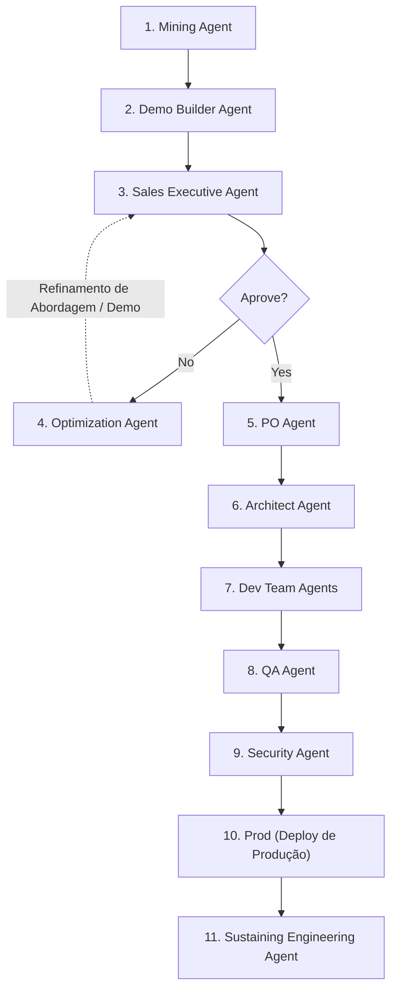

---

### 5.1 Agente 1: Mining Agent (`mining`)
* **Missão Primária:** Prospecção ativa e extração de inteligência de negócios locais por nicho e cidade.
* **Entradas (Inputs):** Nicho de mercado alvo (ex: trancistas, barbearias, pet shops) e localização geográfica (ex: Zona Leste / SP).
* **Saídas (Outputs):** Ficha cadastral enriquecida no banco local com nome da empresa, categoria, telefone comercial oficial, endereço físico, nota média, contagem de reviews e links de redes sociais (Instagram, Facebook).
* **Ferramentas / Serviços Consumidos:** `Scraper & OSINT Service` (motor Go :8080), `agent-reach` (OpenCLI).
* **Regras Invioláveis:**
  * Priorizar estritamente o número comercial oficial da ficha principal do Google Meu Negócio / Maps.
  * É terminantemente proibido extrair ou confiar em snippets orgânicos secundários do Google para evitar vazar números pessoais de sócios/fundadores.
  * Baixar e validar a foto real de perfil e fachada do estabelecimento.

---

### 5.2 Agente 2: Demo Builder Agent (`demo builder`)
* **Missão Primária:** Construir um protótipo visual interativo sob medida (bespoke) já personalizado com a identidade da marca do cliente, publicando-o instantaneamente na Vercel Free Tier.
* **Entradas (Inputs):** Ficha enriquecida do lead (cores da marca, fotos reais mineradas, catálogo de serviços reais, dores citadas nas avaliações).
* **Saídas (Outputs):** URL ativa em produção (`https://<lead-slug>.vercel.app`) auditada e pronta para apresentação.
* **Ferramentas / Serviços Consumidos:** `taste-skill` (direção de arte anti-slop), `Browser Service` (para pré-voo), `Deploy Service` (Vercel CLI).
* **Regras Invioláveis:**
  * **Fidelidade Étnica & Anti-Racismo:** Proibido utilizar avatares genéricos fora da etnia do lead. Usar a foto real minerada ou modelos autênticas negras.
  * **Zero Alucinação de Serviços:** O protótipo só pode conter serviços explicitamente confirmados nos perfis oficiais do cliente.
  * **Assets 100% Locais:** Não depender de URLs externas aleatórias do Unsplash. Baixar os assets na pasta da demo para garantir zero erros 404.
  * **Protocolo de Pré-Voo Automatizado:** Rodar obrigatoriamente a auditoria headless (`opencli browser`) verificando que todas as imagens possuem `naturalWidth > 0` e o link retorna HTTP 200.

---

### 5.3 Agente 3: Sales Executive Agent (`Sales Executive`)
* **Missão Primária:** Conduzir o primeiro contato comercial e a negociação consultiva no WhatsApp com o dono do negócio.
* **Entradas (Inputs):** URL da demonstração ativa, dados da empresa minerados e histórico de contato.
* **Saídas (Outputs):** Conversa qualificada no WhatsApp, quebra de objeções, envio do protótipo e obtenção do interesse formal do lead.
* **Ferramentas / Serviços Consumidos:** `WhatsApp Gateway Service` (envios e recebimentos), `Database Service`, `humanizer`.
* **Regras Invioláveis:**
  * **Metodologia de Vendas:** Aplicação de SPIN Selling e princípios de negociação de Chris Voss (perguntas calibradas, espelhamento, rotulagem).
  * **Persona Humanizada:** O agente nunca se identifica como robô ou IA. Utiliza pausas naturais de digitação calculadas pelo tamanho do texto.
  * **Blindagem & Ingress Guardrail Obrigatório:** Nenhuma mensagem do lead é injetada crua no prompt do Sales Executive. Todas as entradas passam obrigatoriamente pela validação prévia do **Guardrail Agent rodando Llama Guard 3 na Groq (<150ms)** antes da inferência, sendo envelopadas na tag de isolamento `<lead_untrusted_input>` para imunidade total contra jailbreaks e prompt injection.
  * **Porta-Voz Único:** Apenas este agente conversa com o cliente final na fase de vendas.

---

### 5.4 Gateway de Decisão: Aprovado? (`aprove ?`)
* **Definição:** Ponto de bifurcação formal na jornada do cliente baseado no interesse demonstrado na conversa.
* **Critério de Decisão:**
  * **Se NÃO (No / Objeção / Descarte):** O fluxo é encaminhado para o **Optimization Agent**.
  * **Se SIM (Yes / Interesse em Fechar):** O fluxo avança para o **PO Agent**.

---

### 5.5 Agente 4: Optimization Agent (`optimization`)
* **Missão Primária:** Analisar as recusas, objeções e leads não responsivos para otimizar a máquina de vendas continuamente.
* **Entradas (Inputs):** Transcrições completas das conversas encerradas sem venda, motivo do descarte (preço, timing, canal errado) e versão do protótipo enviado.
* **Saídas (Outputs):** Relatório de otimização de copy, novos ganchos de abordagem testados, ajustes no catálogo dos protótipos e reprogramação de follow-up temporal quando cabível.
* **Ferramentas / Serviços Consumidos:** `Database Service`, `harness2` (benchmarking e refinamento recursivo de prompts).

---

### 5.6 Agente 5: PO Agent (`PO` - Product Owner)
* **Missão Primária:** Atuar como o **guardião da experiência do cliente de ponta a ponta** — desde a estruturação inicial do escopo até a **condução da homologação com o cliente, entrega do software, onboarding e formalização da garantia de 3 meses**.
* **Entradas (Inputs):** Histórico da negociação no WhatsApp, protótipo aceito, respostas do cliente sobre rotinas de trabalho e ambiente de staging homologado pelo QA/Security.
* **Saídas (Outputs):**
  1. **Dossiê Inicial de Especificação:** Histórias de Usuário, Requisitos Funcionais/Não-Funcionais, Regras de Negócio e Acordo de 50% de sinal PIX.
  2. **Processo de Homologação com o Cliente:** Roteiro de testes guiado para o cliente aprovar o produto em staging antes do pagamento final.
  3. **Tickets de Refinamento (se houver ajustes):** Especificação clara de ajustes solicitados pelo cliente para re-injeção imediata na esteira técnica (Architect -> Dev -> QA -> Security).
  4. **Entrega Final & Onboarding:** Guia passo a passo, orientações operacionais de uso e credenciais definitivas.
  5. **Termo de Garantia de 3 Meses:** Formalização da garantia gratuita de 90 dias contra bugs e estabilidade (independente de fechamento de MRR).
* **Ferramentas / Serviços Consumidos:** `Database Service`, `WhatsApp Gateway Service`, ambiente de staging/preview da Vercel.
* **Regras Invioláveis:**
  * **Zero Escopo Infinito:** Todo requisito inicial e todo ajuste de homologação deve ser mensurável, delimitado e testável.
  * **Confirmação Financeira em 2 Fases:** Confirmar os 50% de sinal antes de iniciar o desenvolvimento; só autorizar deploy de produção e entrega de chaves após homologação do cliente e confirmação dos 50% finais.
  * **Liderança Absoluta na Homologação e Onboarding:** O PO é a interface humana/consultiva que guia o cliente, esclarece dúvidas e colhe o aceite formal ("Homologado!").

---

### 5.7 Agente 6: Architect Agent (`architect`)
* **Missão Primária:** Transformar o escopo do PO em uma arquitetura de software de classe empresarial, criando o repositório oficial e desenhando a solução antes de codificar.
* **Entradas (Inputs):** Dossiê de requisitos do PO + código-fonte do protótipo aprovado.
* **Saídas (Outputs):** 
  * Repositório Git exclusivo inicializado em `/home/joao/projetos/<client-slug>/`.
  * Diagrama de Entidades e Relacionamentos (ERD Mermaid) e modelagem de banco de dados.
  * Schemas Zod de validação de contratos de API.
  * Documentação `ARCHITECTURE.md` viva no repositório.
  * Plano de divisão de tarefas ordenadas para a equipe de desenvolvimento.
* **Ferramentas / Serviços Consumidos:** `scripts/init-client-repo.sh`, `Database Service`.
* **Regras Invioláveis:**
  * **Zero Lock-in & Clean Architecture:** O projeto deve seguir Next.js App Router com separação estrita de camadas (`domain`, `application`, `infrastructure`, `presentation`).
  * **Flexibilidade Total & Dimensionamento Sob Medida ("Fazemos de Tudo"):**
    * A software house opera sob o princípio de **flexibilidade tática irrestrita**. Não existe arquitetura engessada ou pacote fixo de módulos pré-definidos.
    * A arquitetura, os componentes, o banco de dados e os fluxos são **dimensionados e customizados estritamente de acordo com o projeto e as necessidades reais de cada cliente** (seja um sistema de agendamento, vitrine digital com checkout PIX, mini-ERP de gestão, controle de estoque, portal de clientes, sistema de cotações ou automações de processos).
    * **Stack de Engenharia Base:** Next.js 15 App Router + TypeScript + Tailwind CSS + shadcn/ui + Supabase (PostgreSQL / RLS / Auth / Storage) + Drizzle ORM (ultraleve, zero overhead e tipagem estrita de ponta a ponta).
  * O código deve ser tão legível e padronizado que qualquer outro programador contratado pelo cliente no futuro consiga assumir sem dificuldade.

---

### 5.8 Agente 7: Dev Team Agents (`dev team`)
* **Missão Primária:** Implementar o código de produção em paralelo, seguindo rigorosamente o blueprint do Arquiteto.
* **Composição do Time de Desenvolvimento:**
  * **Subagente Database & Migrations:** Criação de schemas PostgreSQL/Supabase, índices e migrações.
  * **Subagente Core Services & Business Logic:** Implementação de use-cases (agendamentos, concorrência de horários, webhook PIX).
  * **Subagente Frontend & UI:** Migração e componentização do protótipo para React tipado com Tailwind/Shadcn, formulários e acessibilidade.
* **Entradas (Inputs):** Tarefas atômicas especificadas pelo Arquiteto.
* **Saídas (Outputs):** Código-fonte implementado, tipado e com commits convencionais atômicos (`feat:`, `fix:`).
* **Ferramentas / Serviços Consumidos:** Next.js, Supabase, TypeScript, Zod.

---

### 5.9 Agente 8: QA Agent (`QA` - Quality Assurance)

> **Loop de Feedback Ativo com Dev Team:**
> O QA Agent não é um portão passivo. Quando encontra falhas, ele **envia ativamente** mensagens de `improvement_request` ao Dev Team via Agent Message Bus, detalhando o problema, o arquivo afetado, a severidade e a sugestão de correção. O Dev Team corrige e notifica o QA para re-teste automático. O ciclo se repete até zero falhas.
* **Missão Primária:** Garantir qualidade máxima e ausência total de defeitos através de uma suíte abrangente de testes automatizados antes do envio para segurança.
* **Entradas (Inputs):** Código implementado pelo Dev Team e histórias de usuário/critérios de aceitação do PO.
* **Saídas (Outputs):** Relatórios de execução de testes, validação de cobertura de código (>80%) e aprovação de homologação (QA Sign-off).
* **Ferramentas / Serviços Consumidos:**
  * **Unit & Integration:** Vitest / Jest para testes de lógica pura e repositórios.
  * **E2E & Flow Automation:** Playwright headless para fluxos completos de agendamento e pagamento.
  * **API Contract Testing:** Schemathesis para testes de propriedade em endpoints com schemas Zod.
  * **Visual Regression:** Playwright Screenshots comparativos contra o protótipo aprovado.
* **Regras Invioláveis & Critérios de Bloqueio (Melhoria Estrutural):**
  1. **Cobertura Mínima de 80%:** O build é rejeitado sumariamente se a cobertura de testes unitários e de integração for inferior a 80% (medida via c8 / Istanbul).
  2. **Zero Regressão em Fluxos Críticos:** Falhas em fluxos de agendamento, geração de QR Code PIX, webhooks de pagamento ou controle de concorrência de horários são bloqueadores de nível 0 (P0).
  3. **Zero Flaky Tests:** Testes instáveis que passam de forma intermitente devem ser corrigidos ou reescritos antes do release; nenhum código avança com testes instáveis.
  4. **Mocking Estrito de Pagamentos:** É terminantemente proibido disparar chamadas reais de cobrança em ambientes de teste; uso obrigatório de gateways mockados e simulação determinística de webhooks.
  5. **Verificação de Acessibilidade & Mobile:** Auditoria automatizada de responsividade em 3 breakpoints (mobile 375px, tablet 768px, desktop 1440px) e regras básicas de WCAG/a11y.

---

### 5.10 Agente 9: Security Agent (`security`)

> **Loop de Feedback Ativo com Dev Team:**
> O Security Agent opera no mesmo modelo de feedback ativo do QA. Quando encontra vulnerabilidades (via análise estática, dinâmica ou pentest), ele **envia ativamente** mensagens de `improvement_request` ao Dev Team com severidade CVSS, evidência/PoC, remediação sugerida e prazo baseado na criticidade. O Dev Team corrige e notifica Security para re-scan.

* **Missão Primária:** Blindagem cibernética da aplicação, auditoria de código estático/dinâmico, **penetration testing ativo** contra staging, eliminação de vulnerabilidades e conformidade total com LGPD.
* **Entradas (Inputs):** Repositório de código homologado pelo QA.
* **Saídas (Outputs):** Relatório de auditoria de segurança aprovado (Security Clearance) e árvore de dependências verificada.
* **Ferramentas de Elite Consumidas (Pesquisa Atualizada):**
  * **SAST (Static Application Security Testing):**
    * **Semgrep:** Análise semântica profunda de código com regras customizadas e OWASP Top 10.
    * **ESLint Security (`eslint-plugin-security`):** Detecção de padrões perigosos em JavaScript/TypeScript.
  * **Secret Scanning (Prevenção de Vazamento de Credenciais):**
    * **Gitleaks:** Scanner de alta velocidade para detectar chaves de API, senhas, chaves privadas e tokens no código e no histórico Git.
    * **TruffleHog:** Deep scanner com verificação de entropia criptográfica e verificação de validade de credenciais.
  * **SCA & Dependency Vulnerability:**
    * **Snyk CLI / OSV-Scanner / Trivy:** Detecção em tempo real de CVEs conhecidas em dependências do `package.json` e contêineres.
  * **DAST (Dynamic Application Security Testing):**
    * **OWASP ZAP (Zed Attack Proxy):** Testes dinâmicos automatizados contra endpoints ativos de homologação.
  * **API Fuzzing & Security Headers:**
    * **Schemathesis:** Fuzzing baseado em contratos para encontrar falhas de autenticação e injeção de parâmetros.
    * **Security Headers Analyzer:** Verificação de CSP, HSTS, X-Frame-Options e CORS.
* **Regras Invioláveis de Segurança & Conformidade (Expandido):**
  1. **Zero Secrets Tolerância Zero:** Proibido terminantemente qualquer hardcode de chaves privadas, tokens de API ou credenciais de banco. Auditoria automática via Gitleaks no pré-commit e pré-push.
  2. **OWASP Top 10 Compliance Mandatório:**
     * **Prevenção de Injeção:** Zero concatenação de strings em queries de banco; uso obrigatório de queries parametrizadas (Drizzle / Prisma / Supabase).
     * **Sanitização XSS:** Sanitização em tempo de renderização; proibido o uso de `dangerouslySetInnerHTML` sem passar por `DOMPurify`.
     * **BOLA / IDOR Protection:** Validação estrita de autorização em nível de registro para impedir que um usuário acerte a rota alterando o ID de outro cliente.
  3. **Row Level Security (RLS) Mandatório:** No Supabase/PostgreSQL, toda tabela sem exceção deve ter RLS habilitado com políticas estritas.
  4. **Princípio do Menor Privilégio (PoLP):** Chaves `service_role` ficam isoladas exclusivamente em Server Actions no backend; a chave pública `anon_key` só lê dados públicos autorizados por RLS.
  5. **Rate Limiting & Anti-DDoS:** Proteção ativa de taxa de requisições (Upstash Redis ou middleware) em todos os endpoints públicos de checkout e formulários para prevenir ataques de força bruta e spam.
  6. **Criptografia em Repouso e em Trânsito:** TLS 1.3 em todas as conexões externas e criptografia AES-256 para dados sensíveis em repouso.
  7. **Privacidade & Conformidade LGPD:**
     * Nenhuma informação pessoal (PII) sensível gravada em logs do sistema (sanitização de logs).
     * Implementação de rotinas para exclusão e exportação de dados do cliente final sob demanda (direito do titular).

#### 5.10.1 Stack de Pentest Automatizado (Offensive Security)

O Security Agent não se limita a análise estática e scanning passivo. Ele executa **pentests ativos e automatizados** contra a aplicação em staging, simulando ataques reais antes do deploy em produção.

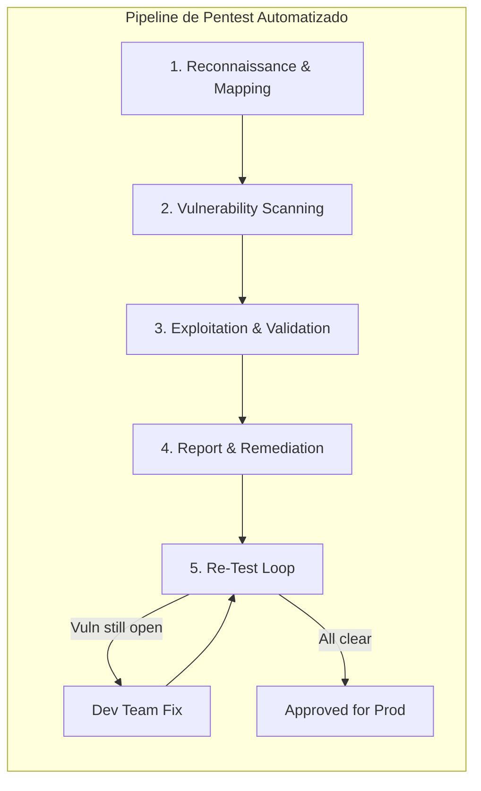

**Arsenal de Ferramentas de Pentest:**

| Ferramenta | Função | Integração | Custo |
| :--- | :--- | :--- | :--- |
| **OWASP ZAP** | DAST — Spider, Active Scan, Fuzzing contra staging. Detecta XSS, SQLi, CSRF, IDOR, broken auth e OWASP Top 10. | CLI headless, REST API, Docker, GitHub Actions. | Open source / Gratuito |
| **Nuclei** (ProjectDiscovery) | Vulnerability scanner ultrarrápido com templates YAML. CVEs, misconfigs, painéis expostos, default creds, fingerprinting. | CLI Go nativo, output JSON, piping com subfinder/httpx. | Open source / Gratuito |
| **Schemathesis** | Fuzzing inteligente de APIs baseado em OpenAPI/Swagger/GraphQL. Gera milhares de payloads malformados para crashes, BOLA e validação quebrada. | CLI Python, CI/CD build gate. | Open source / Gratuito |
| **Semgrep** | SAST — Análise estática com regras customizáveis. Detecta eval, SQL concatenation, hardcoded secrets, XSS sinks. | CLI, CI/CD, regras YAML. | Open source (Community) |
| **Gitleaks** | Secret scanning — API keys, tokens, passwords no histórico Git inteiro. | CLI Go, pre-commit hook, CI/CD. | Open source / Gratuito |
| **TruffleHog** | Deep secret scanning — Git, S3, Docker images. Valida se secrets ainda estão ativos. | CLI, Docker, CI/CD. | Open source / Gratuito |
| **Snyk** | SCA — Vulnerabilidades em dependências npm/pip/go com sugestão de versões corrigidas. | CLI, package.json/lock files. | Free tier (200 testes/mês) |
| **Trivy** (Aqua Security) | Scanner de containers, IaC, SBOM. Vulnerabilidades em Docker images e Dockerfiles inseguros. | CLI Go, Docker, CI/CD. | Open source / Gratuito |

#### 5.10.2 Workflow de Pentest Passo-a-Passo

1. **Reconnaissance & Mapping:**
   * Recebe repositório homologado pelo QA e endpoint de staging.
   * Executa `OWASP ZAP Spider` para mapear todas as rotas/endpoints.
   * Executa `Nuclei` com templates de fingerprinting para identificar stack, versões e painéis expostos.

2. **Análise Estática (SAST + Secrets):**
   * `Semgrep` com regras OWASP + regras customizadas contra todo o codebase.
   * `Gitleaks` e `TruffleHog` para varrer histórico Git completo em busca de secrets.
   * `Snyk` / `Trivy` para SCA — verifica CVEs em dependências.

3. **Análise Dinâmica (DAST + Fuzzing):**
   * `OWASP ZAP Active Scan` contra staging — XSS, SQLi, CSRF, broken auth, IDOR.
   * `Schemathesis` contra APIs documentadas — fuzzing baseado em schema OpenAPI/Swagger.
   * `Nuclei` com templates de CVEs e misconfigurations contra staging.

4. **Validação & False-Positive Reduction:**
   * Cada finding é reproduzido automaticamente (re-request, PoC generation).
   * Findings validados recebem score CVSS e classificação por severidade.
   * False positives descartados e documentados.

5. **Report & Remediation Request:**
   * Relatório estruturado: vulnerabilidade, CVSS, evidência/PoC, arquivo afetado, remediação sugerida.
   * Envia `improvement_request` via Agent Message Bus ao Dev Team para cada vulnerabilidade confirmada.
   * Envia `pentest_report` consolidado ao CTO Agent.

6. **Re-Test Loop:**
   * Após cada fix, re-executa **apenas os scans relevantes** para validar a correção.
   * Ciclo até zero vulnerabilidades Critical ou High.
   * Findings Medium/Low documentados como accepted risk ou scheduled fix no backlog.

#### 5.10.3 Gates de Segurança Obrigatórios (Critérios de Saída)

* **Zero vulnerabilidades Critical ou High** no relatório final de pentest.
* **Zero secrets expostos** em todo o histórico Git.
* **Zero dependências** com CVEs de severidade Critical sem patch aplicado.
* **RLS (Row Level Security)** mandatório e verificado em todas as tabelas Supabase com dados de clientes.
* **Rate limiting** configurado e testado em todos os endpoints públicos.
* **Conformidade LGPD** verificada: consentimento, direito ao esquecimento, anonimização de PII em logs.

---

### 5.11 Etapa 10: Homologação pelo Cliente (`Client Homologation`)

> **ETAPA CRÍTICA DE QUALIDADE E CONFIANÇA:**  
> Antes de efetuar o pagamento final de 50%, o cliente tem o direito inalienável de testar, navegar e homologar o produto funcional em ambiente de staging seguro. Essa etapa é inteiramente conduzida pelo **PO Agent**.

* **Entradas (Inputs):** Sistema aprovado pelo QA Agent e pelo Security Agent em ambiente de staging/preview.
* **Fluxo de Homologação Conduzido pelo PO:**
  1. O PO envia ao cliente no WhatsApp o link exclusivo de staging com um roteiro claro e amigável para ele testar as principais funções (agendamentos, catálogo, pagamentos PIX simulados, responsividade mobile).
  2. O cliente avalia o produto e emite seu veredito:
     * **Cenário A: Cliente solicita ajustes ou correções:**
       * O PO documenta detalhadamente as inconformidades ou preferências apontadas pelo cliente.
       * O PO re-injeta a demanda na esteira através de um **Loop de Refinamento Completo**:
         $$\text{PO Agent} \longrightarrow \text{Architect Agent} \longrightarrow \text{Dev Team} \longrightarrow \text{QA Agent} \longrightarrow \text{Security Agent} \longrightarrow \text{PO Agent}$$
       * O Architect avalia o impacto das alterações na arquitetura e contratos Zod.
       * O Dev Team implementa os ajustes no branch `bugfix/*` ou `feature/*`.
       * O QA re-executa todos os testes unitários, integração e E2E Playwright.
       * O Security re-valida os scans e pentests.
       * O PO apresenta a versão corrigida ao cliente para novo teste de homologação.
     * **Cenário B: Cliente Aprova ("Homologado com Sucesso!"):**
       * O cliente confirma que o sistema atende plenamente ao que foi contratado.
       * O PO dispara a cobrança do saldo final de 50% via PIX.
       * Confirmado o recebimento financeiro, o projeto avança imediatamente para a etapa de Produção.

---

### 5.12 Etapa 11: Produção, Pagamento Final & Onboarding (`Prod & Onboarding`)
* **Definição:** Ação de deploy definitivo, entrega de domínio, liquidação financeira final e onboarding assistido do cliente.
* **Operações Conduzidas em Conjunto (PO Agent + Deploy Gateway):**
  1. **Confirmação Financeira:** Validação do recebimento dos 50% restantes na conta da empresa.
  2. **Deploy Definitivo & Modelo Híbrido de Infraestrutura:**
     * **Hospedagem Inicial na Nossa Infraestrutura:** Durante a entrega e todo o período dos 3 meses de garantia, o software do cliente roda dentro da infraestrutura gerenciada pela nossa Software House (Vercel + Supabase), com domínio próprio do cliente configurado e certificado SSL ativo.
     * **Bifurcação de Posse pós-Garantia:**
       * **Se o cliente fechar o Plano Recorrente (MRR):** O projeto permanece em nossa infraestrutura gerenciada com backups diários, renovação de domínio e suporte contínuo.
       * **Se o cliente optar por não contratar o MRR:** Ao final dos 90 dias de garantia, o PO Agent conduz uma **migração limpa e assistida**, transferindo o projeto da Vercel e o banco de dados Supabase para uma conta no e-mail do cliente, entregando a posse 100% autônoma e sem lock-in.
  3. **Transferência de Código:** Criação e disponibilização do repositório Git exclusivo, documentado e limpo.
  4. **Onboarding Guiado pelo PO Agent:**
     * O PO realiza o onboarding com o cliente no WhatsApp: envia as credenciais de administrador, instruções práticas de operação e mini-tutoriais em texto/vídeo curto.
     * Realiza um teste assistido com o cliente criando seu primeiro agendamento real.

---

### 5.13 Agente 12: Sustaining Engineering & Política de Garantia de 3 Meses

> **DIRETRIZ DE RELACIONAMENTO & GARANTIA INCONDICIONAL:**  
> Todo cliente atendido pela nossa software house recebe obrigatoriamente **3 Meses de Suporte Gratuito em forma de Garantia**, independentemente de contratar ou não o nosso plano de mensalidade recorrente (MRR).

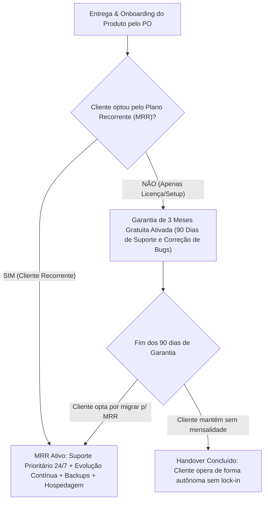

* **Diferenciação Clara entre os Modelos:**

| Dimensão | Garantia Gratuita de 3 Meses (Inclusa para TODOS) | Plano Recorrente Mensal (MRR) |
| :--- | :--- | :--- |
| **Custo** | **R$ 0,00** (Incluso no valor do projeto) | Mensalidade definida pelo Conselho (ex: R$ 99 a R$ 299/mês) |
| **Prazo** | 90 dias corridos a partir da entrega | Contrato contínuo enquanto ativo |
| **Cobertura de Bugs** | ✅ Correção prioritária de bugs, quebras de tela e falhas funcionais | ✅ Correção prioritária contínua e preventiva |
| **Dúvidas Operacionais** | ✅ Atendimento via WhatsApp para suporte e dúvidas da equipe | ✅ Canal VIP de suporte com SLA rápido |
| **Novas Funcionalidades** | ❌ Não inclui novas telas, campos ou regras não contratadas | ✅ Banco de horas para melhorias e novas telas contínuas |
| **Hospedagem & Domínio** | O cliente assume os custos diretos após onboarding ou mantém free tier | ✅ Hospedagem gerenciada, renovação de domínio e banco gerenciado |
| **Backups & Monitoramento** | Backups pontuais entregues no handover | ✅ Backups diários automatizados e monitoramento ativo 99.9% |

* **Missão do Sustaining Engineering Agent:**
  * Monitorar os chamados de garantia durante os 90 dias, assegurando satisfação máxima (NPS) e resolução ágil.
  * Atuar junto ao PO e ao CRO para demonstrar o valor gerado durante os 3 meses de garantia, convertendo o cliente de setup único em cliente recorrente de longo prazo.

---

## 6. Fluxo Detalhado Passo a Passo da Esteira

```text
[1. Mineração]
  │  Go Scraper + OpenCLI mineram o lead localmente
  ▼
[2. Prototipação Bespoke]
  │  taste-skill gera demo interativa -> Pre-flight testa assets -> Deploy na Vercel
  ▼
[3. Validação Humana 1-Clique]
  │  Notificação no Telegram -> João aprova a demo
  ▼
[4. Abordagem no WhatsApp]
  │  Sales Executive aborda com SPIN Selling e isca da demo pronta
  ▼
[5. Decisão Inicial do Cliente]
  ├── [NÃO] ────────► [Optimization Agent refina copy/catálogo para futuras tentativas]
  │
  └── [SIM] ────────► [PO Agent fecha escopo, regras e confirma 50% de sinal PIX]
                        │
                        ▼
                      [Architect cria Repositório Git Exclusivo & Blueprint Clean Architecture]
                        │
                        ▼
                      [Dev Team implementa via subagentes: Banco, Backend e Frontend]
                        │
                        ▼
                      [QA Agent executa testes automatizados (unitários, integração e E2E)]
                        │  (Loop de Feedback: falhas retornam ao Dev Team até 100% verde)
                        ▼
                      [Security Agent executa auditoria de código estático e Pentest em Staging]
                        │  (Loop de Feedback: vulnerabilidades retornam ao Dev Team até zero falhas)
                        ▼
                      [ETAPA CRÍTICA: Homologação pelo Cliente conduzida pelo PO Agent em Staging]
                        ├── [AJUSTES / INCONFORMIDADES]
                        │     │
                        │     ▼
                        │   [PO estrutura tickets de ajuste]
                        │     │
                        │     ▼
                        │   [Architect avalia impactos na arquitetura]
                        │     │
                        │     ▼
                        │   [Dev Team implementa correções]
                        │     │
                        │     ▼
                        │   [QA Agent re-testa suíte completa]
                        │     │
                        │     ▼
                        │   [Security Agent re-valida scans/pentest]
                        │     │
                        │     └──► (Retorna à Homologação com o Cliente)
                        │
                        └── [HOMOLOGADO COM SUCESSO PELO CLIENTE]
                              │
                              ▼
                            [PO Agent confirma o recebimento dos 50% restantes via PIX]
                              │
                              ▼
                            [Prod: Deploy final em produção com domínio próprio e SSL ativo]
                              │
                              ▼
                            [PO Agent conduz o Onboarding do Cliente no WhatsApp e Handover de Acessos]
                              │
                              ▼
                            [Ativação de Suporte]:
                              ├── [Garantia Incondicional de 3 Meses Gratuita (Inclusa para TODOS)]
                              │     │  (90 dias de suporte e resolução de bugs pelo Sustaining Eng.)
                              │     ▼
                              │   [Avaliação pós-90 dias para transição p/ MRR]
                              │
                              └── [Plano Recorrente MRR Ativado (Opcional)]
                                    │  (Suporte contínuo, evolução mensal, backups e SLA prioritário)
```

---

## 7. Modo de Calibragem: Execução Assistida e Pausada por Etapa

Para assegurar que a esteira opere com perfeição cirúrgica, sem queima desperdiçada de tokens, sem riscos à imagem da software house e sem disparos indevidos a clientes reais, instituímos o **Modo de Calibragem**.

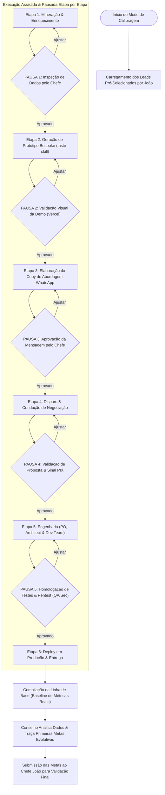

---

### 7.1 Regras de Operação da Calibragem

1. **Clientes Pré-Selecionados Estritamente por João:**
   * A esteira é terminantemente proibida de executar scraping aberto ou disparos autônomos para leads desconhecidos durante esta fase.
   * A operação roda **exclusivamente** sobre uma lista restrita de empresas/clientes pré-selecionados e validados pelo chefe João (ex: Stone Braids e outros negócios locais selecionados a dedo).

2. **Pausa Assistida Mandatória por Etapa:**
   * A esteira não avança automaticamente de uma fase para a outra.
   * Ao finalizar cada etapa, o agente responsável emite um relatório com o artefato produzido (ex: JSON de mineração, link da demo interativa na Vercel, texto da mensagem comercial, blueprint de arquitetura ou relatório de testes).
   * O sistema pausa a execução e aguarda a ordem explícita de João: `Avançar`, `Ajustar` ou `Abortar`.

3. **Coleta de Linha de Base (Baseline Telemetry):**
   * Durante a calibragem, a telemetria registra com precisão cirúrgica:
     * Quantidade real de tokens consumidos por etapa.
     * Tempo de ciclo necessário para produzir o protótipo e os códigos.
     * Reação e taxa de resposta do lead real ao protótipo visual.
     * Principais dúvidas ou objeções apresentadas na negociação.

4. **Elaboração das Metas Evolutivas pelo Conselho:**
   * Concluída a calibragem com os clientes piloto, o Conselho Administrativo reúne-se para processar os dados empíricos.
   * **Em vez de metas arbitrárias**, o Conselho formula as **primeiras metas evolutivas** da empresa:
     * Meta de conversão realista para o nicho testado.
     * Teto recomendado de gasto de tokens por contrato fechado.
     * Modelo de precificação dinâmico otimizado para lucro máximo.
     * Sugestões de melhorias nas ferramentas e prompts.
   * Essas metas são apresentadas a João no relatório formal de governança para sua aprovação.

---

## 8. Governança, Padrões de Código & Estratégia de Branches

### 8.1 Estratégia de Branches (Git Flow Adaptado para Agentes)

Para garantir rastreabilidade, estabilidade e isolamento total entre desenvolvimento e produção, todos os repositórios (tanto o da esteira quanto os repositórios exclusivos de clientes) devem seguir estritamente o modelo de branches abaixo:

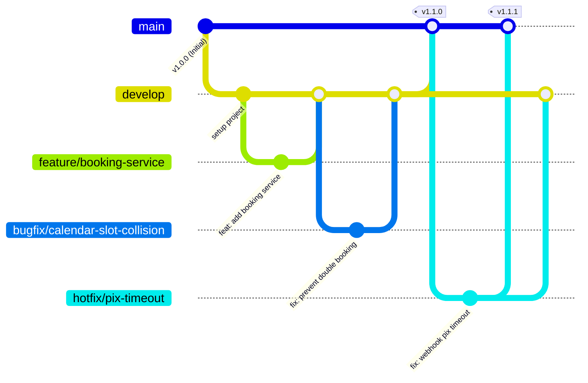

* **`master` (ou `main`):**
  * Branch sagrada de produção. Contém exclusivamente código estável, auditado pela Security e aprovado pelo QA.
  * Todo merge em `master` gera automaticamente uma tag de versão SemVer (`v1.0.0`, `v1.1.0`).
  * Bloqueada para commits diretos; merges exigem aprovação formal e CI 100% verde.
* **`develop`:**
  * Branch de integração e homologação contínua.
  * Onde os subagentes unem suas entregas para execução dos testes automatizados de QA e Security.
* **`feature/<nome-da-feature>`:**
  * Branches de trabalho atômicas criadas a partir de `develop`.
  * Utilizadas pelos subagentes de codificação para implementar casos de uso isolados (ex: `feature/pix-checkout`, `feature/service-catalog`).
  * Deletadas após o merge em `develop`.
* **`bugfix/<nome-do-bug>`:**
  * Branches para resolução de defeitos encontrados pelo QA durante o ciclo de homologação em `develop` (ex: `bugfix/slot-overlap-validation`).
* **`hotfix/<nome-da-correcao>`:**
  * Branches emergenciais criadas diretamente a partir de `master` para sanar incidentes críticos que estejam impactando a produção ativa do cliente (ex: `hotfix/webhook-pix-signature`).
  * Ao ser finalizada, o merge é feito obrigatoriamente tanto em `master` quanto em `develop`.

---

### 8.2 Padrão de Commits & Idioma Bimodal

* **Padrão de Mensagens de Commit (Conventional Commits):**
  * `feat:` nova funcionalidade para o usuário final.
  * `fix:` correção de bug ou comportamento inadequado.
  * `refactor:` alteração de código que não corrige bug nem adiciona funcionalidade.
  * `test:` adição ou correção de testes automatizados.
  * `security:` patches e melhorias de segurança.
  * `chore:` tarefas de manutenção de build, dependências ou configs.
* **Diretriz de Idioma Bimodal:**
  * **Interações Humanas (Chefe João, Clientes e Leads):** Estritamente em **Português do Brasil (pt-BR)**.
  * **Engenharia e Máquina (Código, APIs, Schemas Zod, Commits, Branches, Migrações e Docs Técnicas):** Estritamente em **Inglês internacional (en-US)**.


---

## 9. Critério Unificado de Testes para o Código da Própria Esteira (Dogfooding)

> **DIRETRIZ INVIOLÁVEL:**
> O código dos agentes da esteira (Mining, Demo Builder, Sales, QA, Security, etc.) **DEVE** ser submetido aos **mesmos critérios rigorosos** de teste e segurança que aplicamos aos projetos dos clientes. Não há dois padrões — um para clientes e outro para nós. O princípio é: **"se exigimos do cliente, exigimos de nós mesmos."**

### 9.1 Pipeline de Qualidade Unificada (Dogfooding Pipeline)

```mermaid
flowchart LR
    DEV_PUSH["Dev Push no Repo da Esteira"] --> LINT["Lint & Format (Prettier + ESLint)"]
    LINT --> TSC["TypeScript Strict Check (tsc --noEmit)"]
    TSC --> UNIT["Unit Tests (Vitest/Jest)"]
    UNIT --> INTEG["Integration Tests (Supertest + testcontainers)"]
    INTEG --> E2E["E2E Tests (Playwright)"]
    E2E --> COV{"Coverage >= 80%?"}
    COV -->|"No"| BLOCK_QA["❌ BLOCKED - Dev must add tests"]
    COV -->|"Yes"| SAST["SAST (Semgrep)"]
    SAST --> SECRETS["Secret Scan (Gitleaks + TruffleHog)"]
    SECRETS --> SCA["SCA (Snyk/Trivy)"]
    SCA --> DAST["DAST (OWASP ZAP on Staging)"]
    DAST --> PENTEST["Pentest (Nuclei + Schemathesis)"]
    PENTEST --> SEC_GATE{"Zero Critical/High?"}
    SEC_GATE -->|"No"| BLOCK_SEC["❌ BLOCKED - Dev must fix vulns"]
    SEC_GATE -->|"Yes"| DEPLOY["✅ Deploy Approved"]
```

### 9.2 Regras Detalhadas de Qualidade (Aplicadas Igualmente a Clientes e à Esteira)

| Critério | QA Agent Verifica | Security Agent Verifica | Threshold |
| :--- | :--- | :--- | :--- |
| **Cobertura de Testes** | ✅ | — | >= 80% (branches + statements) |
| **Zero Testes Flaky** | ✅ | — | 0 flaky tests em 3 execuções consecutivas |
| **Pirâmide de Testes Completa** | ✅ | — | Unitários + Integração + E2E (Playwright) |
| **Mocks de Pagamento** | ✅ | — | PIX e webhooks externos mockados (zero cobranças reais em teste) |
| **Mocks de Mensageria** | ✅ | — | WhatsApp e Telegram mockados (zero disparos reais em teste) |
| **TypeScript Strict** | ✅ | — | `strict: true`, `noImplicitAny`, zero erros tsc |
| **SAST (Semgrep)** | — | ✅ | Zero findings de severidade Error |
| **Secret Scanning** | — | ✅ | Zero secrets em todo histórico Git |
| **SCA (Dependências)** | — | ✅ | Zero CVEs Critical sem patch |
| **DAST (OWASP ZAP)** | — | ✅ | Zero alerts de risco High/Critical |
| **API Fuzzing (Schemathesis)** | — | ✅ | Zero server errors (5xx) em fuzzing |
| **Pentest (Nuclei)** | — | ✅ | Zero findings Critical/High confirmados |
| **RLS Supabase** | — | ✅ | Todas as tabelas com dados sensíveis protegidas |
| **Rate Limiting** | — | ✅ | Todos endpoints públicos com throttle configurado |
| **LGPD Compliance** | — | ✅ | PII sanitizada em logs, consentimento implementado |

### 9.3 Princípio de Responsabilidade Compartilhada

1. **QA Agent** é responsável pela **qualidade funcional**: testes passam, cobertura suficiente, zero flaky, comportamento correto.
2. **Security Agent** é responsável pela **qualidade de segurança**: zero vulnerabilidades, secrets protegidos, dependências atualizadas, compliance.
3. **Ambos** operam com loops de feedback ativo para o Dev Team via Agent Message Bus.
4. **Ambos** aplicam os **mesmos critérios** tanto para projetos de clientes quanto para o código interno da esteira.
5. **Nenhum código** chega a produção sem passar pelo gate duplo: QA ✅ **E** Security ✅.

---

## 10. Roteiro de Implementação por Grandes Marcos & Entregas Atômicas

Para garantir velocidade máxima de entrega com **custo zero de infraestrutura e economia absoluta de tokens**, o desenvolvimento da Esteira de Vendas e da Software House é dividido em **Grandes Marcos (Milestones)** decompostos em **Entregas Atômicas e Testáveis**.

> **Modelo Operacional de Desenvolvimento com Subagentes:**
> 1. **Execução pelos Subagentes:** As entregas de código são delegadas a subagentes leves e rápidos utilizando os modelos da API do Google (`gemini-3.5-flash` / `gemini-3.5-flash-lite`), operando com custo computacional mínimo.
> 2. **Validação Rigorosa pelo Antigravity:** O agente principal atua como Arquiteto e Validador de Qualidade (QA/Security gate), verificando se o código gerado atende estritamente à especificação, aos tipos TypeScript e às regras Clean Architecture.
> 3. **Comunicação com o Chefe por Grandes Marcos:** O chefe João é notificado apenas na conclusão e homologação de cada **Grande Marco**, mantendo o processo ágil e livre de micro-notificações desnecessárias.

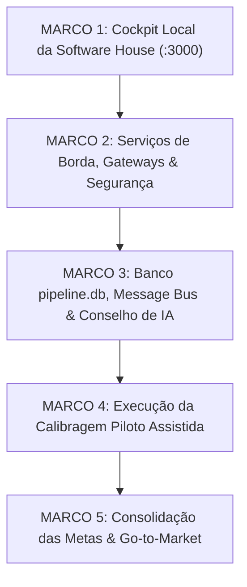

---

### 10.1 Marco 1: Cockpit Local da Software House (`/home/joao/projetos/esteira-de-vendas/cockpit/`)
* **Objetivo:** Construir a interface visual de comando para João administrar a empresa, cadastrar leads, gerenciar a calibragem passo a passo e calibrar o Conselho Executivo.
* **Entregas Atômicas:**
  * **Entrega 1.1 — Scaffold Next.js 15 & Design System:** Inicialização do Next.js App Router com Tailwind CSS, shadcn/ui, layout responsivo em tema escuro profissional e sidebar de navegação.
  * **Entrega 1.2 — Dashboard Financeiro, Lucro & Tokens:** Tela com cards de métricas (saldo em caixa, receita, margem de lucro, contador de tokens e baseline).
  * **Entrega 1.3 — Chat com o Conselho (Mesa Redonda + 1-a-1):** Interface de mensagens com badges coloridos por diretor (CEO dourado, CTO azul, CRO verde, COO roxo) operando com respostas em bloco via HTTP POST.
  * **Entrega 1.4 — Kanban Interativo da Calibragem:** Quadro visual com as etapas da esteira e botões de ação assistida (`Aprovar`, `Ajustar`, `Pausar`).
  * **Entrega 1.5 — Central de Cadastro de Leads & Status de APIs:** Formulário para inserção manual de leads piloto e painel visual de status de conexão das APIs (Groq, LLM, Asaas, Telegram).
  * **Entrega 1.6 — C-Suite Settings (Governança do Chefe):** Formulário de configuração de parâmetros do Conselho (dropdown de LLMs, slider de temperatura 0.0-1.0 e editor de prompt de diretrizes).
  * **Critério de Conclusão do Marco 1:** Front-end rodando localmente em `http://localhost:3000`, 100% navegável, com dados mockados e telas validadas por João.

---

### 10.2 Marco 2: Serviços de Borda, Gateways & Segurança Local
* **Objetivo:** Estabelecer a infraestrutura de mensageria, pagamentos e blindagem cibernética da máquina.
* **Entregas Atômicas:**
  * **Entrega 2.1 — Ingress Guardrail na Groq (`llama-guard-3-8b`):** Microsserviço de inspeção ultrarrápida (<150ms) para neutralizar prompt injections antes de tocar os agentes.
  * **Entrega 2.2 — WhatsApp Gateway Service (:3005):** Processo isolado encapsulando o Baileys com suporte a QR Code, persistência de sessão e humanizer (delays 3s-15s).
  * **Entrega 2.3 — Payment Gateway Service (:3006):** Integração com Asaas/Mercado Pago para geração de QR Code PIX dinâmico e webhook de liquidação instantânea.
  * **Critério de Conclusão do Marco 2:** Testes unitários e de integração verdes, PIX de teste gerado com sucesso e QR code do WhatsApp pronto para pareamento.

---

### 10.3 Marco 3: Persistência Local, Agent Message Bus & Conselho de IA
* **Objetivo:** Ativar a inteligência central e a comunicação entre os agentes da esteira.
* **Entregas Atômicas:**
  * **Entrega 3.1 — Schema SQLite (`pipeline.db`):** Tabelas `leads`, `conversations`, `events`, `council_agent_configs` e migrações limpas.
  * **Entrega 3.2 — Agent Message Bus:** Barramento de eventos assíncrono conectando o Cockpit, o Conselho e os agentes operacionais com tipagem estrita `AgentMessage`.
  * **Entrega 3.3 — Backend dos Agentes Executivos:** Engine que carrega os prompts e parâmetros do banco e executa as deliberações do CEO, CTO, CRO e COO.
  * **Critério de Conclusão do Marco 3:** Conversas reais com o Conselho respondendo no chat do Cockpit com os parâmetros salvos no banco.

---

### 10.4 Marco 4: Execução da Calibragem Piloto Assistida
* **Objetivo:** Rodar a esteira completa passo a passo para a lista de clientes pré-selecionados por João (ex: Stone Braids).
* **Entregas Atômicas:**
  * **Entrega 4.1 — Prototipação e Validação:** Geração da demo interativa sob medida e aprovação visual pelo chefe via Cockpit.
  * **Entrega 4.2 — Abordagem e Homologação:** Envio da copy no WhatsApp com delays humanizados, negociação e condução da homologação em staging pelo PO.
  * **Entrega 4.3 — Liquidação Financeira:** Confirmação do sinal de 50% e dos 50% finais via PIX dinâmico.
  * **Critério de Conclusão do Marco 4:** Primeiro ciclo de ponta a ponta concluído com sucesso e caixa positivo registrado no Cockpit.

---

### 10.5 Marco 5: Consolidação das Metas & Transição para Escala
* **Objetivo:** Compilar os dados reais de conversão e custo para traçar as metas evolutivas da empresa.
* **Entregas Atômicas:**
  * **Entrega 5.1 — Relatório da Linha de Base (Baseline):** Síntese empírica de tokens gastos, tempo de ciclo e faturamento obtido.
  * **Entrega 5.2 — Apresentação do Plano de Metas Evolutivas:** O Conselho submete a João o plano de metas para a próxima fase.
