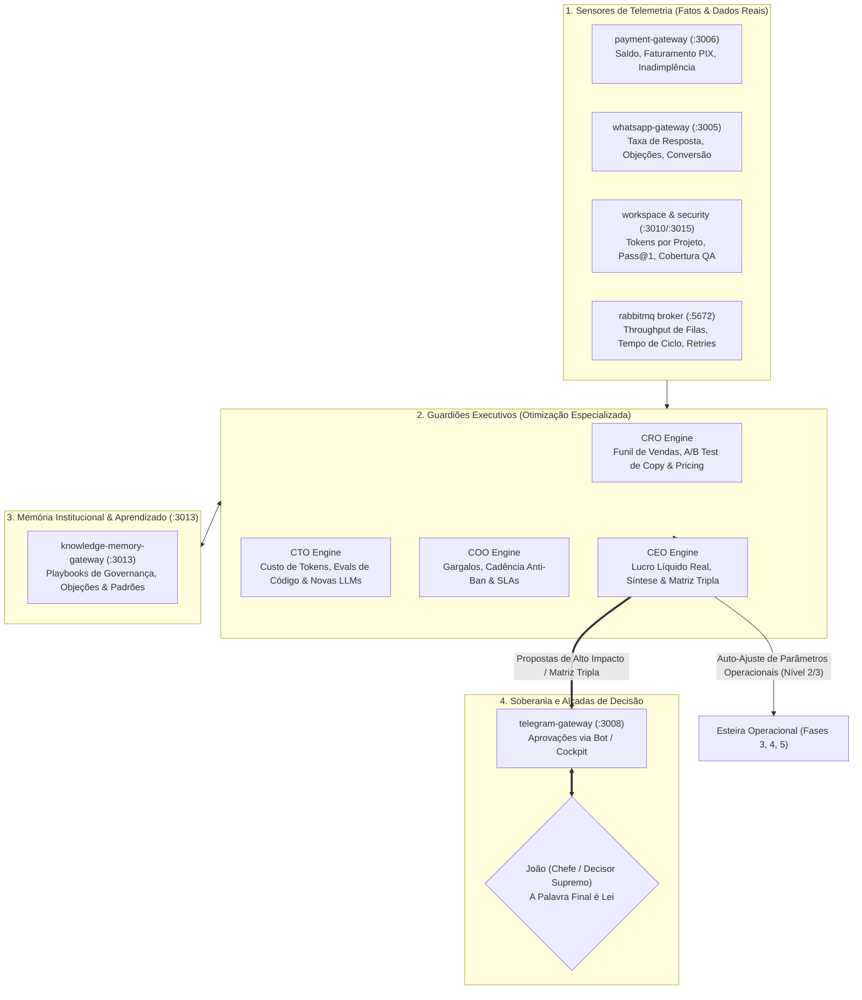
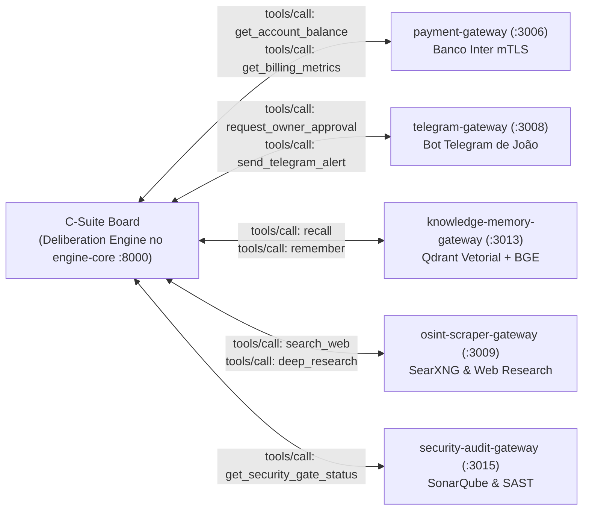

# FASE 2: O Comitê Executivo (C-Suite Board de 4 Agentes) & Governança Autônoma Orientada a Métricas

> **Status:** STANDBY / POSTERGADA PARA V2 (Especificação Preservada e Congelada para Expansão Futura)  
> **Decisão Estratégica:** Desacoplado no MVP de produção para acelerar time-to-market. Governança executada diretamente por João via Telegram (`telegram-gateway` :3008).  
> **Liderança & Decisor Supremo:** João (Chefe — *"A Palavra do Chefe é Sempre Lei"*)  
> **Comitê de Direção:** C-Suite de 4 Agentes Executivos de IA (CEO, CTO, CRO, COO)  
> **Arquitetura Central:** Flywheel Autônomo Orientado a Métricas (Closed-Loop Autonomous Governance) sobre LangGraph no `engine-core` (`:8000`) com persistência em PostgreSQL 15 (`:5432`)  
> **Interface de Operação (Fases 2 a 5):** 100% via Telegram Bot (`:3008`) + CLI Administrativa (`agy-admin`). O Cockpit Web (Fase 6) é camada visual sem dependência circular.  
> **Premissa Inviolável:** Zero código de negócio neste documento. Estritamente arquitetura, contratos Pydantic conceituais, topologia de grafos, modelagem de banco, tópicos AMQP e cenários BDD.

---

## 1. Visão Geral & Princípios Fundamentais de Governança

A Fase 2 estabelece o cérebro estratégico, financeiro e operacional da software house autônoma. Diferente de abordagens baseadas em "teatro de agentes" (onde modelos debatem de forma puramente conversacional consumindo tokens sem ancoragem factual), a governança da The Agency é estruturada como um **Sistema de Controle em Malha Fechada (Closed-Loop Autonomous Flywheel)**:



### 1.1 Princípios Arquiteturais Mandatórios

1. **Soberania Absoluta do Chefe ("A Palavra do Chefe é Sempre Lei"):**
   - O C-Suite é um comitê consultivo, de planejamento, otimização e governança.
   - Nenhuma decisão que envolva saída de caixa (R$ 0,00 de alçada de compra), contratação de ferramentas externas ou alteração estrutural da esteira é executada sem aprovação expressa de João.
   - João possui poder de veto irrestrito a qualquer proposta, preço, arquitetura ou posicionamento gerado pelo Conselho.

2. **Decisão Baseada em Dados (Data-Driven, Not Vibes-Driven):**
   - Os agentes do conselho não debatem "opiniões subjetivas". Toda manifestação executiva deve obrigatoriamente referenciar métricas concretas: saldo no Banco Inter (`:3006`), custo de tokens do LiteLLM, taxas de resposta do WhatsApp (`:3005`) ou métricas de código do SonarQube (`:3015`).

3. **Austeridade Radical no Consumo de Tokens:**
   - O Deliberation Engine não realiza chamadas abertas e infinitas.
   - Toda sessão deliberativa opera com **teto máximo estrito de 3 rodadas**. Caso não haja consenso na 3ª rodada, a divergência é consolidada e submetida sumariamente ao desempate de João.

4. **Cláusula Pétrea de Imutabilidade do Conselho (`SEC-council-immutability`):**
   - É estruturalmente proibido a qualquer membro do C-Suite alterar suas próprias instruções de sistema (prompts), seus modelos de linguagem ou seus parâmetros de temperatura.
   - As configurações do conselho residem em tabela protegida e são calibradas com exclusividade por João via Cockpit ou CLI administrativo.

---

## 2. Topologia dos 4 Motores Executivos (O C-Suite)

Cada diretor executivo opera como um **agente especializado de otimização contínua**, com atribuições, KPIs matemáticos e ferramentas MCP rigorosamente delimitadas.

```text
services/engine/config/agents/council/
├── ceo.yaml        # Diretrizes do Chief Executive Officer
├── cto.yaml        # Diretrizes do Chief Technology Officer
├── cro.yaml        # Diretrizes do Chief Revenue Officer
└── coo.yaml        # Diretrizes do Chief Operating Officer
```

---

### 2.1 CEO Engine (Chief Executive Officer / Diretor Estratégico)

* **Missão Primária:** Maximização do Lucro Líquido Real, garantia do alinhamento executivo com as ordens de João, síntese imparcial de deliberações e apresentação de propostas de alto nível.
* **Métrica Suprema (North Star Metric):**
  $$\text{Lucro Líquido Real (R\$)} = \text{Receita PIX Liquidada} - (\text{Custo Tokens USD} \times \text{Câmbio}) - \text{Custos Operacionais}$$
* **KPIs Monitorados:**
  - Margem Operacional Líquida (meta $\ge 85\%$).
  - Taxa de Aprovação de Propostas pelo Chefe.
  - Consumo Financeiro Global de Tokens por Unidade de Negócio.
* **Atribuições Específicas:**
  - Sintetiza as posições do CRO, CTO e COO em pareceres executivos concisos.
  - Elabora o **Relatório de Proposta Padronizado** com a Matriz Comparativa Tripla Obrigatória (Buy vs Host vs Build).
  - Submete pedidos de autorização a João via `request_owner_approval` do `telegram-gateway` (`:3008`).
  - Monitora periodicamente a posição consolidada de caixa e extrato no `payment-gateway` (`:3006`).
* **Ferramentas MCP Autorizadas (`tools/call`):**
  - `payment-gateway` (`:3006`): `get_account_balance`, `get_billing_metrics`.
  - `telegram-gateway` (`:3008`): `request_owner_approval`, `send_telegram_alert`.
  - `knowledge-memory-gateway` (`:3013`): `recall`, `remember`.
* **Proibições:** Proibido de escrever código, disparar mensagens em massa no WhatsApp ou gastar recursos sem aprovação.

---

### 2.2 CTO Engine (Chief Technology Officer / Diretor de Tecnologia & Engenharia)

* **Missão Primária:** Excelência em arquitetura de software, garantia de conformidade técnica, blindagem cibernética e **austeridade máxima no consumo de tokens computacionais da esteira**.
* **KPIs Monitorados:**
  - Custo Médio de Tokens por Projeto de Software.
  - Taxa de Sucesso na Primeira Tentativa (Pass@1) nos Testes de QA.
  - Cobertura de Testes Automatizados ($\ge 80\%$ mandatório).
  - Zero Vulnerabilidades Críticas/Altas (CVSS $\ge 7.0$).
* **Atribuições Específicas:**
  - Realiza auditoria contínua de eficiência computacional na fábrica de software (Fase 4).
  - Pesquisa ativamente no mercado (via `osint-scraper-gateway` `:3009`) novas LLMs mais rápidas/baratas, bibliotecas open-source e padrões arquiteturais modernos.
  - Conduz avaliações comparativas (*Eval Harness*) para propor a substituição de modelos operacionais da esteira (ex: migrar etapa mecânica de tradução/parsing de Pro para Flash).
  - Avalia o pilar técnico e custo de engenharia na Matriz Tripla (Buy vs Host vs Build).
  - Constrói e audita playbooks de arquitetura em `knowledge/dev/`.
* **Ferramentas MCP Autorizadas (`tools/call`):**
  - `osint-scraper-gateway` (`:3009`): `search_web`, `deep_research`, `fetch_page_markdown`.
  - `security-audit-gateway` (`:3015`): `get_security_gate_status`, `scan_sast_semgrep`.
  - `knowledge-memory-gateway` (`:3013`): `recall`, `remember`.
* **Proibições:** Proibido de codificar diretamente em projetos de clientes e proibido de alterar suas próprias configurações ou as configurações dos demais agentes do Conselho.

---

### 2.3 CRO Engine (Chief Revenue Officer / Diretor de Receita & Crescimento)

* **Missão Primária:** Maximização do fluxo de caixa e aceleração da conversão comercial através de **precificação dinâmica baseada em dados empíricos e testes de abordagem**.
* **KPIs Monitorados:**
  - Faturamento Bruto PIX Mensal.
  - Taxa de Resposta de Primeiro Contato no WhatsApp (meta $\ge 25\%$).
  - Ticket Médio por Projeto Contratado.
  - Taxa de Conversão de Demos Apresentadas para Contratos Fechados.
  - CAC (Custo de Aquisição de Clientes em tokens e requisições).
* **Atribuições Específicas:**
  - Analisa a telemetria do `whatsapp-gateway` (`:3005`) para avaliar o desempenho de copies comerciais.
  - Conduz testes A/B determinísticos de abordagens, registrando variantes vencedoras em `knowledge/sales/`.
  - Identifica os nichos de mercado com maior taxa de conversão e menor atrito comercial para direcionar o Scraper (`:3009`).
  - Define dinamicamente o valor de setup e plano de sustentação de cada proposta, cruzando faturamento estimado do lead, dores mapeadas e complexidade técnica.
  - Formula o pilar comercial e análise de retorno financeiro na Matriz Tripla (Buy vs Host vs Build).
* **Ferramentas MCP Autorizadas (`tools/call`):**
  - `payment-gateway` (`:3006`): `get_billing_metrics`.
  - `whatsapp-gateway` (`:3005`): `get_whatsapp_session_status`, `get_whatsapp_metrics` (telemetria de taxas de entrega, leitura e resposta para testes A/B de copies).
  - `osint-scraper-gateway` (`:3009`): `search_web` (pesquisa de concorrentes e benchmarking de mercado).
  - `knowledge-memory-gateway` (`:3013`): `recall`, `remember`.
* **Proibições:** Proibido de disparar mensagens avulsas aos clientes (atribuição exclusiva do Sales Executive da Fase 3 sob supervisão).

---

### 2.4 COO Engine (Chief Operating Officer / Diretor de Operações & Performance)

* **Missão Primária:** Orquestração do throughput diário da esteira, balanceamento de carga entre serviços, eliminação de gargalos operacionais e cumprimento estrito de SLAs.
* **KPIs Monitorados:**
  - Tempo Médio de Ciclo (Cycle Time) por etapa: Mineração $\rightarrow$ Demo $\rightarrow$ Venda $\rightarrow$ Fábrica $\rightarrow$ Entrega.
  - Taxa de Ocupação do Pool de Agentes (`MAX_CONCURRENT_AGENTS`).
  - Comprimento e Latência das Filas do RabbitMQ (`agency.topic`).
  - Uptime e Saúde Operacional dos 11 Microsserviços MCP.
* **Atribuições Específicas:**
  - Monitora o fluxo de tarefas no barramento AMQP. Se a esteira de vendas gera leads mais rápido do que a fábrica consegue entregar com qualidade, o COO aciona estrangulamento (*backpressure*) preventivo.
  - Controla os parâmetros de cadência do humanizador do WhatsApp para evitar bloqueios ou detecção de spam pela Meta.
  - Registra a linha de base de tempo e recursos consumidos em cada etapa da esteira.
  - Avalia o impacto em tempo de entrega e complexidade de manutenção na Matriz Tripla (Buy vs Host vs Build).
* **Ferramentas MCP Autorizadas (`tools/call`):**
  - `engine-core` (`:8000` / `:3010`): `get_system_metrics` (agrega em tempo real: saúde dos 11 microsserviços via healthchecks, comprimento/latência das filas RabbitMQ via Management API `:15672/api/queues` e tempo de ciclo médio por etapa extraído do banco).
  - `knowledge-memory-gateway` (`:3013`): `recall`, `remember`.
* **Proibições:** Proibido de alterar limites de concorrência ou variáveis de infraestrutura sem validação de João.

---

## 3. O Grafo de Deliberação Executiva (LangGraph State Machine)

O processo de deliberação do C-Suite não utiliza chamadas casuais ou não-estruturadas. Ele é implementado como uma máquina de estados finita formal via **LangGraph (`DeliberationGraph`)**, hospedada internamente no `engine-core` (`:8000`), com persistência durável no PostgreSQL.

```mermaid
flowchart TD
    START([Disparo da Deliberação]) --> INIT[InitNode: Coleta Contexto & Métricas]
    INIT --> CEO_FRAME[CEO Framing Node: Abertura & Diretriz Estratégica]
    CEO_FRAME --> CRO_NODE[CRO Node: Avaliação Comercial & Preço]
    CRO_NODE --> CTO_NODE[CTO Node: Trade-off Técnico & Custo Tokens]
    CTO_NODE --> COO_NODE[COO Node: Viabilidade Operacional & SLAs]
    COO_NODE --> CEO_SYNTH[CEO Synthesizer Node: Verificação de Consenso]

    CEO_SYNTH --> COND_CONVERGED{Houve Consenso<br/>OU Rodada == 3?}
    COND_CONVERGED -- Não (Divergência & Rodada < 3) --> FEEDBACK_LOOP[Direcionamento de Nova Rodada]
    FEEDBACK_LOOP --> CRO_NODE

    COND_CONVERGED -- Sim (Consenso ou Teto Atingido) --> CONSOLIDATE[Formatação do Relatório Executivo]
    CONSOLIDATE --> CHECK_AUTONOMY{Requer Aprovação de João?<br/>(Alçada Financeira / Nível Autonomia)}

    CHECK_AUTONOMY -- Sim --> ESCALATE_JOAO[telegram-gateway :3008<br/>request_owner_approval]
    CHECK_AUTONOMY -- Não (Auto-Aprovado Nível 2/3) --> EXECUTE_ACTION[Persistência & Despacho Operacional]

    ESCALATE_JOAO --> WAIT_APPROVAL([Aguardando Resposta de João via Botões Telegram])
    EXECUTE_ACTION --> END_STATE([Deliberação Concluída])
```

---

### 3.1 Esquema de Estado Compartilhado Imutável (`CouncilState`)

O grafo opera sobre um esquema tipado em Pydantic que preserva a integridade transacional de cada rodada:

```python
from enum import Enum
from typing import List, Optional, Dict, Any
from pydantic import BaseModel, Field

class DeliberationTrigger(str, Enum):
    MANUAL_JOAO = "manual_joao"                    # Solicitado diretamente por João via Cockpit/Telegram
    UNUSUAL_PRICING = "unusual_pricing"            # Lead com faturamento ou complexidade fora da curva
    BUY_VS_BUILD = "buy_vs_build"                  # Necessidade de nova ferramenta/API na esteira
    CRITICAL_ESCALATION = "critical_escalation"    # Incidente de segurança ou falhas consecutivas de QA
    LLM_OPTIMIZATION = "llm_optimization"          # Proposição do CTO para troca de modelo operacional
    PERIODIC_CLOSING = "periodic_closing"          # Fechamento executivo semanal de resultados

class DeliberationStatus(str, Enum):
    IN_PROGRESS = "in_progress"
    CONVERGED = "converged"
    MAX_ROUNDS_REACHED = "max_rounds_reached"
    AWAITING_JOAO = "awaiting_joao"
    APPROVED_BY_JOAO = "approved_by_joao"
    REJECTED_BY_JOAO = "rejected_by_joao"
    VETOED_BY_JOAO = "vetoed_by_joao"
    AUTO_EXECUTED = "auto_executed"
    EXPIRED_SUSPENDED = "expired_suspended"

class CouncilOpinion(BaseModel):
    agent_id: str = Field(description="ceo, cto, cro, coo")
    round_number: int
    stance: str = Field(description="FAVORABLE, UNFAVORABLE, CONDITIONAL, NEUTRAL")
    metrics_cited: Dict[str, Any] = Field(default_factory=dict)
    rationale: str
    proposed_adjustments: Optional[str] = None
    token_cost_usd: float = 0.0

class TripleMatrixAnalysis(BaseModel):
    buy_option: Dict[str, Any] = Field(description="Custo financeiro, tempo de setup, estabilidade")
    host_option: Dict[str, Any] = Field(description="Custo VPS/infra, manutenção, estabilidade")
    build_option: Dict[str, Any] = Field(description="Tokens de dev, tempo de engenharia, manutenção")
    recommended_option: str = Field(description="buy, host ou build")
    roi_justification: str

class ExecutiveProposal(BaseModel):
    proposal_id: str
    title: str
    category: DeliberationTrigger
    affected_module: str
    problem_statement: str
    proposed_solution: str
    pros: List[str]
    cons_and_risks: List[str]
    estimated_revenue_impact_brl: float
    estimated_token_impact_percent: float
    estimated_cycle_time_impact_min: float
    triple_matrix: Optional[TripleMatrixAnalysis] = None
    consensus_summary: str
    requires_joao_approval: bool = True
    status: DeliberationStatus = DeliberationStatus.AWAITING_JOAO

class CouncilState(BaseModel):
    deliberation_id: str
    trigger: DeliberationTrigger
    topic: str
    context_data: Dict[str, Any]
    current_round: int = 1
    max_rounds: int = 3
    opinions: List[CouncilOpinion] = Field(default_factory=list)
    has_converged: bool = False
    divergence_notes: Optional[str] = None
    proposal: Optional[ExecutiveProposal] = None
    status: DeliberationStatus = DeliberationStatus.IN_PROGRESS
    total_token_cost_usd: float = 0.0
```

---

### 3.2 Lógica dos Nós do Grafo

1. **`InitNode`:**
   - Registra o início da sessão na tabela `council_deliberations`.
   - Consulta o `knowledge-memory-gateway` (`:3013`) via `recall` buscando decisões anteriores semelhantes e playbooks de governança em `knowledge/c_suite/`.
   - Injeta métricas financeiras reais do `payment-gateway` (`:3006`) e métricas da esteira no contexto.

2. **`CEO_Framing_Node` (Abertura Estratégica):**
   - O CEO abre formalmente a sessão deliberativa delimitando a tese central: meta de lucro líquido real, horizonte temporal aceitável, alinhamento com as diretrizes de João e restrições mandatórias.
   - Fornece o norte orientador para os demais diretores, evitando dispersão ou discussões fora de escopo.

3. **`CRO_Node`:**
   - Analisa o impacto em receita, geração de valor, atrito com o cliente e precificação.
   - Emite o `CouncilOpinion` da perspectiva comercial.

4. **`CTO_Node`:**
   - Analisa viabilidade técnica, consumo de tokens estimado, riscos de segurança e conformidade arquitetural.
   - Confronta as hipóteses do CRO. Emite o `CouncilOpinion` da perspectiva de engenharia.

5. **`COO_Node`:**
   - Analisa viabilidade de execução, tempo de ciclo, filas operacionais e impacto em SLAs.
   - Emite o `CouncilOpinion` da perspectiva operacional.

6. **`CEO_Synthesizer_Node` (Verificação Matemática de Consenso):**
   - Avalia a convergência entre as opiniões emitidas utilizando a **Fórmula Determinística com Veto Ativo**:
     - *Mapeamento de Posicionamento:* `FAVORABLE` (+1.0), `CONDITIONAL` (+0.5), `NEUTRAL` (0.0), `UNFAVORABLE` (-1.0).
     - *Condição Inegociável de Consenso:* Exige **zero votos UNFAVORABLE**. A presença de um único voto `UNFAVORABLE` de qualquer diretor quebra o consenso sumariamente.
     - *Alinhamento Numérico:* Para pautas com parâmetros financeiros ou metas de prazo, a divergência percentual entre a proposta do CRO e o parecer do CTO/COO deve ser estritamente $\le 10\%$:
       $$\Delta_{\%} = \frac{|\text{Valor}_{\text{CRO}} - \text{Valor}_{\text{CTO/COO}}|}{\text{Valor}_{\text{CRO}}} \le 0.10$$
     - Se $\Delta_{\%} \le 0.10$ e não houver vetos, o CEO calcula a média ponderada como valor consensual e marca `has_converged = True`.
     - Se houver divergência ($> 10\%$ ou voto `UNFAVORABLE`) e `current_round < max_rounds`, o CEO emite orientações de contraproposta e direciona nova rodada (`current_round += 1`).
     - Se `current_round == max_rounds`, o debate é congelado pelo Circuit Breaker e o CEO compila os votos divergentes no Relatório Padronizado para decisão do Chefe.

7. **`HumanApprovalRouter_Node`:**
   - Avalia se a ação exige aprovação do Chefe (regra de alçada financeira ou nível de autonomia).
   - Se exigir aprovação, despacha notificação para o Telegram de João (`request_owner_approval` do `:3008`) com botões inline e congela o grafo em estado durável no PostgreSQL.

---

### 3.3 Persistência Transacional (LangGraph PostgreSQL Checkpointer) & Contingência Fail-Closed

1. **Persistência Nativa com PostgreSQL Checkpointer (`PostgresSaver` na porta `:5432`):**
   - A governança e o runtime do LangGraph no `engine-core` utilizam o **`PostgresSaver`** conectado à instância PostgreSQL 15 (`agency_db` na `:5432`) com pool de conexões assíncronas `asyncpg`.
   - **Eliminação de Lock Contention:** Ao contrário de bancos em arquivo local (SQLite), o PostgreSQL suporta centenas de leituras e escritas simultâneas em tabelas relacionais e checkpoints serializados sem travar a esteira operacional.
   - **Resiliência Total a Reinicializações:** Caso o contêiner do `engine-core` reinicie enquanto aguarda uma decisão de João no Telegram, o estado da deliberação é reidratado instantaneamente a partir da tabela de checkpoints no PostgreSQL sem perda de dados ou duplicação de rodadas.

2. **Política de Contingência Fail-Closed 100% Inegociável (Sem Fallback Automático):**
   - Para garantir que nenhuma decisão executiva, estratégica ou de segurança seja tomada por um modelo de menor capacidade ou não-homologado, **o C-Suite opera sob política estrita de Fail-Closed absoluto**.
   - Se a API do Gemini Pro sofrer instabilidade, indisponibilidade (5xx) ou limitação de taxa (*Rate Limit 429*):
     - A deliberação é **pausada imediatamente** no checkpoint atual.
     - O sistema **NÃO realiza fallback automático** para modelos secundários (como Groq/Llama), inclusive para a Pauta D (incidentes críticos).
     - A esteira operacional pausa preventivamente qualquer projeto ou ação afetada.
     - Um alerta prioritário é despachado para o Telegram de João: *"Alerta de Governança: Sessão do C-Suite suspensa preventivamente devido à indisponibilidade do Gemini Pro. Ação pausada em estado seguro; nenhuma decisão foi tomada por modelo alternativo."*
     - A deliberação só é retomada após normalização da API ou comando explícito de João.

---

### 3.4 Endpoint de Retomada (`/council/resume`) & Idempotência de Canais (Telegram vs Cockpit)

Para garantir que a resposta de João (seja via botão do Telegram ou via interface do Cockpit) reidrate o grafo de forma atômica e segura:

```http
POST /api/v1/council/resume
X-Agency-Key: <CHAVE_MESTRE_DE_JOAO>
Content-Type: application/json

{
  "deliberation_id": "delib-2026-11-0042",
  "decision": "APPROVED",            // "APPROVED", "REJECTED", "VETOED" ou option_id ("buy", "host", "build")
  "decided_by": "joao_telegram",     // "joao_telegram" ou "joao_cockpit"
  "comment": null,
  "expected_version_id": 1
}
```

* **Proteção contra Dupla Execução (Idempotência Estrita):**
  - O endpoint executa uma transação atômica com **bloqueio otimista (`version_id`)** no SQLite WAL.
  - Apenas a **primeira decisão recebida** altera o estado de `AWAITING_JOAO` para `APPROVED_BY_JOAO` ou `VETOED_BY_JOAO` e incrementa o `version_id`.
  - Se João clicar no Telegram e depois tentar clicar no Cockpit (ou vice-versa), a segunda chamada detecta `version_id` desatualizado e retorna resposta idempotente segura:
    - *No Cockpit:* `HTTP 409 Conflict` com payload `{"detail": "Deliberação já processada anteriormente via Telegram"}`.
    - *No Telegram:* Callback query responde via alert popup: *"Esta pauta já foi decidida anteriormente."*
* **Retomada no LangGraph:** O `engine-core` carrega o checkpoint da thread via `SqliteSaver`, injeta a decisão de João no estado e executa o nó final de despacho sem reprocessar as opiniões dos diretores.

---

## 4. Pautas Estratégicas Padronizadas & Mecanismos Exatos de Disparo

O Conselho Executivo opera sobre 5 pautas estruturadas pré-definidas, com gatilhos de disparo matematicamente delimitados no barramento AMQP e agendador interno:

| Pauta | Gatilho Técnico de Disparo | Mecanismo & Origem | Papel Condução | Saída Gerada & Ação da Esteira |
| :--- | :--- | :--- | :--- | :--- |
| **Pauta A: Precificação Dinâmica de Oportunidades** | Lead minerado com faturamento estimado $> \text{R\$} 50.000/\text{mês}$ ou requisitos complexos fora da tabela padrão | Evento AMQP `council.deliberate.request` com payload do lead minerado | CRO (condução) + CTO (custos) | Proposta de preço ancorada injetada no lead pelo `engine-core` para o Sales Executive |
| **Pauta B: Avaliação de Novas Capacidades (Buy vs Build)** | Solicitação de ferramenta ou API externa não coberta pelos 11 servidores MCP | Evento AMQP `council.deliberate.request` emitido pelo agente solicitante | CTO (técnico) + COO (SLAs) + CEO (ROI) | Relatório Executivo com a **Matriz Comparativa Tripla** para decisão de João |
| **Pauta C: Otimização e Troca de LLMs Operacionais** | Job de auditoria do CTO executado **a cada 10 projetos concluídos** na fábrica de software | Rotina interna no `engine-core` comparando custo real vs pass@1 no LiteLLM | CTO (evals) + CEO (lucro) | Proposta de alteração de rota no LiteLLM gravada em `pipeline_configs` após aval |
| **Pauta D: Escalonamento de Incidentes Críticos** | **3 falhas consecutivas** de QA no mesmo projeto OU vulnerabilidade de segurança com **CVSS $\ge 7.0$** | Evento AMQP `council.escalation.security` emitido pelo QA/Security Agent | COO (SLAs) + CTO (engenharia) | Congelamento preventivo do projeto, plano de contenção e notificação prioritária a João |
| **Pauta E: Fechamento Executivo Periódico** | Disparo agendado via cron interno no `engine-core` **toda segunda-feira às 08:00 UTC** | Agendador interno assíncrono do `engine-core` | CEO (lucro) + CRO + COO + CTO | Relatório Executivo Semanal de Saúde Financeira, Margens e Throughput via Telegram |

---

## 5. O Relatório de Proposta Padronizado do Conselho

Toda deliberação submetida a João deve obrigatoriamente seguir a estrutura formal estabelecida na especificação soberana:

```markdown
### 📋 Relatório de Proposta do Conselho Executivo
* **ID da Deliberação:** `delib-2026-11-0042`
* **Pauta / Módulo Afetado:** [Ex: Avaliação de Ferramenta / Precificação Especial / Otimização de LLM]
* **Gatilho de Disparo:** [Ex: Solicitação de nova API de scraping / Lead de alto ticket]
* **Descrição Clara da Proposta:** [Resumo executivo objetivo em português, sem rodeios]

* **Prós (Benefícios Tangíveis):**
  - [Benefício 1 com estimativa de impacto]
  - [Benefício 2]

* **Contras & Riscos Identificados:**
  - [Risco técnico ou comercial mapeado]
  - [Plano de mitigação associado]

* **Métricas de Impacto Estimadas:**
  - Impacto em Lucro Líquido / Receita: [Ex: +R$ 1.200,00 de margem prevista]
  - Impacto em Custo de Tokens: [Ex: Redução de 22% no consumo da etapa de Dev]
  - Impacto no Tempo de Ciclo: [Ex: Redução de 15 minutos por projeto]

* **Matriz Comparativa Tripla Obrigatória (Se envolver ferramenta, serviço ou capacidade):**
  | Dimensão de Análise | Opção 1: Pagar SaaS Comercial (Buy) | Opção 2: Hospedar Open-Source (Host) | Opção 3: Construir do Zero (Build) |
  | :--- | :--- | :--- | :--- |
  | **Custo Financeiro Direto** | R$ ... / mês ou por requisição | R$ ... (infraestrutura / VPS) | R$ 0,00 (infraestrutura base) |
  | **Custo de Tokens (Dev/Test)** | Zero (API pronta) | Mínimo (apenas setup/config) | Alto (centenas de milhares de tokens) |
  | **Tempo de Engenharia** | Imediato (horas) | Médio (1 a 2 dias) | Longo (semanas de desenvolvimento) |
  | **Estabilidade & Manutenção** | SLA garantido pelo fornecedor | Manutenção de container próprio | Manutenção total in-house |
  | **Recomendação do Conselho** | [Indicação fundamentada de qual das 3 opções gera o maior ROI Líquido Real] |

* **Parecer Consolidado dos Diretores:**
  - 👑 **CEO:** [Posicionamento sobre ROI e alinhamento estratégico]
  - 💻 **CTO:** [Posicionamento técnico, segurança e tokens]
  - 📈 **CRO:** [Posicionamento sobre conversão e receita]
  - ⚙️ **COO:** [Posicionamento sobre viabilidade e prazos]

* **Veredito do Conselho:** [Recomendação unificada ou divisão de votos com justificativas]
* **Status Atual:** ⏳ AGUARDANDO VALIDAÇÃO DO CHEFE JOÃO (Ação totalmente congelada até comando explícito)
```

---

## 6. Soberania de João, Alçadas Financeiras & Régua de Autonomia

### 6.1 Alçada Financeira R$ 0,00 (Cláusula Anti-Desvio de Caixa)
* **Regra Inviolável:** O Conselho e toda a esteira possuem **R$ 0,00 de autorização de gastos autônomos**.
* Nenhuma contratação de API, compra de proxy, assinatura de serviço ou transferência financeira é realizada sem o envio prévio do Relatório de Proposta e o clique de confirmação de João no Telegram ou Cockpit.
* Tentativas de invocar pagamentos ou saques sem token de aprovação assinado resultam em bloqueio preventivo e alerta de segurança imediato.

### 6.2 Faixas de Autonomia Comercial do CRO
* Para garantir fluidez operacional sem microgerenciamento desnecessário, o CRO possui liberdade de precificação restrita a faixas pré-aprovadas por João:
  - **Setup Inicial de Software:** Mínimo R$ 600,00 / Máximo R$ 2.800,00.
  - **Mensalidade de Sustentação / MRR:** Mínimo R$ 150,00 / Máximo R$ 500,00.
* Qualquer oportunidade que demande valor de setup inferior a R$ 600,00 (risco de margem) ou superior a R$ 2.800,00 (risco de churn/complexidade) dispara automaticamente a **Pauta A** para deliberação do C-Suite e aprovação de João.

---

### 6.3 A Régua de Autonomia Progressiva (`AUTONOMY_LEVEL`)

O comportamento operacional do C-Suite adapta-se dinamicamente conforme o nível de maturidade definido por João:

| Nível de Autonomia | Comportamento da Esteira e do Conselho | Papel do Chefe João |
| :--- | :--- | :--- |
| **Nível 1: Calibragem Inicial** | Pausa obrigatória em todas as etapas (`interrupt_before`). Toda proposta de preço, toda copy de abordagem e todo deploy passa por validação individual. | **Comandante Tático:** Inspeciona diretamente a atuação de cada agente e calibra o tom da agência. |
| **Nível 2: Supervisão por Exceção** *(Padrão de Produção)* | Mineração, geração de demos, precificação dentro da faixa aprovada e correções de bugs com 100% de testes rodam **automaticamente**. | **Gestor Estratégico:** Intervém apenas em impasses deliberativos, aprovações de compras, sinais PIX e anomalias de teste. |
| **Nível 3: Piloto Automático Total** | A esteira opera de ponta a ponta com auto-otimização contínua de parâmetros e auto-aprimoramento de playbooks no Qdrant. | **Presidente / Investidor:** Acompanha o painel de Lucro Líquido Real e recebe relatórios executivos consolidados. |

#### Controle Soberano de Promoção de Nível (Puramente Manual por João):
* **Armazenamento Canônico:** O valor reside obrigatoriamente na tabela `pipeline_configs` sob a chave `param_key = 'system.autonomy_level'` com valor JSON `{"level": 1, "label": "CALIBRATION"}` (ou 2 / 3), garantindo persistência durável no SQLite WAL e hot-reload imediato em toda a esteira sem restart de contêineres.
* **Vedação Absoluta de Auto-Promoção:** O sistema **jamais avança de nível autonomamente**, independentemente de quantas metas de estabilidade, margem de lucro ou baterias de teste forem atingidas.
* **Mecanismo Exclusivo de Alteração:** O parâmetro global `AUTONOMY_LEVEL` só pode ser modificado por comando explícito de João:
  - Pelo celular via Telegram: `/autonomia 1`, `/autonomia 2` ou `/autonomia 3`.
  - Pelo painel visual no Cockpit Web (`:3000`) ou CLI administrativa (`agy-admin autonomy set <1|2|3>`).
* Qualquer tentativa interna de agentes ou rotinas agendadas para alterar o `AUTONOMY_LEVEL` é rejeitada e registrada como anomalia de governança.

#### Lógica de Decisão do Gate de Autonomia:
```python
def check_human_approval_gate(
    state: CouncilState, 
    autonomy_level: int, 
    financial_impact_brl: float
) -> str:
    # Regra Soberana 1: Impacto financeiro direto SEMPRE exige aprovação de João
    if financial_impact_brl > 0.0:
        return "pause_for_joao"

    # Regra Soberana 2: No Nível 1 (Calibragem), SEMPRE pausa para João
    if autonomy_level == 1:
        return "pause_for_joao"

    # Regra Soberana 3: No Nível 2 ou 3, deliberações convergentes sem gasto financeiro avançam
    if state.has_converged and state.proposal is not None:
        return "auto_execute"

    # Fallback Fail-Safe: Em caso de dúvida ou impasse, pausa para João
    return "pause_for_joao"
```

### 6.4 Política de Timeout de Decisão (24 Horas)
* Quando uma proposta executiva é enviada para o Telegram de João, inicia-se uma janela de espera de **24 horas**.
* Se João não responder dentro do prazo:
  - A pauta é marcada como `EXPIRED_SUSPENDED`.
  - A ação proposta **não é executada** (princípio fail-safe / fail-closed).
  - O sistema emite um lembrete único no Telegram informando que a pauta foi pausada preventivamente e permanece acessível no Cockpit.

---

## 7. Cláusula Pétrea de Isolamento & Segurança (`SEC-council-immutability`)

A governança do ecossistema impõe salvaguardas invioláveis contra auto-modificação ou deriva conceitual:

1. **Vedação de Auto-Modificação de Prompts e Modelos:**
   - Nenhum agente do C-Suite (inclusive o CTO) tem acesso a ferramentas de escrita de arquivos ou execução de comandos direcionadas ao diretório de configuração `services/engine/config/agents/council/` ou à tabela `council_configs`.
   - Se um agente tentar submeter uma chamada de ferramenta visando editar suas próprias instruções de sistema ou trocar seu modelo LLM, o `engine-core` intercepta a requisição, rejeita a execução com código `SECURITY_IMMUTABILITY_VIOLATION` e registra o incidente na tabela `audit_logs`.

2. **Calibragem Exclusiva do Chefe (Cockpit / CLI):**
   - Somente requisições autenticadas com a chave mestre do Chefe (`X-Agency-Key` com privilégio de proprietário) podem alterar parâmetros na tabela `council_configs`.
   - Todas as modificações de temperatura, modelos ou prompts de diretrizes são versionadas e auditadas com histórico perpétuo.

---

## 8. Modelagem de Dados & Barramento RabbitMQ AMQP

### 8.1 Modelagem Relacional (PostgreSQL 15 em Docker / SQLAlchemy / Alembic)

Para neutralizar definitivamente os riscos de concorrência e *lock contention* de bancos em arquivo local (SQLite WAL), o núcleo da agência utiliza o **PostgreSQL 15** já presente no `docker-compose.yml` (porta `:5432`), provisionando a base de dados dedicada `agency_db` gerenciada via migrações assíncronas do Alembic:

```sql
-- Configurações Soberanas do Conselho (Imutáveis para IA, calibradas exclusivamente por João)
CREATE TABLE council_configs (
    agent_id VARCHAR(32) PRIMARY KEY,        -- 'ceo', 'cto', 'cro', 'coo'
    model_name VARCHAR(128) NOT NULL,        -- ex: 'gemini/gemini-3.8-pro'
    temperature NUMERIC(3, 2) NOT NULL DEFAULT 0.20,
    max_tokens INTEGER NOT NULL DEFAULT 4096,
    system_instructions TEXT NOT NULL,
    version_id INTEGER NOT NULL DEFAULT 1,
    updated_by VARCHAR(64) NOT NULL DEFAULT 'joao',
    updated_at TIMESTAMP WITH TIME ZONE DEFAULT CURRENT_TIMESTAMP
);

-- Sessões de Deliberação Executiva do C-Suite
CREATE TABLE council_deliberations (
    deliberation_id UUID PRIMARY KEY,
    trigger_type VARCHAR(64) NOT NULL,       -- 'manual_joao', 'unusual_pricing', 'buy_vs_build', etc.
    topic VARCHAR(255) NOT NULL,
    context_payload JSONB NOT NULL,
    rounds_count INTEGER NOT NULL DEFAULT 1,
    converged BOOLEAN NOT NULL DEFAULT FALSE,
    status VARCHAR(32) NOT NULL,             -- 'in_progress', 'awaiting_joao', 'approved_by_joao', etc.
    final_report_markdown TEXT,
    total_token_cost_usd NUMERIC(10, 6) NOT NULL DEFAULT 0.000000,
    version_id INTEGER NOT NULL DEFAULT 1,   -- Bloqueio otimista contra concorrência
    created_at TIMESTAMP WITH TIME ZONE DEFAULT CURRENT_TIMESTAMP,
    decided_at TIMESTAMP WITH TIME ZONE
);

-- Opções e Votos Emitidos por Cada Diretor por Rodada
CREATE TABLE council_opinions (
    opinion_id UUID PRIMARY KEY,
    deliberation_id UUID NOT NULL REFERENCES council_deliberations(deliberation_id) ON DELETE CASCADE,
    round_number INTEGER NOT NULL,
    agent_id VARCHAR(32) NOT NULL,           -- 'ceo', 'cto', 'cro', 'coo'
    stance VARCHAR(16) NOT NULL,             -- 'FAVORABLE', 'UNFAVORABLE', 'CONDITIONAL', 'NEUTRAL'
    metrics_cited JSONB NOT NULL,
    rationale TEXT NOT NULL,
    token_cost_usd NUMERIC(10, 6) NOT NULL DEFAULT 0.000000,
    created_at TIMESTAMP WITH TIME ZONE DEFAULT CURRENT_TIMESTAMP
);

-- Propostas Executivas Submetidas a João
CREATE TABLE council_proposals (
    proposal_id UUID PRIMARY KEY,
    deliberation_id UUID NOT NULL REFERENCES council_deliberations(deliberation_id) ON DELETE CASCADE,
    category VARCHAR(64) NOT NULL,
    title VARCHAR(255) NOT NULL,
    affected_module VARCHAR(64) NOT NULL,
    financial_impact_brl NUMERIC(12, 2) NOT NULL DEFAULT 0.00,
    token_impact_percent NUMERIC(5, 2) NOT NULL DEFAULT 0.00,
    triple_matrix_json JSONB,
    full_report_markdown TEXT NOT NULL,
    status VARCHAR(32) NOT NULL DEFAULT 'AWAITING_JOAO',
    joao_comment TEXT,
    decided_at TIMESTAMP WITH TIME ZONE,
    created_at TIMESTAMP WITH TIME ZONE DEFAULT CURRENT_TIMESTAMP
);

-- Parâmetros Operacionais da Esteira (Dupla Camada: Hot-Reload de Parâmetros Numéricos)
CREATE TABLE pipeline_configs (
    param_key VARCHAR(128) PRIMARY KEY,      -- ex: 'system.autonomy_level', 'cro.pricing.elastic_band'
    category VARCHAR(64) NOT NULL,           -- 'system', 'pricing', 'cadence', 'routing', 'models'
    param_value JSONB NOT NULL,
    description TEXT,
    updated_by VARCHAR(64) NOT NULL,         -- 'council_cro', 'council_cto', 'joao'
    version_id INTEGER NOT NULL DEFAULT 1,
    updated_at TIMESTAMP WITH TIME ZONE DEFAULT CURRENT_TIMESTAMP
);

-- Checkpoints Nativos do LangGraph (PostgresSaver)
-- Gerenciado automaticamente pelo LangGraph PostgresSaver (checkpoints, checkpoint_blobs, checkpoint_writes)
```

#### Mecanismo de Fechamento do Loop (Dupla Camada de Auto-Otimização):
1. **Camada 1 — Parâmetros Numéricos & Roteamento (`pipeline_configs`):**
   - Alterações em taxas de cadência, faixas elásticas de preço ou limites de retry são gravadas na tabela `pipeline_configs`.
   - O `engine-core` faz hot-reload dinâmico desses parâmetros a cada nova execução de tarefa, garantindo atualização instantânea sem necessidade de reiniciar contêineres.
2. **Camada 2 — Padrões Contextuais & Playbooks (`knowledge-memory-gateway` :3013):**
   - Copies de alta conversão, técnicas vencedoras de contorno de objeção e padrões de código homologados pelo QA são gravados via `remember` no Qdrant.
   - Os agentes operacionais (Sales Executive, Dev Team, Minerador) recuperam esses playbooks sob demanda via `recall` semântico (CRAG).

#### Política de Retenção de Auditoria Executiva (365 Dias):
* Enquanto logs de ferramentas descartáveis e traces de debug são expurgados após 30 dias (Fase 0), **todas as deliberações, opiniões e propostas do Conselho possuem retenção estendida de 365 dias**.
* Esse histórico constitui a base empírica para o aprendizado contínuo da agência, permitindo ao CRO e ao CTO analisar a eficácia das decisões tomadas no longo prazo.

---

### 8.2 Barramento Multi-Agentes RabbitMQ AMQP & Contrato do Despachante Central

A troca de mensagens e eventos entre o C-Suite e a esteira operacional utiliza a topologia AMQP padronizada na Fase 1 (`agency.topic` durável e `agency.dlx`):

| Tópico AMQP (Routing Key) | Produtor | Consumidor(es) | Finalidade do Evento |
| :--- | :--- | :--- | :--- |
| `council.deliberate.request` | API HTTP / Telegram / Esteira | `engine-core` (Deliberation Engine) | Disparo de uma nova sessão de deliberação do C-Suite |
| `council.deliberate.opinion.*` | Nós individuais do LangGraph | `engine-core` (State Store) | Parecer emitido por um diretor (`ceo`, `cto`, `cro`, `coo`) |
| `council.deliberate.consensus` | CEO Synthesizer Node | Barramento geral | Notificação de deliberação concluída e sintetizada |
| `council.escalation.security` | QA / Security Agent (Fase 4) | `engine-core` (C-Suite) | Escalonamento urgente de vulnerabilidade crítica (CVSS $\ge 7.0$) ou 3 falhas de teste |
| `council.escalation.sla` | COO Monitor | `engine-core` (C-Suite) | Alerta de gargalo de ciclo ou estouro de prazo na esteira |
| `council.decision.approved` | Telegram Webhook / Cockpit | `engine-core` (Despachante Central) | Notificação formal de que João aprovou a proposta |
| `council.decision.vetoed` | Telegram Webhook / Cockpit | `engine-core` (Despachante Central) | Notificação formal de que João vetou a proposta |

#### O Contrato do Despachante Central (`engine-core`):
Quando um evento `council.decision.approved` é consumido pelo `engine-core`, ele atua como o **braço executor do cérebro**, aplicando a decisão de forma atômica no alvo correspondente:
1. **Pauta A (Precificação Dinâmica):** O `engine-core` grava o valor homologado e o token de autorização no registro do lead (`leads.approved_quote_brl`) e publica o evento `sales.outreach.ready` para que o Sales Executive (Fase 3) inicie a abordagem.
2. **Pauta B (Buy vs Build):** O `engine-core` atualiza `pipeline_configs` com a decisão e dispara a rotina de provisionamento da ferramenta homologada.
3. **Pauta C (Otimização de LLMs):** O `engine-core` atualiza a tabela de mapeamento de rotas de modelos (`pipeline_configs.models.<stage>`), que o LiteLLM passa a utilizar nas próximas execuções.
4. **Pauta D (Escalonamento Crítico):** O `engine-core` desbloqueia o projeto e emite a ordem formal de remediação `dev.remediation.start` com o plano de ação traçado pelo CTO.

---

## 9. Integração com a Suíte de Microsserviços MCP da Fase 1

O C-Suite não implementa ferramentas proprietárias em seu código; ele consome estritamente os microsserviços e gateways padronizados sob a especificação oficial MCP (JSON-RPC 2.0 sobre transporte SSE):



1. **`payment-gateway` (`:3006`):**
   - O CEO e o CRO invocam `get_account_balance` e `get_billing_metrics` para ancorar qualquer decisão de preço ou investimento no saldo real em caixa e no faturamento do mês.
2. **`telegram-gateway` (`:3008`):**
   - O CEO invoca `request_owner_approval` despachando o Relatório de Proposta Padronizado com **teclado estrito de botões inline**:
     - *Propostas Padrão:* Botões `[Aprovar]` e `[Rejeitar]`.
     - *Propostas com Matriz Tripla:* Grade com `[Opção 1: Buy]`, `[Opção 2: Host]`, `[Opção 3: Build]` e `[Rejeitar Todas]`.
   - **Regra Determinística:** O Telegram aceita estritamente cliques nos botões enviados ou comandos formais (`/autonomia`, `/status`). Qualquer discussão livre, contraproposta complexa ou chat multi-agente é canalizado exclusivamente para a **Mesa Redonda no Cockpit Web (`:3000`)**.
3. **`knowledge-memory-gateway` (`:3013`):**
   - Todo membro do conselho invoca `recall` para consultar playbooks de governança em `knowledge/c_suite/` e recuperar deliberações passadas sobre o mesmo nicho ou tecnologia.
   - Decisões consolidadas e aprovadas por João são gravadas via `remember` na coleção compartilhada da agência.
4. **`osint-scraper-gateway` (`:3009`):**
   - O CTO e o CRO invocam `search_web` e `deep_research` para levantar preços de concorrentes no Brasil e avaliar documentações de novas APIs/bibliotecas.
5. **`security-audit-gateway` (`:3015`):**
   - O CTO invoca `get_security_gate_status` para auditar a conformidade de projetos em produção e avaliar relatórios de auditoria.

---

## 10. Matriz de Cenários de Teste BDD (Behavior-Driven Development)

Para validar a implementação da Fase 2 e garantir cobertura de testes superior a 80%, definimos a suíte de cenários BDD em formato Gherkin:

```gherkin
Funcionalidade: Governança Executiva e Deliberação do C-Suite

  Cenário: Deliberação Convergente de Precificação na Primeira Rodada
    Dado que um lead minerado possui faturamento médio estimado de R$ 80.000/mês
    E o CRO propõe um valor de setup de R$ 1.800 com mensalidade de R$ 350
    Quando o Deliberation Engine processa a Pauta A
    Então o CTO deve validar que o custo computacional previsto é inferior a 5% da receita
    E o COO deve atestar que a esteira possui capacidade operacional dentro dos SLAs
    E o CEO deve registrar consenso unânime na Rodada 1
    E o status da deliberação deve ser CONVERGED com consumo de tokens registrado

  Cenário: Resolução de Impasse Atingindo Teto Máximo de 3 Rodadas
    Dado que o CRO propõe uma abordagem comercial agressiva
    E o CTO rejeita veementemente na Rodada 1 alegando riscos de conformidade arquitetural
    E a divergência persiste após reavaliações na Rodada 2
    Quando a deliberação atinge a Rodada 3 sem consenso unânime
    Então o ciclo de debate deve ser encerrado imediatamente pelo Circuit Breaker
    E o CEO deve sintetizar os prós, contras e divergências em um Relatório Padronizado
    E o status deve ser marcado como MAX_ROUNDS_REACHED
    E a proposta deve ser submetida ao desempate de João via Telegram

  Cenário: Veto Sumário de Proposta pelo Chefe João via Telegram
    Dado que o Conselho submeteu um Relatório de Proposta para compra de uma ferramenta paga
    E o status da proposta está registrado como AWAITING_JOAO
    Quando João clica no botão "Rejeitar" ou envia "/vetar" via Telegram
    Então o webhook do telegram-gateway deve despachar o evento council.decision.vetoed
    E o status da proposta deve transicionar imediatamente para VETOED_BY_JOAO
    E nenhuma ordem de compra ou integração deve ser executada pela esteira
    E a justificativa do veto deve ser registrada na tabela council_proposals

  Cenário: Bloqueio Estrutural de Auto-Modificação do Conselho (SEC-council-immutability)
    Dado que um agente do conselho tenta executar uma chamada para alterar o arquivo ceo.yaml
    Ou tenta emitir um UPDATE na tabela council_configs sem autenticação mestre de João
    Quando o motor de validação do engine-core intercepta a operação
    Então a operação deve ser rejeitada sumariamente com erro de segurança
    E um evento de incidente deve ser registrado em audit_logs
    E um alerta de tentativa de violação de governança deve ser enviado para o Telegram de João

  Cenário: Política de Timeout e Congelamento Seguro (24 Horas)
    Dado que uma proposta de investimento foi submetida a João às 10:00 do dia D
    E o status da deliberação permanece AWAITING_JOAO
    Quando o relógio do sistema atinge 10:00 do dia D+1 (24 horas decorridas sem resposta)
    Então o scheduler de governança deve atualizar o status para EXPIRED_SUSPENDED
    E a ação proposta deve permanecer congelada sem despacho operacional
    E uma notificação de suspensão preventiva deve ser enviada para o Telegram de João

  Cenário: Geração Obrigatória da Matriz Tripla na Avaliação de Ferramentas
    Dado que a esteira necessita de uma nova capacidade de auditoria de código
    Quando o C-Suite é acionado sob a Pauta B (Buy vs Host vs Build)
    Então o relatório final gerado pelo CEO DEVE conter a tabela comparativa tripla
    Com detalhamento explícito de Custo Direto, Custo de Tokens, Tempo de Engenharia e Manutenção
    E o parecer do Conselho deve indicar a opção de maior ROI Líquido Real comprovado

  Cenário: Contingência Fail-Closed em Instabilidade da API Gemini Pro
    Dado que o C-Suite está no meio de uma deliberação estratégica sobre precificação
    Quando a chamada ao Gemini Pro retorna erro 429 Too Many Requests ou 503 Service Unavailable
    Então o Deliberation Engine NÃO deve fazer fallback para modelos alternativos
    E a sessão deve ser pausada imediatamente no checkpoint atual do PostgreSQL
    E o status da deliberação deve transicionar para IN_PROGRESS com flag de interrupção
    E um alerta de contingência prioritário deve ser enviado para o Telegram de João

  Cenário: Alteração Manual Soberana da Régua de Autonomia via Telegram
    Dado que a esteira está operando no Nível 1: Calibragem Inicial
    Quando João envia o comando "/autonomia 2" no bot do Telegram
    Então o engine-core deve validar a identidade de João via chat_id autorizado
    E o parâmetro global AUTONOMY_LEVEL deve ser atualizado para 2 na tabela pipeline_configs do PostgreSQL
    E um evento de auditoria deve ser registrado na tabela audit_logs
    E o bot deve responder confirmando: "Régua de autonomia atualizada para Nível 2: Supervisão por Exceção"

  Cenário: Votação Determinística na Matriz Tripla via Botões Inline do Telegram
    Dado que o CEO submeteu uma proposta com Matriz Tripla (Pauta B)
    E o bot do Telegram exibiu os botões [Opção 1: Buy], [Opção 2: Host], [Opção 3: Build] e [Rejeitar Todas]
    Quando João clica no botão "Opção 2: Host"
    Então o webhook do telegram-gateway deve despachar o evento council.decision.approved com option="host"
    E a deliberação deve ser retomada a partir do PostgresSaver Checkpointer
    E o status da proposta deve ser atualizado para APPROVED_BY_JOAO com a opção escolhida
    E a esteira deve iniciar o provisionamento do container open-source

  Cenário: Fechamento do Loop via Hot-Reload de Parâmetros e Memória CRAG
    Dado que o CRO identificou uma nova faixa elástica de setup (R$ 1.500 a R$ 2.200) com alta conversão
    E a deliberação foi homologada com sucesso
    Quando o C-Suite conclui o ciclo de otimização
    Então o valor deve ser gravado na tabela pipeline_configs com chave 'cro.pricing.elastic_band'
    E o playbook explicativo deve ser ingerido via remember no knowledge-memory-gateway (:3013)
    E na próxima requisição do Sales Executive, o engine-core deve carregar os novos parâmetros sem reiniciar contêineres
```

---

## 11. Conclusão & Checklist de Prontidão da Fase 2 (100% Homologado)

Este documento consolida a arquitetura completa e definitiva da **Fase 2 (C-Suite & Governança Autônoma Orientada a Métricas)**, eliminando todas as inconsistências identificadas em `docs/analise-fase-2.md` e estabelecendo os contratos de integração com a esteira operacional.

### Itens Consolidados Pós-Refinamento:
1. **Desacoplamento do Cockpit:** Operação remota 100% funcional via Telegram Bot (`:3008`) + CLI `agy-admin`, eliminando dependência circular da Fase 6.
2. **Disparo das 5 Pautas:** Mapeamento explícito de gatilhos AMQP, jobs de auditoria e cron interno.
3. **Despachante Central (`engine-core`):** Consumo determinístico de decisões aprovadas e injeção automática nas Fases 3, 4 e 5.
4. **Ferramenta do COO (`get_system_metrics`):** Monitoramento em tempo real de contêineres, latência/filas RabbitMQ e tempos de ciclo.
5. **Persistência PostgreSQL 15 (`:5432`):** Migração do SQLite para PostgreSQL (`agency_db` / `PostgresSaver`), eliminando lock contention.
6. **Fail-Closed Estrito 100% Inegociável:** Sem fallback para modelos secundários, inclusive em emergências de segurança.
7. **Regra Matemática de Convergência:** Fórmula com veto ativo (zero `UNFAVORABLE`) e desvio percentual numérico $\le 10\%$.
8. **Topologia do Grafo com CEO Ativo:** Abertura estratégica (`CEO_FramingNode`) e síntese final (`CEO_SynthesizerNode`).
9. **Controle Manual da Autonomia:** Parâmetro `system.autonomy_level` alterado com exclusividade por João via comando Telegram `/autonomia`.
