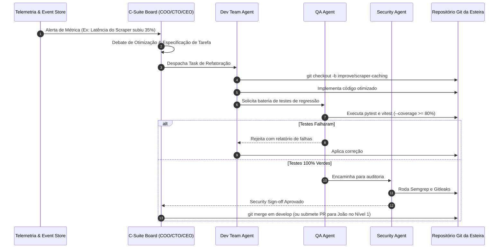

# ⚙️ Especificação Técnica Preliminar: FASE 4 — Fábrica de Software & Blindagem Cibernética

> **Status:** Rascunho / Conceitos Preservados da Fase 0 (Aguardando destrinchamento completo na Fase 4)

---

## 1. Mecanismo de Auto-Aprimoramento Contínuo (Self-Improvement Loop)

O Conselho Executivo possui autoridade para inspecionar métricas e implementar melhorias no próprio código da esteira via **Autonomous Git Flow**:



### Regras de Ouro do Self-Improvement:
1. **Zero Edição Direta em Produção:** Nenhum agente pode editar arquivos na branch `main` ou no ambiente ativo sem passar por branch isolada e testes.
2. **Suíte de Testes Inviolável:** Uma melhoria é sumariamente rejeitada/revertida se quebrar qualquer teste existente ou se a cobertura cair abaixo de 80%.
3. **Rollback Automático:** Caso um serviço apresente erro HTTP 500 ou falhe após merge, o sistema executa `git revert HEAD` automaticamente e restaura a versão estável.

---

## 2. Modelagem de Dados: Tarefas de Engenharia e Refatoração

```sql
CREATE TABLE tasks (
    id TEXT PRIMARY KEY,
    lead_id TEXT REFERENCES leads(id),
    title TEXT NOT NULL,
    description TEXT NOT NULL,
    assigned_to TEXT NOT NULL, -- architect, dev_backend, dev_frontend, qa, security
    status TEXT NOT NULL DEFAULT 'TODO', -- TODO, IN_PROGRESS, IN_REVIEW, DONE, BLOCKED
    branch_name TEXT,
    created_at DATETIME DEFAULT CURRENT_TIMESTAMP,
    updated_at DATETIME DEFAULT CURRENT_TIMESTAMP
);
```
