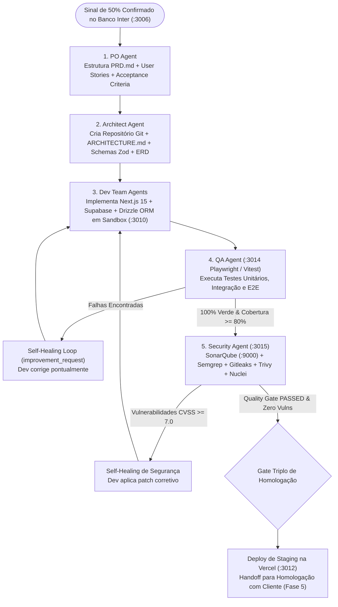

# FASE 4: Fábrica de Software & Blindagem Cibernética (Back-of-the-House)

> **Status:** Especificação Técnica Soberana (Fase 4 — Back-of-the-House)  
> **Liderança & Decisor Supremo:** João (Chefe — *"A Palavra do Chefe é Sempre Lei"*)  
> **Padrões da Indústria Absorvidos:** `MetaGPT` (SOPs e Contratos Formais de Engenharia), `ChatDev` (Pair Programming & Self-Healing Loop) e `agency-agents` (Personas Especializadas de Engenharia e QA)  
> **Arquitetura Técnica:** Clean Architecture em Next.js 15 App Router + TypeScript + Tailwind CSS + Supabase (PostgreSQL / RLS) + Drizzle ORM + Vitest / Playwright + SonarQube Community Edition (:9000)  
> **Premissa Inviolável:** Zero código de negócio neste documento. Estritamente arquitetura, contratos Pydantic conceituais, fluxos de engenharia, modelagem PostgreSQL 15, tópicos AMQP e cenários BDD.  
> **Trava Financeira Primária:** A engenharia de um projeto **JAMAIS inicia sem a confirmação bancária do sinal de 50% via PIX no Banco Inter** (Fase 3).

---

## 1. Visão Geral da Fábrica de Software Autônoma

A Fase 4 compreende o motor de engenharia, arquitetura, implementação, testes e blindagem cibernética da software house. Após o fechamento comercial e a liquidação do sinal de 50% no Banco Inter (Fase 3), o projeto é transferido para a equipe técnica interna.

Diferente de geradores de código ingênuos que cospem arquivos soltos ou sofrem de alucinação estrutural, a Fábrica de Software opera sob o princípio fundamental absorvido do **MetaGPT**:

$$\text{Software de Produção} = \text{SOP}(\text{Engenharia Multi-Agente})$$

Nenhum código é escrito antes de haver um **Documento de Requisitos de Produto (`PRD.md`)** e uma **Arquitetura de Software com Schemas Rígidos (`ARCHITECTURE.md`)**.



---

## 2. Padrões Absorvidos e Aprimorados da Comunidade Open-Source

Absorvemos diretamente no nosso código e arquitetura os pontos fortes dos 3 maiores frameworks da indústria, eliminando suas fragilidades:

### 2.1 Do `MetaGPT` (`geekan/MetaGPT`): A Metodologia de SOPs Estritos
* **A Grande Lição:** Agentes conversando livremente acumulam erros e alucinam interfaces. A comunicação entre agentes de engenharia deve ser feita **exclusivamente por artefatos formais versionados**:
  1. O **PO Agent** gera o `PRD.md` estruturado.
  2. O **Architect Agent** lê o `PRD.md` e gera o `ARCHITECTURE.md` com Diagramas Mermaid de Banco (ERD), Data Structures em JSON e Schemas Zod de API.
  3. O **Dev Team** é proibido de criar endpoints ou tabelas que não estejam formalmente definidos no `ARCHITECTURE.md`.
  4. O **QA Agent** valida a conformidade dos testes contra os Critérios de Aceitação do `PRD.md`.

### 2.2 Do `ChatDev` (`OpenBMB/ChatDev`): O Loop Ativo de Self-Healing (Pair Programming)
* **A Grande Lição:** Testes automatizados não servem apenas para reprovar; servem para **alimentar o ciclo de correção autônoma**.
  - Quando o QA ou o Security Agent reprovam um build, eles não abrem discussões genéricas.
  - O agente de auditoria emite um evento estruturado `improvement_request` contendo:
    - Caminho exato do arquivo e número da linha.
    - Traceback do erro, falha de asserção ou regra de segurança violada (ex: SQL injection sink, secret vazado).
    - Sugestão de remediação pontual.
  - O Dev Team consome o pedido, aplica a correção via ferramenta `patch_file` no sandbox e notifica para re-teste automático.
  - O ciclo repete até atingir **zero falhas e Quality Gate verde**.

### 2.3 Do `msitarzewski/agency-agents`: As Personas e Diretrizes de Engenharia
* **A Grande Lição:** Especialização de papéis com diretrizes negativas (*Do's & Don'ts*).
  - Absorvemos as personas `nextjs-architect`, `fullstack-developer`, `qa-playwright-tester` e `security-auditor-owasp` para balizar os prompts e regras dos agentes da fábrica.

---

## 3. Diretrizes de Implementação para a Próxima IA (Playbooks e Configurações)

> [!IMPORTANT]
> **Instrução Mandatória para Agentes Implementadores:**  
> A próxima IA que atuar nesta fase deve obrigatoriamente construir e validar os seguintes artefatos em `knowledge/dev/`, `knowledge/qa/` e `services/engine/config/agents/pipeline/`, sem criar dependências de pacotes externos, ingerindo-os nativamente via CRAG no `knowledge-memory-gateway` (`:3013`):

### 3.1 Playbooks em `knowledge/dev/`:
* **`knowledge/dev/nextjs-15-patterns.md`:**
  - Padrões obrigatórios do Next.js 15 App Router: Server Components por padrão, Server Actions para mutações de dados, uso estrito de tags de cache (`revalidateTag`), tipagem TypeScript estrita e eliminação de `any`.
  - Integração com Drizzle ORM: queries parametrizadas (prevenção absoluta de SQLi) e migrations tipadas.
* **`knowledge/dev/supabase-auth-template.md`:**
  - Padrão arquitetural de autenticação Supabase SSR (`@supabase/ssr`).
  - Configuração mandatória de Row Level Security (RLS) com políticas estritas em todas as tabelas.
  - Isolamento da chave `service_role` exclusivamente em Server Actions no backend; uso da chave pública `anon_key` restrito ao frontend.
* **`knowledge/dev/tailwind-conventions.md`:**
  - Design System limpo com `shadcn/ui` e Tailwind CSS.
  - Variáveis semânticas de cores, suporte nativo a temas claro/escuro e responsividade mobile-first (375px, 768px, 1440px).
* **`knowledge/dev/metagpt-sop-guidelines.md`:**
  - Templates formais do `PRD.md` e `ARCHITECTURE.md`.
  - Padrões de decomposição atômica de tarefas para subagentes de desenvolvimento.

### 3.2 Playbooks em `knowledge/qa/`:
* **`knowledge/qa/security-checklist.md`:**
  - Checklist de conformidade OWASP Top 10 para aplicações web modernas.
  - Regras de sanitização de inputs contra XSS (uso de `DOMPurify` caso haja renderização de HTML).
  - Verificação de cabeçalhos de segurança (CSP, HSTS, X-Frame-Options, CORS restrito).
  - Secret scanning pré-commit com Gitleaks.
* **`knowledge/qa/edge-cases-inventory.md`:**
  - Catálogo de casos de borda mandatórios para testes de QA: concorrência de horários de agendamento em milissegundos, expiração de QR Code PIX, idempotência de webhooks financeiros e tratamento de falhas de rede.

### 3.3 Configurações dos Agentes em `services/engine/config/agents/pipeline/`:
* **`po_agent.yaml`:**
  - Modelo: `gemini/gemini-2.5-flash`, temperatura 0.2.
  - Ferramentas: `workspace-sandbox-service` (`:3010`), `knowledge-memory-gateway` (`:3013`).
  - Missão: Estruturar o `PRD.md` detalhado a partir do protótipo e histórico comercial.
* **`architect_agent.yaml`:**
  - Modelo: `gemini/gemini-3.8-pro`, temperatura 0.1 (máximo determinismo).
  - Ferramentas: `git-vcs-gateway` (`:3011`), `workspace-sandbox-service` (`:3010`), `knowledge-memory-gateway` (`:3013`).
  - Missão: Inicializar repositório Git em `/home/joao/projetos/<client-slug>/`, gerar `ARCHITECTURE.md` e schemas Zod.
* **`dev_team_agent.yaml`:**
  - Modelo: `gemini/gemini-2.5-flash`, temperatura 0.2.
  - Ferramentas: `workspace-sandbox-service` (`:3010`), `git-vcs-gateway` (`:3011`), `knowledge-memory-gateway` (`:3013`).
  - Missão: Implementar o código em TypeScript nos contêineres descartáveis (`node:20-slim`).
* **`qa_agent.yaml`:**
  - Modelo: `gemini/gemini-2.5-flash`, temperatura 0.1.
  - Ferramentas: `browser-gateway` (`:3014` com Playwright), `workspace-sandbox-service` (`:3010`), `knowledge-memory-gateway` (`:3013`).
  - Missão: Executar testes unitários, de integração e E2E, exigindo cobertura $\ge 80\%$.
* **`security_agent.yaml`:**
  - Modelo: `gemini/gemini-2.5-flash`, temperatura 0.1.
  - Ferramentas: `security-audit-gateway` (`:3015` com SonarQube :9000, Semgrep, Gitleaks, Trivy, Nuclei), `knowledge-memory-gateway` (`:3013`).
  - Missão: Garantir Quality Gate `Passed`, zero CVEs críticas e zero secrets vazados.

---

## 4. Topologia e Especificação dos 5 Agentes da Fábrica

### 4.1 Agente 1: PO Agent (`po_agent` — Product Owner)
* **Missão Primária:** Traduzir a negociação comercial e a demo aceita na Fase 3 em um dossiê formal de especificação de produto (`PRD.md`).
* **Entradas (Inputs):** Ficha do lead no banco, histórico de conversas do WhatsApp em `lead_interactions`, e URL da demo aprovada.
* **Saída Obrigatória (SOP):** Arquivo `PRD.md` salvo na raiz do projeto contendo:
  - Visão Geral do Produto e Metas de Negócio do Cliente.
  - User Stories com Critérios de Aceitação em formato Gherkin (*Dado/Quando/Então*).
  - Priorização MoSCoW (Must Have, Should Have, Could Have, Won't Have).
  - Requisitos Não-Funcionais (latência < 300ms, suporte mobile 100%, disponibilidade).
* **Trava de Segurança:** Apenas processa projetos com status `CONVERTED_SIGNAL_PAID` (sinal de 50% confirmado no Banco Inter).

---

### 4.2 Agente 2: Architect Agent (`architect_agent` — Arquiteto de Software)
* **Missão Primária:** Desenhar a arquitetura técnica completa da aplicação, criar o repositório Git local e definir os contratos estritos de dados e APIs antes da escrita de código.
* **Entradas (Inputs):** `PRD.md` do PO Agent.
* **Saídas Obrigatórias (SOP):**
  1. Inicialização do repositório Git oficial em `/home/joao/projetos/<client-slug>/` via `git_init_repository` do `git-vcs-gateway` (`:3011`).
  2. Documento vivo `ARCHITECTURE.md` contendo:
     - Diagrama de Entidades e Relacionamentos (ERD em Mermaid).
     - Mapeamento de pastas sob Clean Architecture (`domain/`, `application/`, `infrastructure/`, `presentation/`).
     - Schemas Zod de validação de todas as rotas e contratos de formulário.
  3. Decomposição de tarefas atômicas sequenciais registradas na tabela `tasks` no PostgreSQL.
* **Regra Inviolável:** Zero dependências exóticas ou bibliotecas legadas. Uso estrito de Next.js 15, Tailwind, Supabase e Drizzle ORM.

---

### 4.3 Agente 3: Dev Team Agents (`dev_team_agent` — Equipe de Desenvolvimento)
* **Missão Primária:** Implementar o código de produção em TypeScript nos sandboxes Docker descartáveis (`:3010`), seguindo rigorosamente os schemas Zod e o blueprint do Arquiteto.
* **Sub-Papeis Especializados:**
  - **Database & Supabase Subagent:** Escreve schemas Drizzle ORM, scripts de migração SQL e políticas de Row Level Security (RLS).
  - **Backend & Services Subagent:** Implementa use-cases, validações de regra de negócio e handlers de webhooks PIX.
  - **Frontend & UI Subagent:** Constrói os componentes React com Tailwind e `shadcn/ui`, garantindo responsividade mobile e acessibilidade.
* **Ferramental de Execução:** Opera exclusivamente dentro do contêiner Docker descartável (`node:20-slim`) montado em `/home/joao/projetos/<client-slug>/` sem privilégios de root na máquina host.
* **Commits Convencionais:** Cada tarefa concluída gera um commit atômico no Git via `git_commit` do `:3011` assinado granularmente (ex: `feat(catalog): implementar listagem com filtros`).

---

### 4.4 Agente 4: QA Agent (`qa_agent` — Quality Assurance)
* **Missão Primária:** Validar a qualidade funcional, ausência de bugs e estabilidade visual através de uma suíte completa de testes automatizados.
* **Bateria de Testes Mandatória:**
  - **Testes Unitários & Integração (Vitest):** Testa regras de negócio puras, cálculos de preço, manipulação de datas e validações Zod.
  - **Testes E2E (Playwright `:3014`):** Navega em navegador Chromium headless real simulando o fluxo completo do usuário (ex: agendar horário, preencher dados, gerar cobrança).
  - **Auditoria de Responsividade:** Validação visual em viewports mobile (375x812), tablet (768x1024) e desktop (1440x900).
* **Critério de Aprovação (QA Gate):**
  - **Cobertura Mínima de 80%:** O build é sumariamente reprovado se a cobertura total de linhas/branches for inferior a 80%.
  - **Zero Testes Falhando:** 100% dos testes devem passar de forma determinística (zero *flaky tests*).
* **Self-Healing Loop:** Se houver falhas, emite `qa.improvement_request` detalhado e aguarda a correção do Dev Team para re-teste automático.

---

### 4.5 Agente 5: Security Agent (`security_agent` — Blindagem Cibernética & Pentest)
* **Missão Primária:** Realizar auditoria estática de código (SAST), caça a credenciais vazadas, auditoria de dependências (SCA) e testes dinâmicos de penetração (DAST) contra a aplicação em staging.
* **Arsenal Enterprise Integrado (`:3015`):**
  1. **SonarQube Community Edition (`:9000`):** Análise central de débitos técnicos, code smells, bugs e homologação do Quality Gate oficial (`Passed` / `Failed`).
  2. **Gitleaks:** Scanner em nível de repositório Git para garantir **zero secrets ou chaves de API commitadas**.
  3. **Semgrep:** Análise semântica estática focada no OWASP Top 10 (prevenção de SQLi, XSS, Command Injection).
  4. **Trivy / OSV-Scanner:** Varredura em tempo real de CVEs ativas nas dependências do `package.json`.
  5. **Nuclei:** Pentest dinâmico automatizado contra a URL efêmera de preview na Vercel (:3012).
* **Critério de Aprovação (Security Gate):**
  - **Zero Vulnerabilidades Críticas ou Altas (CVSS $\ge 7.0$).**
  - **Zero Secrets Detectados** no histórico Git.
  - **Status SonarQube Quality Gate: `PASSED`.**
* **Self-Healing Loop:** Emite `security.improvement_request` estruturado para o Dev Team caso encontre vulnerabilidades, acompanhado da PoC e remediação recomendada.

---

### 4.6 O Gate Triplo de Liberação para Homologação
Um projeto de software **SÓ é liberado para o cliente homologar (Fase 5)** quando atender cumulativamente ao **Gate Triplo**:
1. **Gate Financeiro:** 50% de sinal confirmado no Banco Inter (validado via webhook mTLS).
2. **Gate de QA:** 100% dos testes unitários, de integração e E2E aprovados com cobertura $\ge 80\%$.
3. **Gate de Segurança:** Quality Gate do SonarQube `PASSED`, zero vulnerabilidades críticas/altas e zero vazamentos de secrets.

---

## 5. Modelagem de Dados Relacional (PostgreSQL 15 / `agency_db`)

```sql
-- Status do Projeto de Software
CREATE TYPE project_status_enum AS ENUM (
    'WAITING_SIGNAL',     -- Aguardando 50% de sinal do cliente
    'SCOPING_PRD',        -- PO Agent elaborando o PRD.md
    'ARCHITECTING',       -- Arquiteto criando repo e ARCHITECTURE.md
    'DEVELOPING',         -- Dev Team implementando código
    'QA_TESTING',         -- QA executando suíte de testes
    'SECURITY_AUDITING',  -- Security executando SonarQube e pentest
    'READY_HOMOLOGATION', -- Gate Triplo aprovado, pronto para cliente homologar (Fase 5)
    'BLOCKED_ERROR'       -- Bloqueado por falha irrecuperável
);

-- Tabela de Projetos de Software de Clientes
CREATE TABLE projects (
    project_id UUID PRIMARY KEY DEFAULT gen_random_uuid(),
    lead_id UUID NOT NULL REFERENCES leads(lead_id) ON DELETE CASCADE,
    client_slug VARCHAR(128) NOT NULL UNIQUE,
    repo_path TEXT NOT NULL,                  -- /home/joao/projetos/<client-slug>/
    github_repo_url TEXT,
    staging_vercel_url TEXT,
    prd_markdown TEXT,
    architecture_markdown TEXT,
    status project_status_enum NOT NULL DEFAULT 'WAITING_SIGNAL',
    coverage_percent NUMERIC(5, 2) DEFAULT 0.00,
    sonarqube_project_key VARCHAR(128),
    sonarqube_quality_gate VARCHAR(32) DEFAULT 'NONE', -- 'PASSED', 'FAILED', 'NONE'
    created_at TIMESTAMP WITH TIME ZONE DEFAULT CURRENT_TIMESTAMP,
    updated_at TIMESTAMP WITH TIME ZONE DEFAULT CURRENT_TIMESTAMP
);

-- Tabela de Tarefas Atômicas de Desenvolvimento
CREATE TABLE tasks (
    task_id UUID PRIMARY KEY DEFAULT gen_random_uuid(),
    project_id UUID NOT NULL REFERENCES projects(project_id) ON DELETE CASCADE,
    title VARCHAR(255) NOT NULL,
    description TEXT NOT NULL,
    assigned_to VARCHAR(64) NOT NULL,         -- 'database_dev', 'backend_dev', 'frontend_dev'
    status VARCHAR(32) NOT NULL DEFAULT 'TODO', -- 'TODO', 'IN_PROGRESS', 'DONE', 'BLOCKED'
    git_branch VARCHAR(128),
    created_at TIMESTAMP WITH TIME ZONE DEFAULT CURRENT_TIMESTAMP,
    completed_at TIMESTAMP WITH TIME ZONE
);

-- Tabela de Solicitações de Auto-Correção (Self-Healing Loop)
CREATE TABLE improvement_requests (
    request_id UUID PRIMARY KEY DEFAULT gen_random_uuid(),
    project_id UUID NOT NULL REFERENCES projects(project_id) ON DELETE CASCADE,
    origin VARCHAR(32) NOT NULL,              -- 'QA' ou 'SECURITY'
    severity VARCHAR(16) NOT NULL,            -- 'CRITICAL', 'HIGH', 'MEDIUM', 'LOW'
    target_file TEXT NOT NULL,
    target_line INTEGER,
    error_traceback TEXT NOT NULL,
    suggested_fix TEXT,
    status VARCHAR(32) NOT NULL DEFAULT 'OPEN', -- 'OPEN', 'IN_FIX', 'RESOLVED'
    created_at TIMESTAMP WITH TIME ZONE DEFAULT CURRENT_TIMESTAMP,
    resolved_at TIMESTAMP WITH TIME ZONE
);
```

---

## 6. Barramento RabbitMQ AMQP (`agency.topic`) na Fase 4

| Routing Key | Produtor | Consumidor | Finalidade do Evento |
| :--- | :--- | :--- | :--- |
| `dev.project.start` | `engine-core` | `PO Agent` | Sinal de 50% pago; inicia elaboração do PRD |
| `dev.prd.ready` | `PO Agent` | `Architect Agent` | PRD.md finalizado; dispara criação do repo e arquitetura |
| `dev.architecture.ready` | `Architect Agent` | `Dev Team` | Repositório e ARCHITECTURE.md prontos; dispara implementação |
| `dev.code.committed` | `Dev Team` | `QA Agent` | Tarefas de dev concluídas; aciona suíte de testes |
| `qa.improvement_request` | `QA Agent` | `Dev Team` | Teste quebrou; aciona self-healing loop de QA |
| `qa.gate.passed` | `QA Agent` | `Security Agent` | Testes 100% verdes com cobertura $\ge 80\%$; aciona segurança |
| `security.improvement_request` | `Security Agent` | `Dev Team` | Vulnerabilidade detectada; aciona self-healing de segurança |
| `security.gate.passed` | `Security Agent` | `engine-core` | SonarQube `PASSED` e zero CVEs; homologa Gate Triplo |
| `prod.staging.ready` | `engine-core` | `telegram-gateway` | Deploy na Vercel pronto; notifica João e libera Fase 5 |

---

## 7. Matriz de Cenários de Teste BDD (Gherkin)

```gherkin
Funcionalidade: Fábrica de Software Autônoma e Blindagem Cibernética (Fase 4)

  Cenário: Handoff com Sucesso da Fase 3 e Elaboração do PRD
    Dado que o Banco Inter confirmou a liquidação do sinal de 50%
    Quando o evento "dev.project.start" é consumido pelo engine-core
    Então o PO Agent deve gerar o arquivo PRD.md na raiz do workspace
    E o PRD deve conter histórias de usuário e critérios de aceitação em Gherkin
    E o evento "dev.prd.ready" deve ser publicado no RabbitMQ

  Cenário: Arquiteto Inicializa Repositório Git e Schemas Zod
    Dado que o PRD.md está finalizado e aprovado
    Quando o Architect Agent consome "dev.prd.ready"
    Então um repositório Git local deve ser criado em /home/joao/projetos/<client-slug>/
    E o arquivo ARCHITECTURE.md deve ser criado com diagramas Mermaid
    E as tarefas de desenvolvimento devem ser decompostas na tabela tasks

  Cenário: Ciclo de Self-Healing Ativo entre QA e Dev Team
    Dado que o Dev Team concluiu a implementação inicial do catálogo
    Quando o QA Agent executa a suíte de testes Playwright e detecta falha em um formulário
    Então um evento "qa.improvement_request" deve ser emitido com arquivo e linha do erro
    E o Dev Team deve aplicar o patch corretivo no sandbox
    E o QA Agent deve re-executar os testes automaticamente até atingir 100% de aprovação

  Cenário: Reprovação Sumária pelo SonarQube por Cobertura Insuficiente
    Dado que o código do projeto possui 72% de cobertura de testes
    Quando o Security Agent invoca o SonarQube (:9000)
    Então o Quality Gate do SonarQube deve retornar status "FAILED"
    E o projeto NÃO deve receber autorização para deploy de staging
    E o Dev Team e QA devem ser acionados para implementar testes complementares até atingir >= 80%

  Cenário: Aprovação no Gate Triplo e Liberação para Homologação do Cliente
    Dado que o sinal de 50% está liquidado no Banco Inter
    E a suíte de testes de QA obteve 100% de sucesso com cobertura de 84%
    E o SonarQube retornou Quality Gate "PASSED" com zero CVEs críticas e zero secrets vazados
    Quando o engine-core consolida o Gate Triplo
    Então o status do projeto deve transicionar para "READY_HOMOLOGATION"
    E o deploy efêmero de staging deve ser publicado na Vercel
    E uma notificação de sucesso deve ser enviada para o Telegram de João
```

---

## 8. Conclusão & Checklist de Prontidão da Fase 4

A especificação da **Fase 4** está formalmente desenhada e documentada, pronta para guiar qualquer agente ou desenvolvedor com clareza matemática:
- Metodologia de SOPs do `MetaGPT` impedindo código desordenado e alucinações.
- Ciclo de auto-cura (*Self-Healing*) do `ChatDev` resolvendo falhas de testes e segurança de forma atômica.
- Personas especializadas do `agency-agents` aplicadas a Next.js 15, Supabase, Playwright e SonarQube.
- Gate Triplo inegociável garantindo blindagem financeira, técnica e cibernética antes de qualquer entrega ao cliente.
