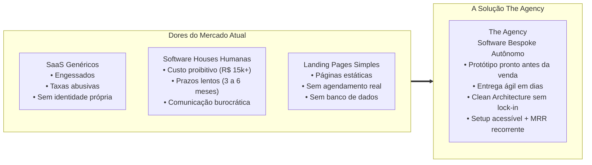
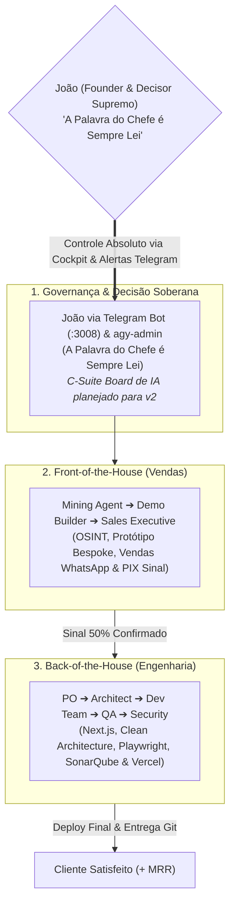
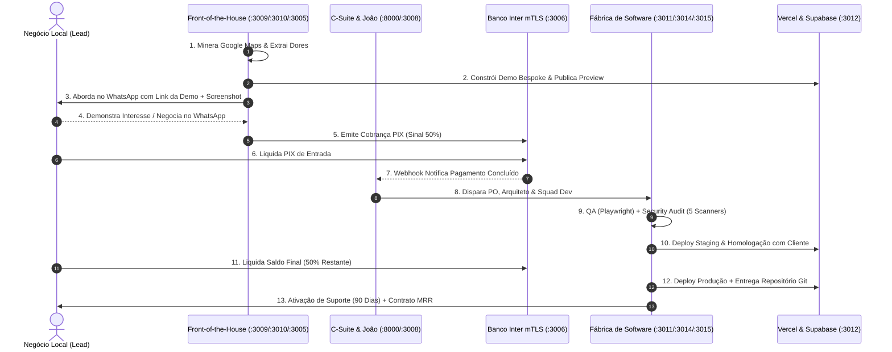
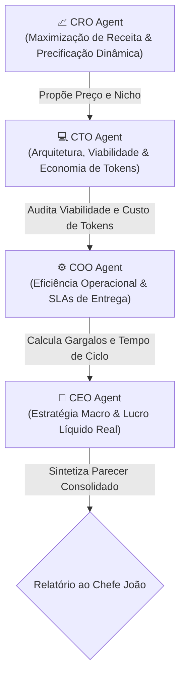

# 🚀 The Agency: Pitch Executivo & Arquitetura de Funcionamento

> **A Primeira Software House Autônoma de Ponta a Ponta Dirigida por Agentes de Inteligência Artificial**  
> *Da mineração de leads e prototipação sob medida à entrega de software de produção, pentest automatizado e liquidação financeira via PIX.*

---

## Executive Summary (Elevator Pitch)

O mercado de desenvolvimento de software para Pequenas e Médias Empresas (PMEs) e negócios locais está quebrado:
* **Softwares de prateleira genéricos (SaaS)** impõem interfaces engessadas, comissões abusivas sobre transações e nunca atendem às peculiaridades do negócio.
* **Software Houses tradicionais** cobram orçamentos proibitivos (R$ 15.000 a R$ 60.000) e levam de 3 a 6 meses para lançar uma primeira versão, sobrecarregadas pelo custo de equipes humanas multidisciplinares.
* **Agências de marketing digital** entregam landing pages estáticas e descartáveis que não integram fluxos transacionais, bancos de dados ou rotinas operacionais reais.

**The Agency** reinventa a entrega de tecnologia sob demanda. Somos uma **Software House Autônoma de Agentes de IA**, operada por uma esteira de microsserviços desacoplados e governada por um **Conselho Executivo de IA (C-Suite Board)**, sob a liderança soberana de um operador humano (*Human-in-the-Loop*).

Nossa operação inverte a lógica tradicional de vendas com uma premissa de alto impacto: **Show, Don't Tell**. Em vez de panfletagem digital ou ligações frias, nós mineramos os dados públicos e as dores reais do cliente no Google Maps, construímos um protótipo funcional bespoke (personalizado com a identidade, cores e catálogo real dele) e apresentamos o sistema pronto em seu WhatsApp.

Uma vez contratado, squads de agentes cognitivos projetam a arquitetura limpa em TypeScript/Next.js, codificam o sistema em sandboxes Docker isolados, executam suítes completas de testes E2E (Playwright) com meta de cobertura superior a 80%, realizam pentests e análises estáticas de segurança com 5 motores simultâneos, realizam o deploy definitivo na nuvem e emitem cobranças PIX automatizadas com mTLS bancário.

O resultado é uma operação de **custo marginal próximo a zero**, entrega em dias (não meses), código de qualidade corporativa entregue sem *lock-in* no GitHub do cliente e margem líquida superior a 90%.

---

## 1. O Problema de Mercado & A Oportunidade



### O Dilema do Pequeno e Médio Empresário
No Brasil, existem mais de 15 milhões de micro e pequenas empresas (clínicas, oficinas, barbearias, consultórios, estéticas, prestadores de serviços, autônomos e comércios locais). Todos necessitam de presença digital transacional (agendamento online com confirmação PIX, catálogos interativos, portais de autoatendimento e mini-ERPs). No entanto, deparam-se com duas barreiras intransponíveis:
1. **Falta de Capital:** Não possuem R$ 20.000 para contratar uma equipe tradicional de desenvolvimento.
2. **Frustração com Soluções Prontas:** Plataformas genéricas cobram mensalidades crescentes, fatiam funcionalidades essenciais em planos caros e cobram taxas por transação.

### A Oportunidade Operacional
Agentes de IA autônomos atingiram maturidade para raciocinar, planejar e executar chamadas de ferramentas de forma orquestrada. Ao eliminar a fricção de reuniões, alinhamentos manuais e o custo da hora-humana de codificação elementar, a The Agency atende esse mercado reprimido com preços justos e velocidade sem precedentes, garantindo rentabilidade recorde por projeto.

---

## 2. A Solução: The Agency

A The Agency opera como uma empresa de tecnologia completa e autocontida, com três pilares fundamentais:



### 1. Isca de Altíssimo Valor (Anti-Spam & Anti-Slop)
Diferente de robôs de disparo que entopem caixas postais com textos genéricos, nossa esteira minera as fotos reais, os serviços declarados e as dores apontadas nas avaliações dos clientes no Google Maps. O sistema projeta uma interface sob medida para aquele negócio específico e envia um link navegável em produção na Vercel junto a um screenshot mobile. O lead não compra uma promessa: ele experimenta seu próprio sistema pronto.

### 2. Engenharia de Nível Corporativo Sem Lock-in
Todo código gerado pela esteira obedece a padrões estritos de **Clean Architecture**, tipagem forte em TypeScript, componentes Tailwind modernos e banco de dados relacional isolado (Postgres/Supabase). Ao concluir o projeto, o cliente recebe a propriedade do repositório Git. Caso queira contratar um desenvolvedor humano amanhã, o código é limpo, padronizado e auditado.

### 3. Governança Rigorosa e Segurança Cibernética
A esteira conta com barreira ativa contra ataques:
* **Ingress Guardrail:** Inspeção por Llama Guard 3 em menos de 150ms na Groq contra *prompt injections*, jailbreaks e comandos hostis via WhatsApp.
* **Sandboxes Docker Efêmeros:** Cada rotina de build, teste e compilação roda isolada sem acesso ao sistema host (`DooD`).
* **Suíte de 5 Motores de Segurança:** Análise de vulnerabilidades com SonarQube, Semgrep (SAST), Gitleaks (segredos), Trivy (CVEs) e Nuclei (DAST).

---

## 3. Como o Produto Funciona: A Esteira Ponta a Ponta

A jornada operacional da The Agency é dividida em 6 etapas perfeitamente orquestradas:



### Etapa 1: Mineração Cirúrgica de Leads (OSINT)
* O **Mining Agent** vasculha o Google Maps em nichos e regiões pré-definidas (ex: barbearias premium, clínicas estéticas, oficinas em bairros selecionados).
* O robô extrai notas, fotos reais do local, endereço, serviços prestados e reclamações em avaliações de 1 a 3 estrelas (ex: *"difícil agendar horário"*, *"ninguém atende o telefone"*).
* O gateway de WhatsApp valida silenciosamente se o número comercial possui conta ativa, eliminando desperdício com leads inválidos.

### Etapa 2: Prototipação Expressa (Demo Builder)
* O **Demo Builder Agent** processa os dados reais minerados e monta um software interativo sob medida (ex: agendamento com escolha de profissional, vitrine com cálculo de preços ou portal de serviços).
* O **Browser Service** (Playwright) realiza uma auditoria pré-voo: confirma que a página responde HTTP 200, que não há imagens quebradas ou erros no console e captura um screenshot responsivo em viewport de smartphone (375x812).
* A demo é publicada instantaneamente na Vercel sob uma URL pública rápida e segura.

### Etapa 3: Vendas Humanizadas & Negociação Consultiva
* O **Sales Executive Agent** inicia a abordagem no WhatsApp respeitando regras estritas de humanização: pausas realistas (3s a 8s), digitação proporcional (30ms por caractere) e atuação restrita ao horário comercial.
* O fluxo de copy baseia-se em **SPIN Selling** e nas técnicas de negociação de alta influência de Chris Voss (*Never Split the Difference*), apresentando a demo como uma solução imediata para a dor que os clientes relataram nas avaliações.
* As mensagens recebidas passam pelo **Ingress Guardrail** (Groq LPU Llama Guard 3) em menos de 150ms para desarmar tentativas de prompt injection. Mensagens de voz em áudio (.ogg) são transcritas instantaneamente via Groq Whisper (`whisper-large-v3`) em < 500ms.

### Etapa 4: Fechamento Financeiro & Emissão de PIX
* Ao fechar o negócio, o **Payment Gateway** se comunica via mTLS nativo com a API Banking v2 do Banco Inter e emite uma cobrança PIX com QR Code dinâmico e chave Copia e Cola.
* **Trava de Segurança Financeira:** A esteira de engenharia pesada permanece congelada até que o webhook bancário confirme a liquidação do sinal de 50% em conta.

### Etapa 5: Engenharia Autônoma, QA & Auditoria Cibernética
Com o sinal na conta, entra em ação o *Back-of-the-House*:
1. **Product Owner (PO Agent):** Converte a proposta aprovada em escopo fechado, especificações técnicas e critérios de aceite no formato BDD/Gherkin.
2. **Architect Agent:** Inicializa o repositório Git isolado em `/workspaces/clients/<client-slug>/`, define a árvore de diretórios em Clean Architecture, esquemas de banco (Drizzle ORM / Supabase) e contratos Zod.
3. **Dev Team Agents:** Subagentes especializados (Database, Backend e Frontend) geram o código modular com commits semânticos atômicos (*Conventional Commits*).
4. **QA Agent:** Executa testes automatizados com Playwright. A esteira impõe um *Quality Gate* inviolável de **80%+ de cobertura de testes** e zero testes flutuantes (*flaky*).
5. **Security Agent:** Submete o código à suíte de segurança:
   * **Gitleaks:** Impede vazamento de chaves ou segredos.
   * **Semgrep:** Análise estática de código (SAST) para OWASP Top 10 em < 3 segundos.
   * **Trivy / OSV-Scanner:** Checagem de vulnerabilidades conhecidas (CVEs) em dependências.
   * **SonarQube:** Avaliação de manutenibilidade, débitos técnicos e qualidade geral.
   * **Nuclei:** Pentest dinâmico (DAST) contra a URL de staging na Vercel.
6. **Self-Healing Loop:** Caso qualquer teste ou scanner aponte inconformidades, a esteira gera chamados automáticos com a correção requerida para o Dev Team, re-executando os testes em loop até obter 100% de aprovação técnica.

### Etapa 6: Homologação, Liquidação Final & Suporte (Handover)
* O cliente recebe o link de homologação no WhatsApp com um roteiro de testes guiado.
* Com a aprovação final do cliente, o sistema emite a cobrança PIX dos 50% restantes.
* Confirmado o pagamento integral, a esteira realiza o deploy definitivo em domínio próprio com certificado SSL, transfere o repositório Git para a conta do cliente e ativa a garantia incondicional de 90 dias contra bugs, abrindo caminho para o contrato mensal de suporte (MRR).

---

## 4. O C-Suite Board de IA: Inteligência Estratégica & Governança (V2 / Standby)

> [!NOTE]
> **Alinhamento do Roadmap MVP:** No MVP operacional (v1), a esteira conecta a Fase 1 (Fundação MCP) diretamente à Fase 3 (Prospecção e Vendas) e Fase 4 (Fábrica de Software), com João exercendo o controle e aprovação direta via Telegram (`:3008`) com teto orçamentário R$ 0,00 autônomo. O C-Suite Board multi-agente detalhado abaixo representa a expansão estratégica deliberativa formalizada para a v2 da The Agency.

A operação da The Agency não se resume a scripts de automação. No centro da tomada de decisões opera um **Conselho Executivo de 4 Agentes de IA**, organizados sob o padrão deliberativo de *Round-Robin*:



* 👑 **CEO Agent:** Guardião da margem líquida da empresa, garantindo que nenhum projeto consuma mais recursos do que o retorno financeiro que produz.
* 💻 **CTO Agent:** Defensor intransigente da excelência arquitetural e da frugalidade no uso de tokens de LLM. Responsável pela Matriz Comparativa Tripla Obrigatória (**Buy vs. Host vs. Build**) antes de qualquer contratação de serviço.
* 📈 **CRO Agent:** Estrategista comercial focado em precificação dinâmica (ajustando orçamentos com base no faturamento estimado do nicho e valor percebido na demo) e testes A/B de conversão.
* ⚙️ **COO Agent:** Controlador de tempo de ciclo, gargalos de execução e telemetria da esteira.

### Cláusulas Pétreas de Governança
* **Soberania do Chefe:** O Conselho é consultivo e deliberativo; a decisão final, vetos e direcionamentos cabem exclusivamente a João.
* **Anti-Conflito de Interesses e Imutabilidade:** O Conselho tem autoridade para escolher e otimizar as LLMs dos agentes da esteira operacional, mas é **terminantemente proibido de alterar seus próprios prompts, código-fonte ou escolher seus próprios modelos de IA**.

---

## 5. Arquitetura Técnica & Topologia de Microsserviços

A The Agency foi projetada sob uma arquitetura de microsserviços poliglota e desacoplada, utilizando **Model Context Protocol (MCP)** como espinha dorsal de comunicação entre o cérebro cognitivo e suas ferramentas de execução:

```
the-agency/
├── services/
│   ├── engine/       # Orquestrador Central FastAPI (:8000) - Host MCP & ReAct Loop
│   ├── whatsapp/     # WhatsApp Gateway Baileys Node.js (:3005) com Humanizer
│   ├── payment/      # Payment Gateway Banco Inter mTLS (:3006) com PIX Dinâmico
│   ├── guardrail/    # Ingress Guardrail Groq LPU Llama Guard 3 + Whisper (:3007)
│   ├── telegram/     # Alertas e Aprovações Bidirecionais para João (:3008)
│   ├── scraper/      # OSINT Google Maps & SearXNG Search (:3009)
│   ├── sandbox/      # FileSystem & Docker Execution MCP Server (:3010)
│   ├── git/          # Git & GitHub Management MCP Server (:3011)
│   ├── deploy/       # Vercel & Supabase Cloud Management (:3012)
│   ├── memory/       # Knowledge Base, Qdrant & FastEmbed CRAG (:3013)
│   ├── browser/      # Headless Playwright Multi-Persona (:3014)
│   └── security/     # SonarQube, Semgrep, Gitleaks, Trivy & Nuclei (:3015)
├── apps/
│   └── cockpit/      # Cockpit Web Next.js 15 para Controle de João (:3000)
├── workspaces/       # Ambientes isolados para os códigos-fonte dos clientes
└── knowledge/        # Playbooks em Markdown fatiados via Knowledge-as-Code
```

### Destaques da Infraestrutura
1. **Comunicação Padronizada via MCP:** Todas as capacidades operacionais (banco de dados, arquivos, deploys, mensagens e scanners) são servidores MCP expondo endpoints padronizados JSON-RPC 2.0 via HTTP/SSE. O orquestrador central conecta-se dinamicamente a elas sem acoplamento de código.
2. **Eficiência Extrema de Custos (Token Economy):**
   * Embeddings vetoriais locais utilizando **FastEmbed (BGE-M3)** rodando em CPU via ONNX Runtime (custo zero de API).
   * Reranker local de alta precisão (**BGE-Reranker-v2-M3**) julgando a pertinência documental em 15ms.
   * Roteamento dinâmico de LLMs via LiteLLM (Gemini 2.5 Flash / Flash Lite para tarefas ágeis; Groq LPU para ultra-baixa latência; modelos superiores apenas quando estritamente necessário).
3. **Persistência Confiável:** SQLite em modo WAL (Write-Ahead Logging) com backups atômicos diários sem travamento de tabelas (`sqlite3 VACUUM INTO`).
4. **Observabilidade Unificada:** Coleta centralizada de logs estruturados em JSON via Grafana, Loki e Promtail para todos os 11 contêineres Docker.

---

## 6. O Cockpit de Comando (A Torre de Controle de João)

Operando no endereço local `http://localhost:3000`, o **Cockpit de Comando** oferece a João o controle visual e em tempo real de toda a operação:

```
+------------------------------------------------------------------------------------+
|  THE AGENCY COCKPIT                                        [Status: Operação Normal]|
+------------------------------------------------------------------------------------+
|  [ Caixa Real ]         [ Faturamento Mês ]      [ Margem Líquida ]   [ Tokens (US$) ] |
|  R$ 18.450,00           R$ 24.800,00             92.4%                $ 3.82           |
+------------------------------------------------------------------------------------+
|  KANBAN DE OPORTUNIDADES (MODO DE CALIBRAGEM ASSISTIDA COM PAUSAS AUTOMÁTICAS)     |
|  [ Mineração (12) ] -> [ Demo Pronta (4) ] -> [ Negociando (3) ] -> [ Fechados (8) ]|
|  * Barbearia Silva     * Clínica Sorriso      * Auto Mecânica ABC   * Estética Bella|
|  [Inspecionar Dados]   [Ver Demo Vercel]      [Copilot WhatsApp]    [Ver no GitHub] |
+------------------------------------------------------------------------------------+
|  COGNITIVE GOVERNANCE: MESA REDONDA DO C-SUITE (CEO, CTO, CRO, COO)                |
|  > CRO: "Nicho odontológico comporta setup de R$ 1.800 com adesão de 68%."         |
|  > CTO: "Custos de tokens do template estimados em R$ 1,42. Viabilidade aprovada."  |
|  > CEO: "Submetendo proposta ao Chefe João para autorização de disparo."           |
|  [ BOTÃO: APROVAR PROPOSTA ]               [ BOTÃO: AJUSTAR DIRETRIZ ]              |
+------------------------------------------------------------------------------------+
```

### Principais Capacidades do Cockpit:
* **Kanban com Pausas de Calibragem:** Possibilidade de pausar qualquer lead para inspecionar os dados minerados, testar o link da demo na Vercel ou revisar a mensagem sugerida pela IA antes do envio.
* **Copilot de Mensageria:** Chat integrado ao WhatsApp em tempo real. A IA gera a resposta ideal fundamentada nas técnicas de negociação; João pode aprová-la ou editá-la com um clique.
* **Mesa Redonda Interativa:** Interface para João debater diretamente com seus 4 diretores de IA, solicitar análises de mercado sob medida ou ordenar ajustes na esteira.
* **Telemetria de Tokens ao Centavo:** Rastreabilidade exata do gasto de inferência de cada agente, discriminando tokens de entrada, saída e cache em Dólar e Reais.

---

## 7. Modelo de Negócio, Unit Economics & Projeções

### Fluxo de Monetização
A The Agency combina duas fontes complementares de receita:

| Linha de Receita | Descrição | Ticket Médio | Recorrência |
| :--- | :--- | :--- | :--- |
| **Taxa de Implantação (Setup)** | Desenvolvimento, personalização, configuração de domínio e entrega do software completo. | R$ 450 a R$ 2.500 | Pagamento único (50% sinal + 50% entrega) |
| **Plano de Sustentação (MRR)** | Hospedagem em nuvem, backups diários, monitoramento de disponibilidade e 2h/mês de evolução. | R$ 97 a R$ 297/mês | Recorrente mensal via PIX automático |

### Unit Economics por Projeto Entregue
A estrutura de custos marginais da The Agency é revolucionária quando comparada à de uma software house humana:

```
RECEITA MÉDIA POR PROJETO (SETUP):                          R$ 1.200,00
-----------------------------------------------------------------------
Custos Marginais de Operação por Projeto:
  • Tokens de LLM (Mineração, Prototipação, Código, QA):       - R$   4,80
  • Transcrições de Áudio (Whisper Groq LPU):                   - R$   0,20
  • Emissão de Cobrança PIX (Banco Inter):                      - R$   0,00 (Gratuito)
  • Hospedagem de Staging (Vercel Free / Pro Tier rateado):    - R$   1,50
  • Embeddings e Busca Vetorial (FastEmbed + Qdrant Local):    - R$   0,00 (CPU local)
-----------------------------------------------------------------------
LUCRO BRUTO DIRETO POR PROJETO:                              R$ 1.193,50
MARGEM BRUTA DIRETA:                                               99,4%
```

Mesmo deduzindo despesas de infraestrutura fixa local (energia, internet, amortização do hardware) e eventuais proxies dedicados, a **margem líquida real de operação supera 90%**, proporcionando geração massiva de caixa desde as primeiras ativações.

---

## 8. Fosso Defensivo & Vantagens Competitivas (Moats)

1. **Abordagem com Amostra Pronta ("Fait Accompli"):**
   Enquanto concorrentes disputam a atenção do cliente com mensagens frias que são sumariamente ignoradas, a The Agency chega com o produto do cliente pronto e navegável. Essa quebra de padrão eleva a taxa de resposta e conversão em ordens de magnitude.
2. **Arquitetura Aberta sem Lock-in:**
   Garantir ao cliente a posse do código-fonte em TypeScript com Clean Architecture e banco de dados relacional remove o maior receio de contratação: o medo de ficar refém de uma plataforma proprietária obscura.
3. **Custo Operacional Marginal Quase Zero:**
   A engenharia da esteira foi concebida para prescindir de SaaS intermediários caros (sem assinaturas desnecessárias de scraping, sem bibliotecas de memória pagas, sem serviços de mensageria inflacionados).
4. **Governança com Auto-Cura (Self-Healing Loop):**
   A integração direta entre orquestrador, sandboxes Docker, testes Playwright e 5 motores de segurança cria uma esteira que detecta seus próprios erros de código e os corrige autonomamente antes de qualquer intervenção humana.

---

## 9. Visão de Futuro & Conclusão

A **The Agency** redefine a fronteira entre a capacidade cognitiva da inteligência artificial e a prestação de serviços de engenharia de software de alto valor agregado. 

Não se trata de um assistente de código ou de um gerador de snippets para programadores, mas sim de uma **instituição empresarial autônoma completa**: capaz de identificar a demanda, validar a dor comercial, construir a solução sob medida, negociar, auditar o código sob rigorosos padrões corporativos e liquidar a transação financeira no banco.

Com uma arquitetura robusta, governança inegociável, custo de execução marginal desprezível e controle supremo do operador humano, a The Agency posiciona-se como o modelo definitivo para a próxima geração de empresas de tecnologia lucrativas e escaláveis.
