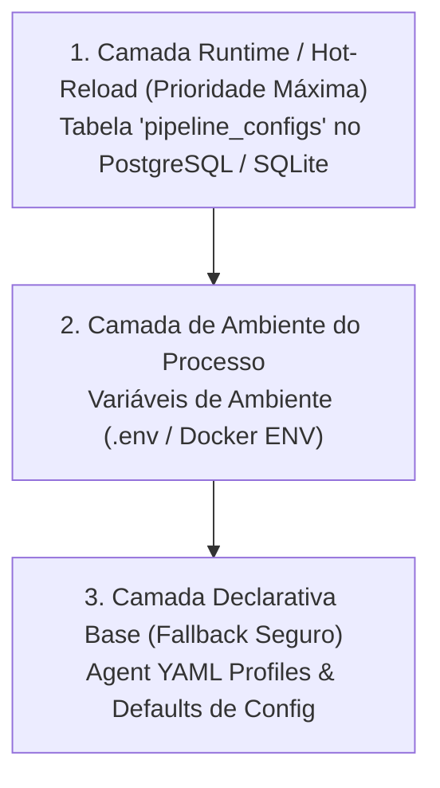

# Arquitetura Paramétrica de Precificação, Margens e Alocação de Modelos (Fase 3)

> **Status:** Especificação Paramétrica Soberana (Zero Hardcoded Models / Dynamic Limits)  
> **Autoridade:** Aprovado por João — *"A Palavra do Chefe é Sempre Lei"*  
> **Premissa Inviolável:** NENHUM modelo de IA, preço comercial ou limite operacional pode ser fixado (hardcoded) no código ou nos prompts. Todos os parâmetros devem ser injetados dinamicamente via variáveis de ambiente, tabela `pipeline_configs` do banco de dados ou arquivos de configuração de ambiente.

---

## 1. Hierarquia de Resolução de Parâmetros

Para garantir flexibilidade operacional, testes A/B e intervenção em tempo real por João via Telegram, todo valor numérico, limite e modelo de IA é resolvido pela seguinte precedência:



---

## 2. Parâmetros Comerciais e Financeiros (Configuráveis)

Todos os preços de tabela e regras de faturamento são vinculados a variáveis de configuração parametrizáveis:

| Parâmetro de Configuração | Variável de Ambiente (`.env`) | Chave `pipeline_configs` | Valor Padrão de Calibração | Descrição da Regra |
|---|---|---|---|---|
| **Preço Base de Setup** | `PRICING_SETUP_BASE_BRL` | `pricing.setup_base_brl` | `1500.00` | Valor nominal total do desenvolvimento e entrega inicial |
| **Percentual de Sinal Mandatório** | `PRICING_SIGNAL_PERCENT` | `pricing.signal_percent` | `0.50` (50%) | Trava financeira da Fase 4. Valor padrão: `PRICING_SETUP_BASE_BRL * PRICING_SIGNAL_PERCENT` = R$ 750,00 |
| **Percentual de Saldo na Entrega** | `PRICING_DELIVERY_PERCENT` | `pricing.delivery_percent` | `0.50` (50%) | Valor a liquidar após homologação guiada (Fase 5) |
| **Mensalidade Recorrente (MRR)** | `PRICING_MRR_BASE_BRL` | `pricing.mrr_base_brl` | `250.00` | Valor mensal de hospedagem, domínio, suporte e SLA contínuo |
| **Teto Máximo de Desconto** | `PRICING_MAX_DISCOUNT_PERCENT` | `pricing.max_discount_percent` | `0.10` (10%) | Limite máximo de desconto que o Sales Executive pode conceder à vista sem aprovação de João |

### 2.1 Fórmulas Paramétricas de Cobrança

1. **Valor do Sinal Emitido no PIX:**
   $$\text{Valor do Sinal (BRL)} = \text{PRICING\_SETUP\_BASE\_BRL} \times \text{PRICING\_SIGNAL\_PERCENT}$$
2. **Valor Mínimo Autorizado para Pagamento Único à Vista:**
   $$\text{Piso à Vista (BRL)} = \text{PRICING\_SETUP\_BASE\_BRL} \times (1 - \text{PRICING\_MAX\_DISCOUNT\_PERCENT})$$
3. **Bloqueio de Alçada Comercial:**
   Se um cliente solicitar desconto superior a `PRICING_MAX_DISCOUNT_PERCENT` ou parcelamento fora da regra, o `sales_executive_agent` é **programaticamente impedido** de emitir o PIX com valor inferior ao piso, disparando o evento `sales.escalation.pricing` para o Telegram de João.

---

## 3. Matriz Paramétrica de Modelos de IA (Zero Hardcode)

Cada agente da esteira comercial consome um **Slot de Modelo** configurável de forma independente. O sistema utiliza o catálogo dinâmico de precificação (`PRICING_CATALOG` no `services/engine/src/services/pricing.py`) para calcular custos reais em USD e BRL sem fixar fornecedores ou versões:

| Agente / Função | Variável de Ambiente do Slot | Tier / Perfil Recomendado | Teto Estimado de Input | Teto Estimado de Output | Teto de Custo Parametrizável (`.env`) |
|---|---|---|---|---|---|
| **Mining Agent** | `MODEL_MINING_AGENT` | Fast / High-Throughput Tier | 5.000 tokens | 1.000 tokens | `BUDGET_MINING_PER_LEAD_BRL` (Padrão: R$ 0,05) |
| **Demo Builder Agent** | `MODEL_DEMO_BUILDER_AGENT` | Code & Structured Output Tier | 20.000 tokens | 4.000 tokens | `BUDGET_DEMO_PER_LEAD_BRL` (Padrão: R$ 0,25) |
| **Sales Executive Agent** | `MODEL_SALES_EXECUTIVE_AGENT` | Conversational / Low-Latency Tier | 2.500 tokens / turno | 250 tokens / turno | `BUDGET_SALES_PER_LEAD_BRL` (Padrão: R$ 0,35) |
| **Optimization Agent** | `MODEL_OPTIMIZATION_AGENT` | Analytical / Embedding Tier | 8.000 tokens | 1.500 tokens | `BUDGET_OPTIMIZATION_PER_LEAD_BRL` (Padrão: R$ 0,10) |
| **Ingress Guardrail** | `MODEL_GUARDRAIL_AGENT` | Fast LPU / Safety Classification | 500 tokens / msg | 50 tokens / msg | `BUDGET_GUARDRAIL_PER_MSG_BRL` (Padrão: R$ 0,01) |

> [!IMPORTANT]
> **Flexibilidade de Provedores:**  
> O operador pode alterar qualquer um dos slots acima para modelos do Google (`gemini/gemini-2.5-flash`, `gemini/gemini-3.5-flash`, `gemini/gemini-3.8-pro`), Groq (`groq/llama-3.3-70b-versatile`), Anthropic (`anthropic/claude-3-5-sonnet`) ou modelos locais rodando no Ollama, bastando definir a variável correspondente no arquivo `.env` ou injetar via `pipeline_configs` no banco, **sem necessidade de alterar uma única linha de código**.

---

## 4. Limites Operacionais e Anti-Ban Parametrizáveis

Para evitar banimentos no WhatsApp e controlar o consumo de recursos computacionais, todos os limites operacionais são estritamente parametrizáveis:

| Limite Operacional | Variável de Ambiente (`.env`) | Chave `pipeline_configs` | Padrão | Finalidade e Impacto |
|---|---|---|---|---|
| **Teto Diário de Abordagens por Chip** | `LIMIT_DAILY_OUTREACH_PER_CHIP` | `limits.daily_outreach_per_chip` | `25` | Limite máximo de novos contatos frios iniciados em 24h por número |
| **Início da Janela Comercial** | `LIMIT_BUSINESS_HOURS_START` | `limits.business_hours_start` | `08:30` | Horário mínimo para disparos no fuso local do lead |
| **Término da Janela Comercial** | `LIMIT_BUSINESS_HOURS_END` | `limits.business_hours_end` | `18:30` | Horário máximo para disparos no fuso local do lead |
| **Jitter Mínimo entre Mensagens** | `LIMIT_JITTER_MIN_SECONDS` | `limits.jitter_min_seconds` | `15` | Atraso mínimo randômico entre interações de leads distintos |
| **Jitter Máximo entre Mensagens** | `LIMIT_JITTER_MAX_SECONDS` | `limits.jitter_max_seconds` | `45` | Atraso máximo randômico entre interações de leads distintos |
| **Simulação Mínima de Digitação** | `LIMIT_COMPOSING_MIN_SECONDS` | `limits.composing_min_seconds` | `3` | Tempo mínimo com status "digitando..." no WhatsApp |
| **Simulação Máxima de Digitação** | `LIMIT_COMPOSING_MAX_SECONDS` | `limits.composing_max_seconds` | `7` | Tempo máximo com status "digitando..." no WhatsApp |
| **Teto de Turnos de Diálogo** | `LIMIT_MAX_TURNS_PER_CONVERSATION` | `limits.max_turns_per_conversation` | `5` | Máximo de trocas de mensagem antes de forçar proposta ou descarte |
| **Teto de Custo Total por Lead** | `LIMIT_MAX_TOKEN_BUDGET_PER_LEAD_BRL` | `limits.max_token_budget_per_lead_brl` | `1.00` | Se o custo acumulado de tokens de um lead ultrapassar R$ 1,00, pausa para revisão |

---

## 5. Exemplo de Configuração Paramétrica no `.env`

```bash
# ==============================================================================
# PARAMETRIZAÇÃO DA FASE 3: COMERCIAL, MODELOS E LIMITES
# ==============================================================================

# --- Slots de Modelos de IA ---
MODEL_MINING_AGENT=gemini/gemini-2.5-flash
MODEL_DEMO_BUILDER_AGENT=gemini/gemini-2.5-flash
MODEL_SALES_EXECUTIVE_AGENT=gemini/gemini-2.5-flash
MODEL_OPTIMIZATION_AGENT=gemini/gemini-2.5-flash
MODEL_GUARDRAIL_AGENT=groq/llama-guard-3-8b

# --- Parâmetros Comerciais e Preços (BRL) ---
PRICING_SETUP_BASE_BRL=1500.00
PRICING_SIGNAL_PERCENT=0.50
PRICING_DELIVERY_PERCENT=0.50
PRICING_MRR_BASE_BRL=250.00
PRICING_MAX_DISCOUNT_PERCENT=0.10

# --- Limites Operacionais e Anti-Ban ---
LIMIT_DAILY_OUTREACH_PER_CHIP=25
LIMIT_BUSINESS_HOURS_START=08:30
LIMIT_BUSINESS_HOURS_END=18:30
LIMIT_JITTER_MIN_SECONDS=15
LIMIT_JITTER_MAX_SECONDS=45
LIMIT_COMPOSING_MIN_SECONDS=3
LIMIT_COMPOSING_MAX_SECONDS=7
LIMIT_MAX_TURNS_PER_CONVERSATION=5
LIMIT_MAX_TOKEN_BUDGET_PER_LEAD_BRL=1.00
```
