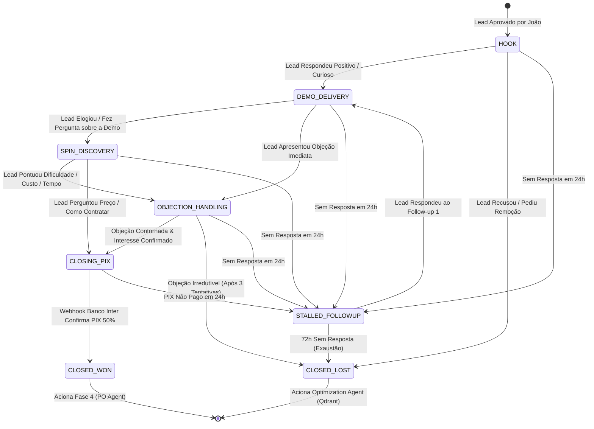

# Especificação da Máquina de Estados Finita de Negociação (SalesGPT State Machine)

> **Versão:** 2.0 (Modelagem Determinística de Diálogo Comercial)  
> **Framework:** Baseado nos conceitos do `SalesGPT` adaptados para o WhatsApp brasileiro.  
> **Objetivo:** Garantir que o diálogo progrida de forma lógica, sem rodeios e sem alucinações, com gates de transição estritos até o fechamento via PIX.

---

## 1. Visão Geral da Máquina de Estados

A conversa de prospecção e vendas não é um chat aberto. Ela opera como uma **Máquina de Estados Finita (FSM)** com 7 estados formais:

---

## 2. Detalhamento dos Estados e Transições

### 2.1 Estado: `HOOK` (Abertura Personalizada)
* **Objetivo:** Romper o gelo com personalização genuína, sem parecer spam robótico.
* **Payload de Entrada:** Ficha cadastral do lead (nome, nicho, bairro, ponto forte do Google Maps).
* **Ação Executada:** Dispara gancho de no máximo 25 a 30 palavras com pergunta aberta única.
* **Critério de Transição:**
  - Se o cliente responde qualquer coisa além de "pare" ou xingamento $\rightarrow$ Transiciona para `DEMO_DELIVERY`.
  - Se o cliente pede remoção imediata (*"tire meu número da lista"*) $\rightarrow$ Transiciona para `CLOSED_LOST`.
  - Se passar 24 horas sem resposta $\rightarrow$ Transiciona para `STALLED_FOLLOWUP`.

---

### 2.2 Estado: `DEMO_DELIVERY` (Entrega da Isca Bespoke)
* **Objetivo:** Gerar senso de posse imediato mostrando o software já construído com a marca do cliente.
* **Payload de Entrada:** URL da Vercel (`demo_artifacts.vercel_url`) e caminho da imagem (`demo_artifacts.screenshot_mobile_path`).
* **Ação Executada:**
  1. Envia a imagem do screenshot mobile de alta fidelidade.
  2. Envia mensagem curta (30 a 40 palavras) contendo o link clicável e a pergunta: *"O que achou de ver o seu negócio com um sistema assim?"*
* **Critério de Transição:**
  - Cliente elogiou ou perguntou funções $\rightarrow$ Transiciona para `SPIN_DISCOVERY`.
  - Cliente perguntou preço diretamente $\rightarrow$ Transiciona para `CLOSING_PIX`.
  - Cliente apresentou desconfiança ou objeção $\rightarrow$ Transiciona para `OBJECTION_HANDLING`.
  - Sem resposta em 24h $\rightarrow$ Transiciona para `STALLED_FOLLOWUP`.

---

### 2.3 Estado: `SPIN_DISCOVERY` (Diagnóstico de Dor e Ancoragem)
* **Objetivo:** Identificar o impacto financeiro da perda de clientes no WhatsApp ou balcão (SPIN Selling).
* **Perguntas Guia:**
  - *Situação:* *"Hoje quem fica respondendo os clientes no WhatsApp é você mesmo?"*
  - *Problema:* *"E na hora do pico do atendimento, já aconteceu de cliente desistir por demora na resposta?"*
  - *Implicação:* *"Se você perde 2 ou 3 atendimentos por semana, no fim do mês isso dá um valor considerável, né?"*
  - *Necessidade:* *"Já pensou o cliente poder escolher o serviço, pagar o sinal no PIX e o agendamento cair pronto pra você?"*
* **Critério de Transição:**
  - Dor reconhecida pelo lead $\rightarrow$ Transiciona para `CLOSING_PIX`.
  - Lead levanta dúvida de viabilidade $\rightarrow$ Transiciona para `OBJECTION_HANDLING`.

---

### 2.4 Estado: `OBJECTION_HANDLING` (Quebra de Objeções Consultiva)
* **Objetivo:** Resolver dúvidas e resistências sem confrontação, utilizando Chris Voss (espelhamento e rotulagem).
* **Ação Executada:** Invoca ferramenta `recall` no `knowledge-memory-gateway` (`:3013`) para buscar a melhor resposta no vetor de `whatsapp-objections.md`.
* **Limite de Rodadas:** Máximo de **3 tentativas** de contorno na mesma conversa.
* **Critério de Transição:**
  - Lead concorda com o argumento $\rightarrow$ Transiciona para `CLOSING_PIX`.
  - 3 tentativas sem avanço ou recusa categórica $\rightarrow$ Transiciona para `CLOSED_LOST`.

---

### 2.5 Estado: `CLOSING_PIX` (Fechamento e Sinal de 50%)
* **Objetivo:** Liquidar o pagamento de sinal de 50% (R$ 750,00 ou valor parametrizado) de forma simples e segura.
* **Ação Executada:**
  1. Invoca `create_pix_charge` no `payment-gateway` (`:3006`) gerando QR Code dinâmico do Banco Inter com expiração de 24 horas.
  2. Envia a chave Copia e Cola em mensagem de texto isolada (para cópia fácil no celular).
  3. Envia a imagem do QR Code em Base64.
  4. Instrução clara: *"Assim que o sinal de 50% for confirmado, nossa equipe de arquitetura e engenharia já inicia o projeto com entrega prevista nesta semana."*
* **Mecanismo de Reconciliação Híbrida (Webhook + Polling Reativo):**
  - **Fluxo Primário:** Webhook mTLS do Banco Inter notifica liquidação $\rightarrow$ Transiciona imediatamente para `CLOSED_WON`.
  - **Fluxo Reativo sob Demanda:** Se o cliente mandar no WhatsApp *"já paguei"*, *"PIX feito"*, *"mandei o dinheiro"* antes do webhook chegar:
    1. O Sales Executive invoca na hora a ferramenta `get_pix_status` (`:3006`) na API do Banco Inter.
    2. Se a API responder `PAID` / `LIQUIDADO` $\rightarrow$ confirma instantaneamente no WhatsApp, transiciona para `CLOSED_WON` e dispara a Fase 4.
    3. Se a API responder `PENDING` $\rightarrow$ informa com empatia: *"Ainda não acusou no sistema bancário aqui, costuma levar alguns segundinhos. Assim que compensar eu já te aviso!"*
* **Critério de Transição:**
  - Pagamento confirmado (Webhook ou Polling) $\rightarrow$ Transiciona para `CLOSED_WON`.
  - PIX expira após 24h sem pagamento $\rightarrow$ Dispara aviso de renovação ou transiciona para `STALLED_FOLLOWUP`.

---

### 2.6 Estado: `STALLED_FOLLOWUP` (Recuperação de Conversas Travadas)
* **Cadência de Reativação:**
  - **Tentativa 1 (24 horas após vácuo):**
    > *"Opa [Nome], tudo bem? Conseguiu abrir o link da demonstração pelo celular?"*
  - **Tentativa 2 (48 horas após vácuo — Pergunta de Desengajamento Chris Voss):**
    > *"Olá [Nome], tudo bem? Pelo silêncio, imagino que você tenha desistido de automatizar os agendamentos da [Empresa] agora, certo?"*
* **Critério de Transição:**
  - Lead respondeu $\rightarrow$ Retorna para o estado onde o diálogo parou.
  - 72 horas totais sem resposta $\rightarrow$ Transiciona para `CLOSED_LOST` (Motivo: `UNRESPONSIVE`).

---

### 2.7 Estados Terminais

* **`CLOSED_WON` (Vitória Comercial):**
  - Publica evento AMQP `sales.payment.confirmed`.
  - Alerta comemorativo enviado no Telegram do Chefe João.
  - Handoff determinístico acionando o `PO Agent` da Fábrica (Fase 4).
* **`CLOSED_LOST` (Perda / Descarte):**
  - Publica evento AMQP `sales.lead.discarded`.
  - Invoca o `Optimization Agent` para registrar a transcrição sanitizada e o motivo da perda no Qdrant (`:3013`).
